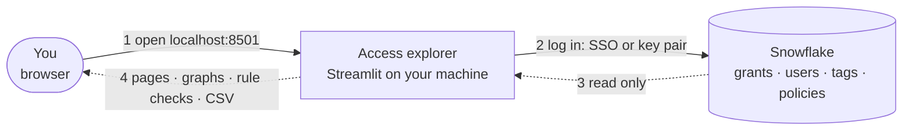
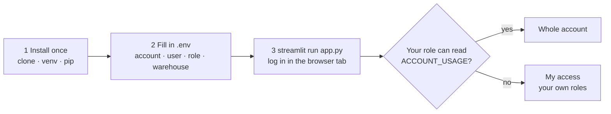

# Snowflake access explorer

See who can access what in Snowflake, and through which roles. It runs on your own machine, only reads from Snowflake, and never changes a grant.

**Full guide: [README.html](README.html)**, in this folder. It covers every screen with screenshots, how to read the graphs, all 23 rules, settings and limits. Open it in a browser: double-click it, or run `start README.html`. GitHub shows it as source code, so open your local copy.

## What it does

Key: solid = calls · dashed = data moves · numbers = order.

- **Every path, at any depth.** It walks the whole role hierarchy, so access inherited ten roles deep shows up next to direct grants, each with its full chain (`ANALYST_01 > GRP_ANALYSTS > F_ANALYST > T_SALES_CORE_READ > TABLE`).
- **Who reads sensitive data.** It uses classification tags and masking or row access policies to show which columns each role sees in clear.
- **Rule checks.** 23 checks of the role model, such as a technical role granted to a person, an admin role held by a user, dormant users or PUBLIC grants. Each finding comes with the fix as infrastructure-as-code text and the matching SQL.
- **Read-only.** It only reads from Snowflake. It never runs GRANT, REVOKE, CREATE or ALTER, and it stores no data or passwords.
- **Works with what you have.** It shows the whole account if your role can read it, and only your own access if not (My access).

## Questions it answers
| Page | Question |
|---|---|
| User | What can this user reach, through every role? Graph, privileges with their paths, sensitive data, roles used. |
| Role | Who holds this role, what does it give, and who loses access if it is revoked? |
| Object | Who can touch this table or view, and how? Which columns are masked for whom? |
| Can they? | Can user X do SELECT, INSERT, CREATE TABLE, etc. on Y? Yes, with every path and how to remove it, or no, with the role to ask for. |
| Sensitive data | Which objects are sensitive, who reads them, and which columns are unmasked? Two roles compared. |
| Rule checks | Where does the role model break its own rules? Severity, findings and fixes. |
| Access review | One row per user and object in a database, with the path, exported as CSV with Reviewer and Keep/Revoke columns. |

Find (top bar) opens any user, role or object. Every view is a link (`?page=role&name=F_ANALYST`), so you can share it.


More screens, and how to read them: [README.html](README.html).

## Try it now, without Snowflake
```
git clone https://github.com/darshanmeel/snowflake-access-explorer.git
cd snowflake-access-explorer
python -m venv .venv; .venv\Scripts\activate
pip install -r requirements.txt
streamlit run app.py          # fake data; opens http://localhost:8501
```

## Run it on your Snowflake

Key: box = step · diamond = what you see depends on your role.

### 1. Install once (PowerShell; needs Python 3.10+ and git)
```
git clone https://github.com/darshanmeel/snowflake-access-explorer.git
cd snowflake-access-explorer
python -m venv .venv; .venv\Scripts\activate          # macOS/Linux: python3 -m venv .venv; source .venv/bin/activate
pip install -r requirements.txt
copy .env.example .env                                # macOS/Linux: cp .env.example .env
```
If `activate` says running scripts is disabled, run `Set-ExecutionPolicy -Scope CurrentUser RemoteSigned` once, then activate again.
Next time: `cd snowflake-access-explorer; .venv\Scripts\activate`. Update: `git pull; pip install -r requirements.txt`.

### 2. Fill in `.env`
```
FAKE=0
ACCESS_SNAPSHOT=
SNOWFLAKE_ACCOUNT=<org>-<account>
SNOWFLAKE_USER=<your Snowflake login name>
SNOWFLAKE_ROLE=<role>
SNOWFLAKE_WAREHOUSE=<WH>
```
- `<org>-<account>` is the start of your Snowflake URL: `https://<org>-<account>.snowflakecomputing.com`.
- Login is browser SSO by default: a tab opens. To use a key pair instead, add the two lines below (the second only if the key is encrypted):
  ```
  SNOWFLAKE_PRIVATE_KEY_FILE=C:\keys\rsa_key.p8
  SNOWFLAKE_PRIVATE_KEY_PWD=<passphrase>
  ```
- There are no passwords and nothing is stored in the repo; `.env` is git-ignored. Don't put a comment after a value on the same line. No `.env`, or a name missing or empty in it: the environment variable is used instead (e.g. `$env:SNOWFLAKE_USER="..."`). A variable set in the shell wins over `.env`.

### 3. Run
```
streamlit run app.py          # opens http://localhost:8501; a second tab asks for your Snowflake login
```
Stop it with Ctrl+C. The browser tab opens on the machine running Streamlit, so run the app on your own machine.

### What you see depends on your role
| Your role has | Open | You see |
|---|---|---|
| Only a warehouse | `http://localhost:8501/?data=mine`, then **Load my access** | Your own roles and everything they reach (User, Role, Object, Can they?) |
| `MANAGE GRANTS` | `http://localhost:8501` | The whole account, read with `SHOW` (slow: one query per role) |
| `IMPORTED PRIVILEGES` on DB `SNOWFLAKE` | `http://localhost:8501` | The whole account, including tags, policies and query history (fast) |

- The app reads everything when it starts and keeps it in memory for 1 h. **Read Snowflake again** in the sidebar reads it again.
- If something can't be read, the app still loads. The sidebar shows **Incomplete** with what is missing and why.
- My access reads with your own rights and saves nothing. It has no sensitivity (tags need the governance views), and Rule checks and Access review are not available in it (they are about everyone).
- One login per new connection. To reuse a login for about 4 h, an admin runs `ALTER ACCOUNT SET ALLOW_ID_TOKEN = TRUE;` once (on Linux also `pip install "snowflake-connector-python[secure-local-storage]"`).

### Other ways to run
- **Fake data:** `FAKE=1`, the default when there is no `.env`. Use it to try the app.
- **Snapshot tables:** `ACCESS_SNAPSHOT=<DB>.<SCHEMA>`. Use it if your team can create tables and procedures and wants one shared, scheduled copy. The setup is in [README.html, Run modes and setup](README.html#run).

## Also in this repo
- **`sf.py` runs plain SQL from your machine.** It uses the same `.env` and logins. Run `python sf.py "select current_user(), current_role()"` or `python sf.py -f query.sql`, or from Python: `from sf import run; cols, rows = run("select 1")`.
- **Tests:** `python test_access.py` and `python test_sql.py`. They include a check that every page renders.
- **Commit guardrail:** `.githooks/pre-commit` blocks a commit if a staged file matches a term in `~/.company-terms.txt`. Turn it on once with `git config core.hooksPath .githooks`, after creating that file (one regex per line). Without the file, the hook blocks every commit.
- **Roles and grants** are managed as infrastructure as code. This app only reads them and never changes them.

## Where to find more
[README.html](README.html) covers:
- every screen, one by one, with screenshots;
- how to read the graphs;
- the 23 rules;
- run modes and the one-time setup for snapshot tables;
- the role model;
- SQL functions for worksheets;
- data sources;
- all settings, and the limits.
