# Snowflake access explorer

See who can access what in Snowflake, and through which roles. It runs on your own machine, only reads from Snowflake, and never changes a grant.

**Full guide: [README.html](README.html)**, in this folder. It covers every screen with screenshots, how to read the graphs, all 29 rules, settings and limits. Open it in a browser: double-click it, or run `start README.html`. GitHub shows it as source code, so open your local copy.

## What it does
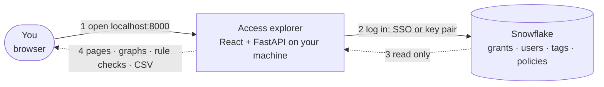
Key: solid = calls · dashed = data moves · numbers = order.

- **Every path, at any depth.** It walks the whole role hierarchy, database roles (`DB.ROLE`) included, so access inherited ten roles deep shows up next to direct grants, each with its full chain (`ANALYST_01 > GRP_ANALYSTS > F_ANALYST > T_SALES_CORE_READ > TABLE`).
- **Who reads sensitive data.** It uses classification tags and masking or row access policies to show which columns each role sees in clear.
- **Rule checks.** 29 checks of the role model and of what people did, such as a technical role granted to a person, an admin role held by a user, dormant users, PUBLIC grants, a person changing a table or a service user used from Snowsight. Each finding comes with the fix as infrastructure-as-code text and the matching SQL.
- **What if.** Pick grants to take away (a role from a user or role, a privilege, a whole role, or everything on PUBLIC). See who loses what, who keeps it another way, which objects and roles are left behind, and which findings go away or appear. Fixes from the rule checks collect in one change plan. It is a simulation: it prints the REVOKE text for your infrastructure as code and never runs it.
- **Readable graphs.** One lane per depth from the user, many database roles of one database folded into one box, huge boxes grouped by schema and type, hover explains each line in words, and each box shows its worst rule finding ("High · 3", click opens them). Snowflake's own built-in grants that every user gets through PUBLIC are one folded box, not findings.
- **Read-only.** It only reads from Snowflake. It never runs GRANT, REVOKE, CREATE or ALTER and writes nothing to Snowflake. Locally it keeps a copy of what it read in `.cache/` (git-ignored) for a day; no passwords.
- **Works with what you have.** It shows the whole account if your role can read it, and only your own access if not (My access).

## Questions it answers
Every screen keeps the detailed diagram or table of the earlier version as its first tab, with the newer views as further tabs.

| Screen (`?page=`) | Question |
|---|---|
| Home (`home`) | Search a person, role, table or screen, or type "can X read Y". Your access, account risks, data protection. |
| A person or role (`access`) | What can they reach, through every role? Role hierarchy diagram and privilege tabs first, then one row per object at the most it allows. An Activity tab shows which tables they used in the last 60 days, with which role and client. |
| Who has access to an object (`object`) | Who can touch this table or view, and how? Diagram, paths and users first, then people grouped by level, and which columns are masked for whom. An Activity tab shows who used it in the last 60 days, with which role and client, and how much of it outside business hours; for a Streamlit app, who opened it and who saw data they can't read; for a warehouse, who ran queries on it. A Streamlit app runs with its owner's rights, so its page says whose data viewers see (rule 29). |
| Can they? (`check`) | Can X (a person or a role) do SELECT, INSERT, ... on Y? Yes, Partly or No, with every path, where to cut, the nearest ways in and rows / columns. For a database role: ways in only from database roles of its own database, and no USE ROLE line (a database role can't be activated). |
| Access graph (`graph`) | The role graph from a table, role or person, by depth, and a trace graph coloured by what each line grants. |
| What they see (`see`) | Which columns each person or role sees in clear or masked, and why. |
| Compare (`compare`) | Two people or roles side by side as two overlapping circles (only A, only B, both but different, the same), the differences, and the text to make them match. |
| Request access (`request`) | The smallest existing role that gives it, the approver, and the request as SQL, Terraform or ticket text: `GRANT ROLE x TO USER u` for a person, `GRANT ROLE x TO ROLE r` for a role (with a too broad warning). For a database role: a skeleton for a new database role in its own database (`GRANT DATABASE ROLE ... TO DATABASE ROLE ...`), or why it can't be done when the object is in another database. |
| Risks & fixes (`rules`) | Rule checks with findings and admin holders; risks by rule, person, object or as a heat grid (grantee x rule, `by=grid`) with a change plan built from the fixes; the Rules list (`show=list`): the 29 rules by area with a severity bar per area (Home's findings-by-area bars open it at `area=`), with On/Off. |
| What if (`whatif`) | If we revoke this, who loses what (people who lose the same thing are one row, the removed link crossed out, a lose-vs-keep bar), who keeps it another way, and which findings go or appear. Simulation only. |
| Review & sign-off (`review`) | The access review (CSV) and a people x objects grid with Keep / Revoke and a signed CSV. |
| Sensitive data (`sensitive`) | Sensitive objects, who reads them, a catalog of how well each one is protected. |
| Sensitive data flow (`flow`) | People -> roles -> sensitive objects, with the dormant and disabled people first. |
| Granted vs used (`usage`) | Which granted tables and views were actually used (ACCESS_HISTORY), and what could be trimmed. |
| What changed (`changes`) | This snapshot against the previous one: a strip of new against fixed findings per severity, each gained or lost grant drawn as two boxes and a + or crossed-out link, and watched questions asked again. |
| User paths, Role paths (`user`, `role`) | The detailed pages of the earlier version, also shown inside A person or role. |

Find (top bar) opens any user, role or object; it and every picker search on the server as you type (arrow keys and
Enter pick, Escape or a click elsewhere closes the list). The graph opens fitted when it has 6 lanes or fewer, else
centred on the selected box (the person, role or object it starts from); Tab reaches each box, Enter opens it, and on a
touch screen the first tap shows the box's tip and the second opens it. The layout code (elkjs) loads on the first
graph; the local server answers gzip. Every view is a link (`?page=role&name=F_ANALYST`), so you can share it;
older links (`?page=user&part=sees`, `?page=catalog`, ...) are sent to the screen that now shows that part.
Streamlit runs the same React app as one component, so it has every screen (My access and What changed only in the local version).

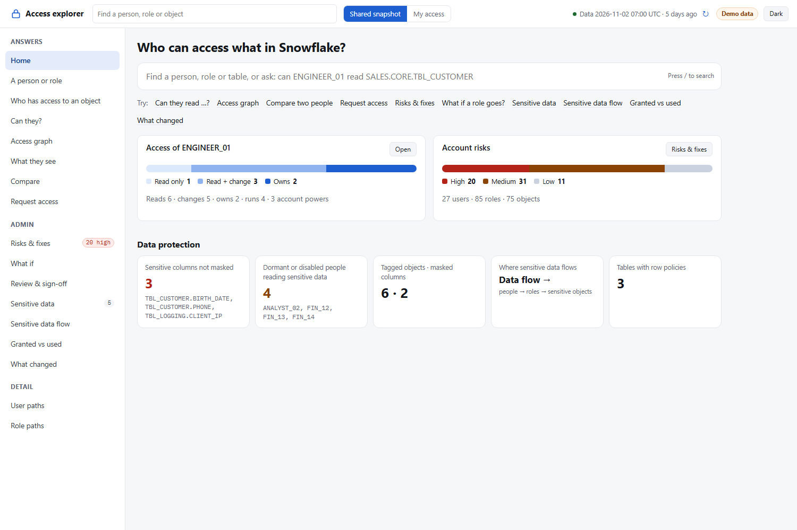
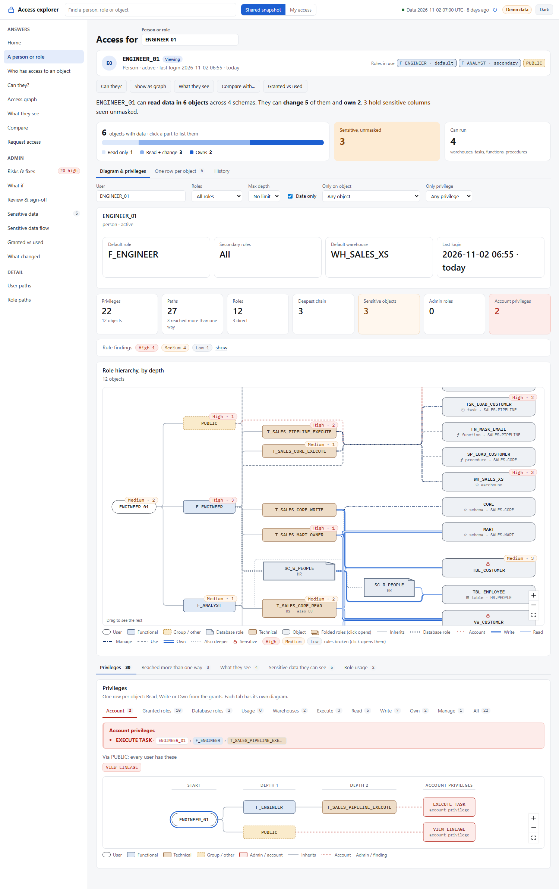
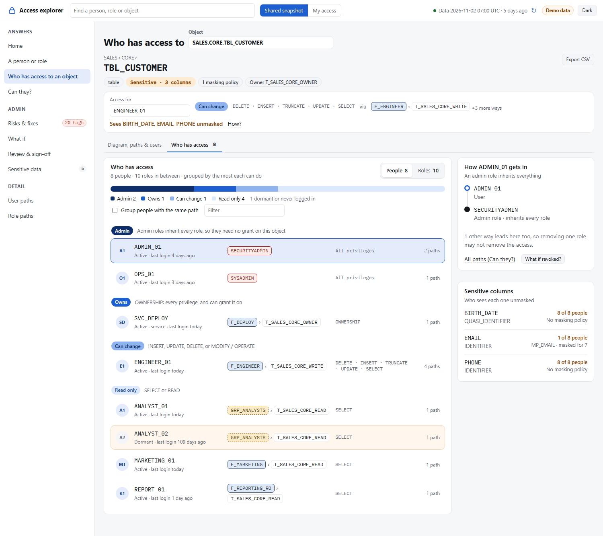
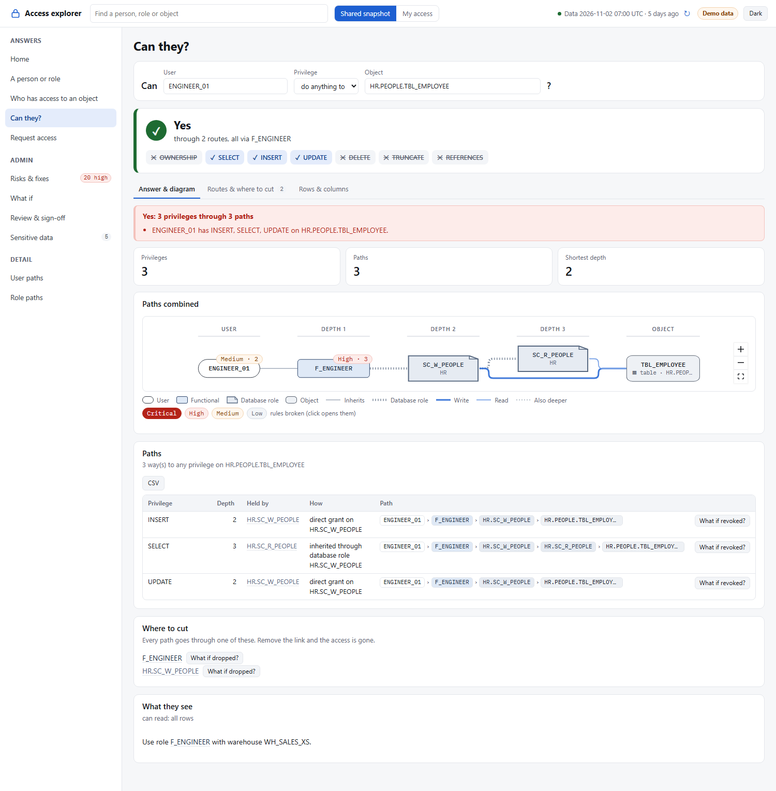
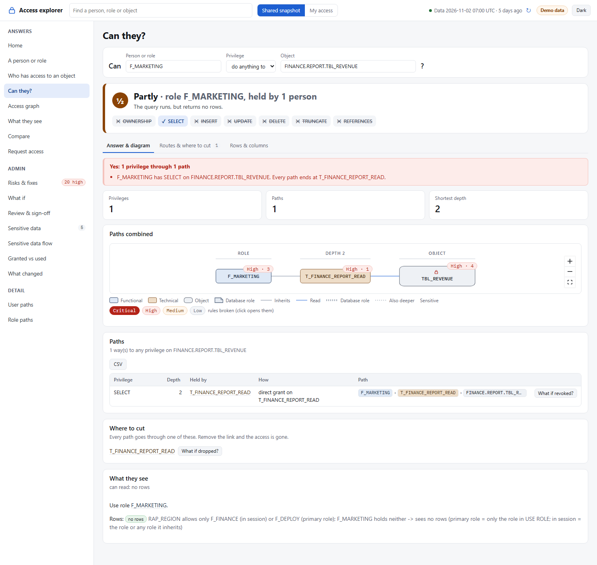
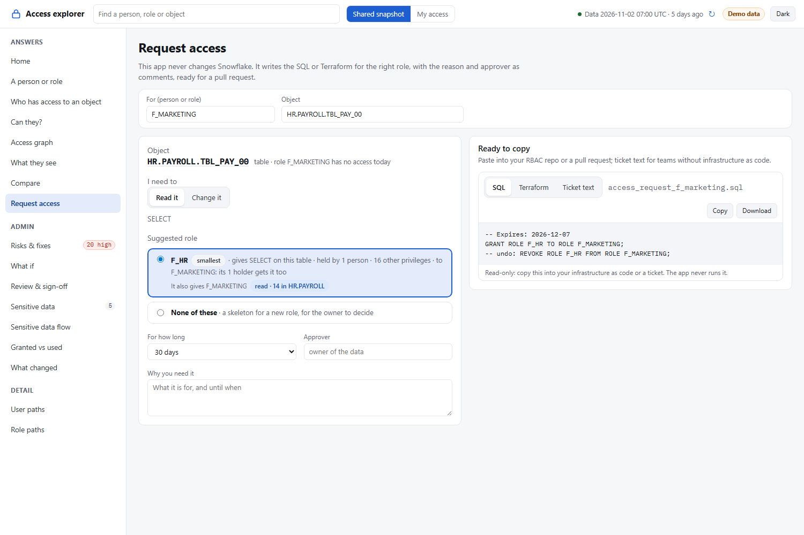
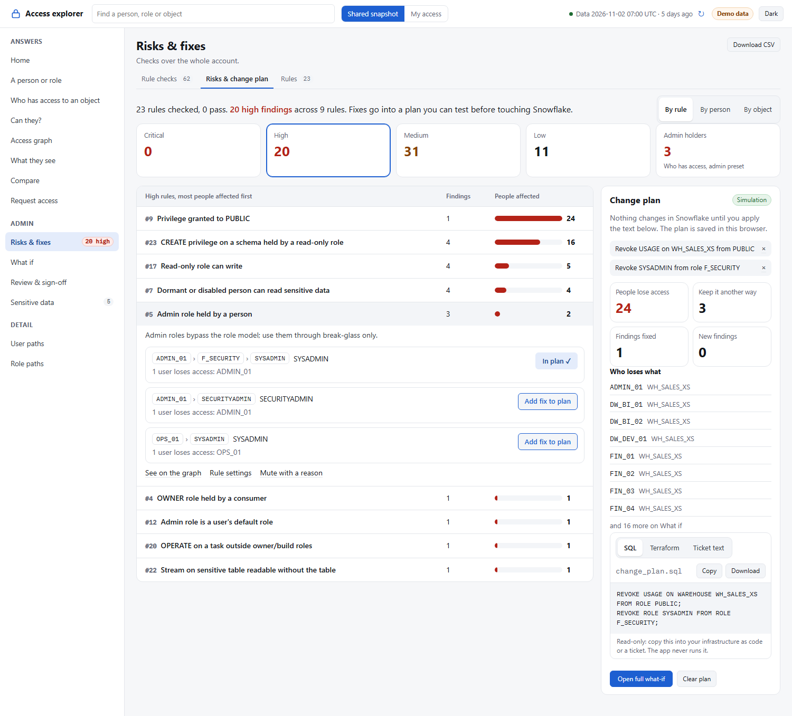
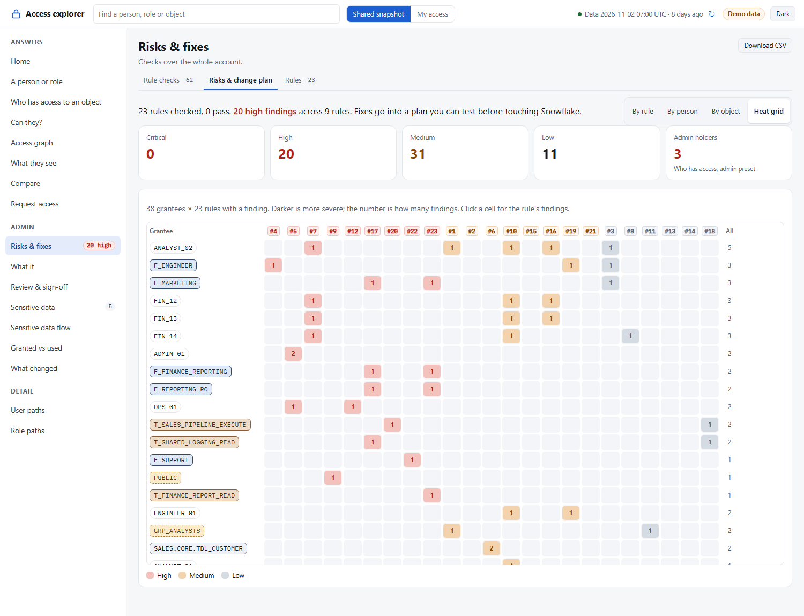
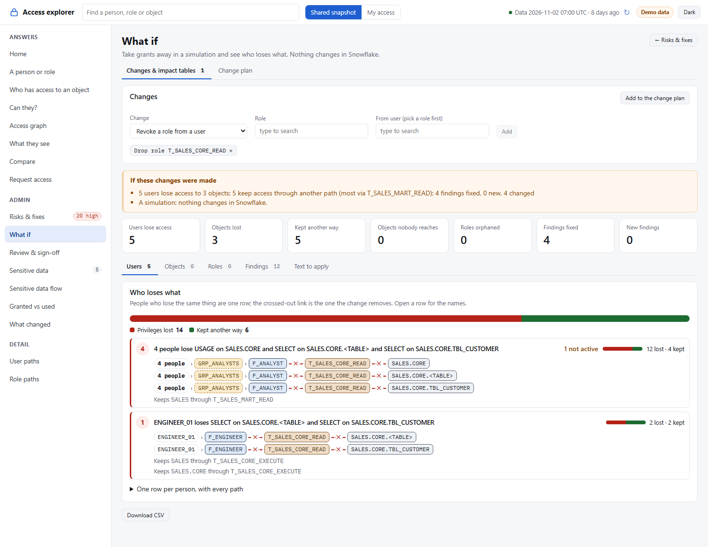
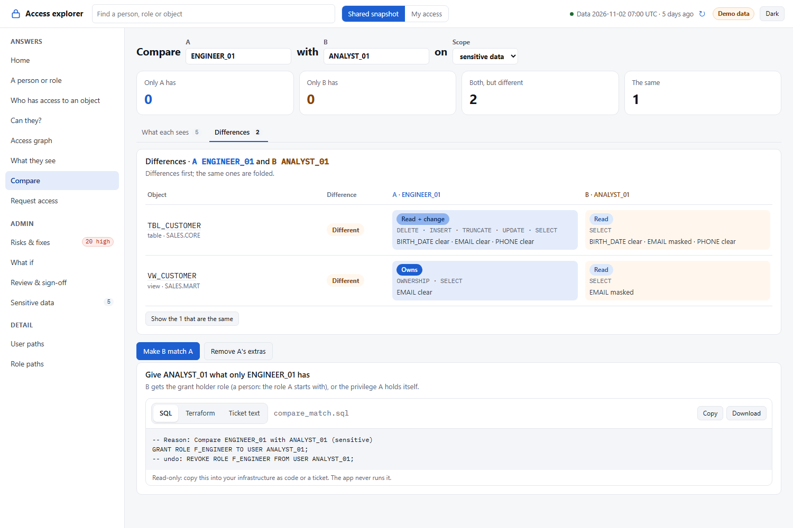
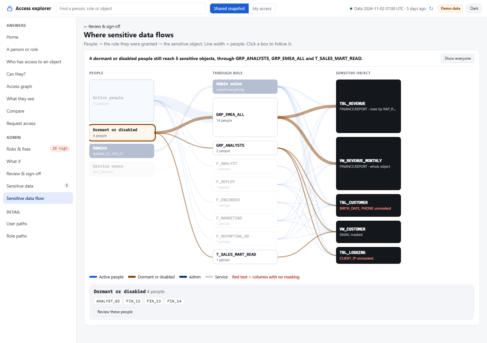
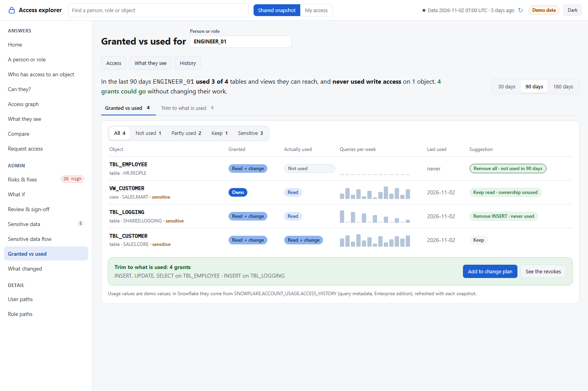
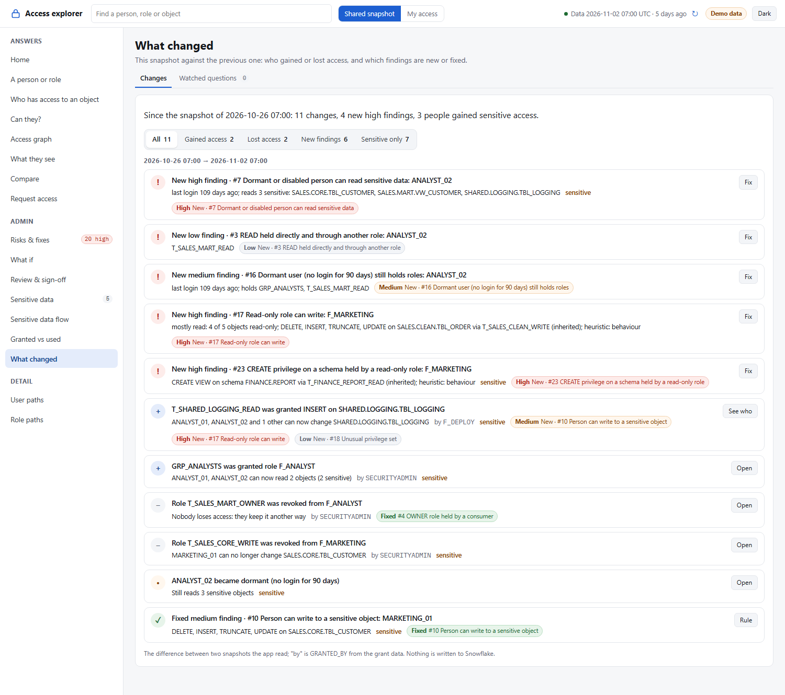

More screens, and how to read them: [README.html](README.html).

## Quick start
Needs Python 3.10+ and git. No Node or npm: the web app comes built.
```
git clone https://github.com/darshanmeel/snowflake-access-explorer.git
cd snowflake-access-explorer
python -m venv .venv; .venv\Scripts\activate          # macOS/Linux: python3 -m venv .venv; source .venv/bin/activate
pip install -r requirements-web.txt
python run.py --fake                                  # try it on fake data: open http://localhost:8000
```
For your own account: `copy .env.example .env` (macOS/Linux: `cp`), fill in account, user, role and warehouse (step 3 below), then `python run.py`. A browser tab opens for the Snowflake login. The details follow.

## Which way to run it
Pick by what your Snowflake role can do. When in doubt, start locally: run `python run.py`, and the side menu's
**Incomplete** box lists what your role could not read and which grant would add it.

| Your role has | Run | You get |
|---|---|---|
| Only a warehouse | Locally: `python run.py` | **My access**: your own roles and everything they reach, on almost every screen |
| `MANAGE GRANTS` | Locally | The whole account's grants, read with `SHOW` (slow: one query per role) |
| `IMPORTED PRIVILEGES` on DB `SNOWFLAKE`, or the database roles `SNOWFLAKE.SECURITY_VIEWER` + `SNOWFLAKE.GOVERNANCE_VIEWER` | Locally | The whole account: grants, users, tags, policies, query history and the **Activity** tab (ACCESS_HISTORY, Enterprise edition) |
| The above, plus `CREATE STAGE` and `CREATE STREAMLIT` on a schema (and `CREATE TABLE`, `PROCEDURE`, `FUNCTION`, `TASK` for snapshot mode) | **Streamlit in Snowflake** ([steps](#streamlit-in-snowflake-sis)) | One shared app in Snowsight; viewers only need `USAGE` on it (`APP_ROLE`) |

- Locally the app reads with **your** login and role and creates nothing in Snowflake (direct mode).
- In Snowflake the app runs with its **owner role's rights**: every viewer sees what the owner role reads, not their
  own access, so My access is hidden there. The owner role needs `IMPORTED PRIVILEGES` on the role itself, not through a
  secondary role.
- A setup made before the Activity tab: run `sql/1_setup.sql` again; it adds the new columns (`HOURS`, `APP`).
- If the account blocks Streamlit custom components, the app in Snowflake shows "the React component did not load":
  use the local version.

## Run each mode
Every mode after install ([step 1](#1-install-once-powershell-needs-python-310-and-git-no-node-or-npm)). Commands are PowerShell; on macOS/Linux write
`NAME=value python run.py` instead of `$env:NAME="value"; python run.py`. Stop with Ctrl+C.

| Mode | Needs | Command | Open |
|---|---|---|---|
| Fake data, local web app | nothing | `python run.py --fake` | http://localhost:8000 |
| Fake data, Streamlit | `pip install -r requirements.txt` | `python run.py streamlit --fake` | http://localhost:8501 |
| Your account, read directly (default), web app | `.env` ([step 3](#3-fill-in-env-for-snowflake)) | `python run.py` (same as `python run.py --direct`) | http://localhost:8000 |
| Your account, read directly, Streamlit | `.env`, `requirements.txt` | `python run.py streamlit --direct` | http://localhost:8501 |
| Your account, snapshot objects, web app | `.env` with `ACCESS_SNAPSHOT=<DB>.<SCHEMA>`, the [objects setup](#objects-in-snowflake-sourceobjects) once | `python run.py --objects` | http://localhost:8000 |
| Your account, snapshot objects, Streamlit | the same, `requirements.txt` | `python run.py streamlit --objects` | http://localhost:8501 |
| Both versions side by side | two terminals | `python run.py` and `python run.py streamlit` | :8000 and :8501 |
| Another port | | `python run.py --port 9000` | http://localhost:9000 |
| DuckDB SQL copy | `requirements-web.txt` (has `duckdb`) | on by default after each Snowflake read; off: `$env:DUCKDB="0"; python run.py`; also for fake data: `$env:DUCKDB="1"; python run.py --fake` | `.cache\access.duckdb`, see [Query the data with SQL](#query-the-data-with-sql-duckdb) |
| Memory only, nothing in `.cache/` | | `$env:CACHE_HOURS="0"; python run.py` | |
| Shared server for a team | key-pair login in `.env` | `$env:HOST="0.0.0.0"; python run.py` | `http://<server>:8000`, [details](#on-a-shared-server-local-web-app-or-streamlit) |
| Streamlit in Snowflake, snapshot objects | objects setup, `sis/.env` with `INSIDE=1`, `SOURCE=objects`, `ACCESS_SNAPSHOT=<DB>.<SCHEMA>` | `python run_sql.py sql/4_streamlit.sql` | Snowsight > Projects > Streamlit, [details](#streamlit-in-snowflake-sis) |
| Streamlit in Snowflake, read directly (no objects) | `sis/.env` with `INSIDE=1`, `SOURCE=direct`; owner role holds `IMPORTED PRIVILEGES` on DB `SNOWFLAKE` | `python run_sql.py sql/4_streamlit.sql` | Snowsight > Projects > Streamlit |
| Streamlit on another host | key-pair login, `requirements.txt` | `python -m streamlit run app.py --server.address 0.0.0.0 --server.port 8501 --server.headless true` | `http://<host>:8501`, [details](#streamlit-anywhere-else) |

The same settings can live in `.env` instead of the command line (`SOURCE`, `FAKE`, `DUCKDB`, `HOST`, `WEB_PORT`, ...; see [Settings](#settings)).

## Run it
The **local web app (React)** is the recommended and default version: it runs on your machine and reads Snowflake with your own login. The Streamlit version runs the very same React app inside Streamlit, so both look and work the same. Data comes from Snowflake by default; fake data only with `--fake`. Both use the same code (`access.py`).

| | `SOURCE=direct` (default) | `SOURCE=objects` |
|---|---|---|
| Creates in Snowflake | Nothing: no tables, procedures or functions | Snapshot tables, `SP_ACCESS_SNAPSHOT`, `SP_ACCESS_FINDINGS`, table functions `TF_ACCESS_OF` / `TF_WHO_CAN` / `TF_CAN` (`sql/1_setup.sql`) |
| How the data is read | The app queries Snowflake with your role (`access.live()`) | The procedure reads it with its owner's rights into `TBL_ACCESS_` tables; the app reads the last snapshot |
| Use it when | You can't (or don't want to) create objects, or you just want to try it | A team wants one shared, scheduled copy, viewers with low rights, and SQL in worksheets without the app |
| Settings | nothing more | `ACCESS_SNAPSHOT=<DB>.<SCHEMA>`, or `SNOWFLAKE_DATABASE` and `SNOWFLAKE_SCHEMA` |

With `SOURCE=direct` the shared data is read only when you click **Load shared data** (a copy from the last 24 h opens at
once), so **My access** works without waiting for it. Without ACCOUNT_USAGE it reads with one `SHOW` per role, sent 16 at a
time (`SHOW_THREADS`); `IMPORTED PRIVILEGES` on database `SNOWFLAKE` makes it one fast query. The side menu's
**Incomplete** box says what could not be read and which grant fixes it.

Data does not need to be real time. Once read, it is kept for 24 h in memory and in `.cache/` (one file per account and source, and one per user for My access). When a new read replaces a file of another run, the older one stays as `<name>.prev.pkl`, the previous snapshot that **What changed** compares with, until the next new run replaces it (deleting `.cache/` removes it). The top bar shows **Data from &lt;time&gt;**; **↻** (Read Snowflake again) reads it again. The side menu's **Data from** box says where the data came from, how long it is kept and where its [SQL copy](#query-the-data-with-sql-duckdb) is. For `objects`, schedule `SP_ACCESS_SNAPSHOT` as a daily task (README.html, Run modes and setup).

### 1. Install once (PowerShell; needs Python 3.10+ and git, no Node or npm)
```
git clone https://github.com/darshanmeel/snowflake-access-explorer.git
cd snowflake-access-explorer
python -m venv .venv; .venv\Scripts\activate          # macOS/Linux: python3 -m venv .venv; source .venv/bin/activate
pip install -r requirements-web.txt
```
If `activate` says running scripts is disabled, run `Set-ExecutionPolicy -Scope CurrentUser RemoteSigned` once, then activate again.
The web app comes built (`web/dist`, and `web/dist-st` for Streamlit), so running it needs only Python. Update: `git pull; pip install -r requirements-web.txt`.
Developers who change `web/src` rebuild both bundles with Node 20+ (`cd web; npm ci; npm run build; npm run build:st`) and commit them.

### 2. Start it
```
python run.py                    # local web app on your Snowflake data: http://localhost:8000
python run.py --fake             # fake data, no Snowflake, no .env
python run.py streamlit          # the Streamlit version (pip install -r requirements.txt): http://localhost:8501
python run.py --direct | --objects   # SOURCE for this run
python run.py --port 9000        # another port
```
Both apps can run side by side to compare them: `APP=web|streamlit` picks the default, `WEB_PORT` (8000) and `STREAMLIT_PORT` (8501) the ports. Stop with Ctrl+C.

The fake account has users, functional, technical and group roles, admin holders, sensitive tags, masking policies and at least one finding for each of the 29 rules. **My access** shows one demo user's slice (`ENGINEER_01`, or `DEMO_USER=<name>`).

### 3. Fill in `.env` for Snowflake
```
copy .env.example .env                                # macOS/Linux: cp .env.example .env
```
```
SNOWFLAKE_ACCOUNT=<org>-<account>
SNOWFLAKE_USER=<your Snowflake login name>
SNOWFLAKE_ROLE=<role>
SNOWFLAKE_WAREHOUSE=<WH>
```
- `<org>-<account>` is the start of your Snowflake URL: `https://<org>-<account>.snowflakecomputing.com`.
- Login is browser SSO by default: a tab opens. For a key pair add `SNOWFLAKE_PRIVATE_KEY_FILE=C:\keys\rsa_key.p8` (and `SNOWFLAKE_PRIVATE_KEY_PWD=<passphrase>` if encrypted).
- No passwords in the repo; `.env` is git-ignored. No comment after a value on the same line. A name missing or empty in `.env` comes from the environment variable; a variable set in the shell wins.
- One login per new connection. To reuse a login for about 4 h, an admin runs `ALTER ACCOUNT SET ALLOW_ID_TOKEN = TRUE;` once.

### Settings
| Name | Default | Meaning |
|---|---|---|
| `FAKE` | unset | `1` = fake data (also `python run.py --fake`); anything else = Snowflake |
| `SOURCE` | `direct` (`objects` if `ACCESS_SNAPSHOT` is set) | `direct` or `objects`, see above |
| `ACCESS_SNAPSHOT` | `SNOWFLAKE_DATABASE.SNOWFLAKE_SCHEMA` | `<DB>.<SCHEMA>` of the `TBL_ACCESS_` tables; `SOURCE=objects` without any of these is an error |
| `CACHE_HOURS` | `24` | Hours the local copy in `.cache/` is used; `0` = memory only |
| `BUILTIN` | `SNOWFLAKE.*,SYSTEM_COMPUTE_POOL_*,SYSTEM$*,SNOWFLAKE_LEARNING_*` | Names of Snowflake's built-in roles and objects, folded under PUBLIC and left out of rule checks (`?builtin=1` shows them) |
| `APP`, `WEB_PORT`, `STREAMLIT_PORT` | `web`, `8000`, `8501` | What `run.py` starts, and where |
| `SHOW_THREADS` | `16` | SHOW statements sent at once when ACCOUNT_USAGE is not readable (`1` = one after another) |
| `HOST` | `127.0.0.1` | Address the local web app (and `run.py streamlit`) listens on; `0.0.0.0` on a shared server ([Deploy](#deploy)) |
| `DUCKDB` | unset | The [SQL copy](#query-the-data-with-sql-duckdb) in `.cache/access.duckdb`: unset = after each read from Snowflake, `0` = off, `1` = also of the fake data |
| `KEEP_BUILT` | `3` | Data sets kept built in memory besides the loaded one (shared, My access, `builtin=1`): switching back costs no rebuild |

More settings (`ROLE_PREFIXES`, `DORMANT_DAYS`, `MAX_PATHS`, ...): README.html. Path counts are exact and counted over the role graph; full chains are listed up to `MAX_PATHS`, so big accounts stay quick (README.html > Limits).

### Query the data with SQL (DuckDB)
After each read from Snowflake (shared data and My access) the app also writes what it read to `.cache/access.duckdb`, a
local [DuckDB](https://duckdb.org) file you can query with SQL. The app itself keeps using its `.pkl` copy; this file is
only for you. It holds the `TBL_ACCESS_` tables of `sql/1_setup.sql` with the same names and columns (`RUN`, `GRANT`,
`USER_ROLE`, `USER`, `USAGE`, `TAG`, `POLICY`, `STREAM`, `OBJECT_USE`, `ACTIVITY`):
- one **schema per account + source** (and per user for My access), named after the copy in `.cache/`, for example
  `myorg_myacct_direct_jdoe_analyst`; the table `COPIES` lists them (`SCHEMA_NAME`, `CACHE_KEY`, `RUN_ID`, `READ_AT`, `PREV_RUN_ID`);
- each new read **replaces** that schema's tables, and the read before stays as `TBL_ACCESS_<name>_PREV` (a read of the same
  snapshot run replaces only the current tables). Direct reads and My access get a `RUN_ID` per read (`direct-20261110080000`).
- The side menu's **Data from** box names the file and schema. Not inside Snowflake (no disk there), not with `DUCKDB=0`
  or `CACHE_HOURS=0`, not for fake data unless `DUCKDB=1`. Without the `duckdb` package (it is in `requirements-web.txt`;
  the Streamlit version needs `pip install duckdb`) the app runs as before and the box says why there is no copy. While
  another program has the file open for writing, the copy is skipped with a note: close it and read again.

```
duckdb .cache/access.duckdb -readonly        # DuckDB CLI
SELECT SCHEMA_NAME, READ_AT FROM COPIES;
USE myorg_myacct_direct_jdoe_analyst;
-- who holds a role directly, and since which read
SELECT USER_NAME, ROLE_NAME FROM TBL_ACCESS_USER_ROLE WHERE ROLE_NAME = 'F_ANALYST';
-- grants that are new since the previous read
SELECT GRANTEE_ROLE, PRIVILEGE, OBJECT_NAME FROM TBL_ACCESS_GRANT
EXCEPT SELECT GRANTEE_ROLE, PRIVILEGE, OBJECT_NAME FROM TBL_ACCESS_GRANT_PREV;
```
```python
import duckdb
con = duckdb.connect(".cache/access.duckdb", read_only=True)
s = con.sql("SELECT SCHEMA_NAME FROM COPIES ORDER BY READ_AT DESC LIMIT 1").fetchone()[0]
print(con.sql(f'SELECT PRIVILEGE, COUNT(*) AS N FROM "{s}".TBL_ACCESS_GRANT GROUP BY 1 ORDER BY 2 DESC'))
```

### What you see depends on your role
| Your role has | You see |
|---|---|
| Only a warehouse | **My access** (top bar): your own roles and everything they reach, on every screen except Review & sign-off, Sensitive data flow and What changed |
| `MANAGE GRANTS` | The whole account, read with `SHOW` (slow: one query per role) |
| `IMPORTED PRIVILEGES` on DB `SNOWFLAKE` | The whole account, including tags, policies and query history (fast) |

- If something can't be read, the app still loads and shows **Incomplete** with what is missing and why.
- Without `.env` (and not `--fake`) the app says to copy `.env.example` to `.env`; it never mistakes your laptop for Snowflake.
- My access reads with your own rights and writes nothing to Snowflake. It has no sensitivity (tags need the governance views), and Risks & fixes runs on your own roles only.
- My access is only offered when the login is yours: off inside Snowflake, on a shared server (`HOST` not `127.0.0.1` / `localhost`, or `ALLOWED_HOSTS` naming another host such as a proxy or tunnel) and with a key-pair login (a service user). `MY_ACCESS=1` turns it on when the key pair is your own user, `MY_ACCESS=0` turns it off.
- The local server answers only its own host names (`localhost`, `127.0.0.1`, `HOST`, this machine's names and IP addresses with `HOST=0.0.0.0`, plus `ALLOWED_HOSTS`, comma-separated), refuses a POST from another site's page (its Origin is checked against these names, so a proxy that rewrites Host still works) and any API call another site's page starts (an image or link to `/api/...` cannot start a Snowflake read or the SSO login).

### Objects in Snowflake (`SOURCE=objects`)
A developer whose role can create tables and procedures runs this once, from the same folder and `.env`:
```
copy settings.sql settings.local.sql      # fill in DB, SCHEMA, WH, DEV_ROLE, APP_ROLE (git-ignored)
python run_sql.py sql/1_setup.sql;     python run_sql.py sql/1_setup_verify.sql      # tables, procedures, functions
python run_sql.py sql/2_snapshot.sql;  python run_sql.py sql/2_snapshot_verify.sql   # CALL SP_ACCESS_SNAPSHOT('AUTO')
```
Then set `ACCESS_SNAPSHOT=<DB>.<SCHEMA>` in `.env` (and `SNOWFLAKE_ROLE=<APP_ROLE>` for viewers) and run `python run.py --objects`.
- `run_sql.py` stops with a message when `settings.local.sql` is missing or still has `<placeholders>`, and before any statement when a file a `PUT` needs is missing.
- `DEV_ROLE` needs, on the role itself (`run_sql.py` runs `USE SECONDARY ROLES NONE`): `USAGE` on `<DB>`, `<SCHEMA>` and `<WH>`; on `<DB>.<SCHEMA>` `CREATE TABLE`, `CREATE PROCEDURE`, `CREATE FUNCTION`, `CREATE STAGE`, plus `CREATE STREAMLIT` for Streamlit in Snowflake and `CREATE TASK` with account `EXECUTE TASK` for the daily task; and `IMPORTED PRIVILEGES` on DB `SNOWFLAKE` (or `MANAGE GRANTS`) to see the whole account. Viewers only need `APP_ROLE`.
- Fresh data: schedule `CALL SP_ACCESS_SNAPSHOT('AUTO')` as a **daily task**, or rerun `sql/2_snapshot.sql` (README.html, Run modes and setup). **Rebuild snapshot** in the app runs the procedure too; a second CALL while one is still running steps back (`SKIPPED`).
- Without the app, in a worksheet: `SELECT * FROM TABLE(TF_ACCESS_OF('<USER>', NULL));`, `TF_WHO_CAN`, `TF_CAN`, `CALL SP_ACCESS_FINDINGS('{}')` (`TBL_ACCESS_FINDING` keeps only the last run).
- SnowSQL instead of `run_sql.py`: `!source` the same `sql/` files in order. Remove everything: `python run_sql.py sql/3_cleanup.sql`.

## Deploy
Four ways to run it. All of them only read; none of them changes grants.

| Where | Who uses it | Login to Snowflake | Data |
|---|---|---|---|
| [Your own machine](#on-your-own-machine) | you | your own (browser SSO or key pair) | what your role can read |
| [A shared server](#on-a-shared-server-local-web-app-or-streamlit) | a team, in the browser | one service user (key pair) | what that user's role can read |
| [Streamlit in Snowflake](#streamlit-in-snowflake-sis) | anyone with the app role, in Snowsight | none extra: Snowflake's own login | what the owner role can read (snapshot tables, or ACCOUNT_USAGE live) |
| [Streamlit elsewhere](#streamlit-anywhere-else) | a team, in the browser | one service user (key pair) | what that user's role can read |

### On your own machine
The [Quick start](#quick-start) and steps 1 to 3 above: `python run.py` (React, http://localhost:8000) or `python run.py streamlit`
(http://localhost:8501). It listens on your machine only (`127.0.0.1`). Nothing to install in Snowflake with `SOURCE=direct`.

### On a shared server (local web app or Streamlit)
A VM or container your team can reach, with Python 3.10+:
```
git clone https://github.com/darshanmeel/snowflake-access-explorer.git
cd snowflake-access-explorer
python3 -m venv .venv; source .venv/bin/activate; pip install -r requirements-web.txt   # Streamlit: -r requirements.txt
HOST=0.0.0.0 python run.py                                                   # React on port 8000
python -m streamlit run app.py --server.address 0.0.0.0 --server.port 8501 --server.headless true   # or Streamlit
```
- Browser SSO can't work on a server (the login tab would open there): create a service user with a **key pair** and set
  `SNOWFLAKE_PRIVATE_KEY_FILE` (and `SNOWFLAKE_PRIVATE_KEY_PWD`) in `.env`. Everyone then sees what that user's role sees,
  so **My access** is off there (it would show the service user's access as each visitor's own).
- With `HOST=0.0.0.0` the server answers this machine's names and IP addresses; for another name (a DNS alias, a proxy) add it to
  `ALLOWED_HOSTS`.
- Prefer `SOURCE=objects` with the daily snapshot task: the service role then needs only `SELECT` on the `TBL_ACCESS_` tables.
- The app has no login of its own and shows who can reach what: put it behind your company sign-in (VPN, a reverse proxy
  with SSO) and never on the open internet.
- Keep it running with your usual tool (systemd, Docker, a Windows service). Update: `git pull; pip install -r requirements-web.txt`, then restart.

### Streamlit in Snowflake (SiS)
The app runs inside Snowflake and opens in Snowsight; nobody installs anything. It runs the same React app as one Streamlit
component (`web/dist-st/`, committed); its data calls are answered in Python by the same code as the local server.
It uses the app's own Snowflake session, keeps data in memory only (24 h) and writes nothing. Two options:

| | `SOURCE=objects` (recommended for a team) | `SOURCE=direct` |
|---|---|---|
| Creates in Snowflake | the snapshot tables, procedures and daily task (`1_setup.sql`, `2_snapshot.sql`), then the app (`4_streamlit.sql`) | only the stage and the app (`4_streamlit.sql`): no tables, procedures or task |
| How the data is read | the app reads the last snapshot: opens fast, every viewer sees the same run | each viewer's session reads `ACCOUNT_USAGE` live with the owner role on **Load shared data** (seconds to minutes), kept 24 h in memory |
| The owner role (`DEV_ROLE`) needs | the [Objects in Snowflake](#objects-in-snowflake-sourceobjects) privileges | `USAGE` on `<DB>`, `<SCHEMA>`, `<WH>`, `CREATE STAGE` and `CREATE STREAMLIT` on the schema, and `IMPORTED PRIVILEGES` on DB `SNOWFLAKE` (or the `SNOWFLAKE` database roles `SECURITY_VIEWER` + `GOVERNANCE_VIEWER`) |
| Missing | as in both: My access and What changed (local version only) | also future grants and streams when Snowflake refuses their `SHOW` in the app: listed under **Incomplete** |

1. `SOURCE=objects`: do the [Objects in Snowflake](#objects-in-snowflake-sourceobjects) setup first (`1_setup.sql`,
   `2_snapshot.sql`, the daily task). `SOURCE=direct`: skip it; step 3 also grants the app role `USAGE` on `<DB>`,
   `<SCHEMA>` and `<WH>`.
2. Settings for the app go in `sis/.env` (required, git-ignored, so the `sis` folder is not in a fresh clone), uploaded
   as the app's `.env`: `mkdir sis; copy sis.env.example sis\.env` (macOS/Linux: `mkdir -p sis && cp sis.env.example sis/.env`)
   and fill in:
   ```
   INSIDE=1
   SOURCE=objects                 # or SOURCE=direct (then no ACCESS_SNAPSHOT)
   ACCESS_SNAPSHOT=<DB>.<SCHEMA>
   ```
   With `SOURCE=direct` the app reads `ACCOUNT_USAGE` with the owner role; `USE SECONDARY ROLES` is refused in there, so
   the owner role itself needs `IMPORTED PRIVILEGES` (not through a secondary role). It uses the app's own session (`INSIDE=1`; it also finds the session by itself). Never put `SNOWFLAKE_ACCOUNT` or a key in this file.
3. Upload the files and create the app, from the repo folder with the same `.env` and `settings.local.sql` as step 1:
   ```
   python run_sql.py sql/4_streamlit.sql;  python run_sql.py sql/4_streamlit_verify.sql
   ```
   It creates the stage `STG_ACCESS_APP`, uploads the Python files, `environment.yml` (packages: `streamlit=1.52.*`,
   pinned so a redeploy can't change it, and `snowflake-snowpark-python`) and `web/dist-st` (the old bundle files removed
   first), creates the Streamlit app `ST_ACCESS_EXPLORER` (warehouse `WH`) and grants `USAGE` on it to `APP_ROLE`.
   SnowSQL: `!source sql/4_streamlit.sql`.
4. Open it in Snowsight: **Projects > Streamlit > ST_ACCESS_EXPLORER**. To update after `git pull`, run step 3 again.

- The app runs with its **owner's rights** (`DEV_ROLE`): every viewer sees what that role reads, not their own access.
  So **My access** (each person's own view) is hidden there; it is a feature of the local version.
- The app needs the React component (`web/dist-st`). If the message "the React component did not load" stays (the
  component blocked in your account, or `web/dist-st` not uploaded), there is no plain Streamlit fallback: use the
  local version.
- Remove it: `python run_sql.py sql/3_cleanup.sql` (drops the app and its stage too).

### Streamlit anywhere else
Any host that runs Python (a VM, Docker, Kubernetes, a Streamlit hosting service):
```
pip install -r requirements.txt
python -m streamlit run app.py --server.address 0.0.0.0 --server.port 8501 --server.headless true
```
- Settings as environment variables or a `.env` next to `app.py`, with a **key pair** login as on a shared server.
  Hosting services that offer "secrets" usually turn them into environment variables; the key itself must be a file the app
  can read (`SNOWFLAKE_PRIVATE_KEY_FILE`).
- The same warnings as for a shared server: one service user's view, no login of its own, so keep it private, never public.
- Fake data to try a host first: `FAKE=1`.

### Container Services (optional)
Only to give everyone the local web app without each person installing it: run `server.py` as a Snowpark Container Services
service (any container image with Python and `requirements-web.txt`, `HOST=0.0.0.0`). Not needed to use the app.
The app logs in like on a shared server: give the service `SNOWFLAKE_ACCOUNT`, `SNOWFLAKE_USER` and a key pair
(`SNOWFLAKE_PRIVATE_KEY_FILE`, mounted as a secret). Browser SSO can't work there, and My access is off (key pair).

## Data sources
Only metadata, never table data: `ACCOUNT_USAGE` grants, users, query history, tags and policies (or `SHOW` when
`ACCOUNT_USAGE` is not readable). Granted vs used also reads `ACCOUNT_USAGE.ACCESS_HISTORY` (Enterprise edition),
aggregated per user, object and week; without it that screen explains why it is empty. The Activity tabs (object, person,
role) and rules 24-28 read `ACCESS_HISTORY` with `QUERY_HISTORY` (role, statement type) and `SESSIONS` (client) for the
last 60 days (`ACTIVITY_DAYS`), aggregated per UTC day, user, role, client, object, Streamlit app (from the query tag) and statement, with the queries
per UTC hour (`HOURS`): query metadata, never query text. Off-hours are worked out in the app from `HOURS` and
`WORK_HOURS`. To keep the cost down, a new read copies the days the last one already has and reads only the days after them
(the last day again, as ACCESS_HISTORY lags up to 3 hours); the app tags its own queries (`QUERY_TAG` = `access-explorer`)
and leaves them out. Snowflake does not log result downloads from Snowsight or drivers. The full table, with the fallbacks,
is in [README.html](README.html) > Data sources.

## Use the queries without the app
Only want the answers, not the app? [`access_queries/`](access_queries/README.md) holds plain SQL over `SNOWFLAKE.ACCOUNT_USAGE`:

| File | Answers |
|---|---|
| `1_user_roles.sql` | every role a user holds, direct and inherited |
| `2_user_access.sql` | everything a user can finally do, through which role |
| `3_role_access.sql` | everything a role grants, downwards |
| `4_role_holders.sql` | who holds a role, upwards, down to the users |
| `5_object_users.sql` | which roles and users reach an object |
| `functions.sql` | optional: the five as table functions `AQ_USER_ROLES` ... `AQ_OBJECT_USERS` (if functions are not allowed, skip it) |
| `access_examples.ipynb` | Snowflake Notebook with 8 examples, each twice: path A calls the functions, path B runs the query directly |

### How to use them
Pick one of three ways; all read the same views and give the same rows.

**A. Run a query directly (nothing created)**
1. Snowsight > Projects > Worksheets > new SQL worksheet; pick a role with the access below and a warehouse.
2. Paste one file, e.g. `2_user_access.sql`.
3. Change its `SET` lines to your names (names as stored, unquoted names are upper case):
   ```sql
   SET USER_NAME = 'ANALYST_01';   -- 1_user_roles.sql, 2_user_access.sql
   SET MAX_DEPTH = 50;             -- every file; NULL = 50
   SET SHOW_BUILTIN = FALSE;       -- TRUE also lists Snowflake's own grants via PUBLIC
   ```
   Other inputs: `ROLE_NAME` (files 3 and 4), `OBJECT_NAME` = `DB`, `DB.SCHEMA` or `DB.SCHEMA.OBJECT` and
   `PRIVILEGE` (`''` = any) in file 5.
4. Select all and run. Result: one row per answer with `DEPTH`, the shortest `PATH` (`ANALYST_01 > F_ANALYST > ...`)
   and `WAYS` (how many role paths lead there). To filter it, wrap the query: `SELECT * FROM (<query>) WHERE ...`.

**B. Create the functions once, then call them**
1. In `functions.sql` replace `AQ_DB.AQ_SCHEMA` with a schema where your role may create functions; run the file.
2. Call them like tables:
   ```sql
   SELECT * FROM TABLE(MY_DB.MY_SCHEMA.AQ_USER_ROLES('ANALYST_01')) ORDER BY DEPTH;
   SELECT * FROM TABLE(MY_DB.MY_SCHEMA.AQ_USER_ACCESS('ANALYST_01')) WHERE OBJECT_NAME LIKE 'SALES.%';
   SELECT * FROM TABLE(MY_DB.MY_SCHEMA.AQ_ROLE_ACCESS('F_ANALYST'));
   SELECT * FROM TABLE(MY_DB.MY_SCHEMA.AQ_ROLE_HOLDERS('T_SALES_CORE_READ')) WHERE HOLDER_KIND = 'USER';
   SELECT * FROM TABLE(MY_DB.MY_SCHEMA.AQ_OBJECT_USERS('SALES.CORE.TBL_CUSTOMER', 'SELECT'));
   ```
   Optional last arguments: `MAX_DEPTH` (50), `SHOW_BUILTIN` (`FALSE`).
3. If a `CREATE FUNCTION` is refused (functions not allowed, or the account does not accept the recursive query in a
   function), use way A; nothing else changes. To remove them: the commented drop lines at the end of `functions.sql`.

**C. The notebook (8 examples)**
1. Snowsight > Projects > Notebooks > Import .ipynb file > `access_queries/access_examples.ipynb`; pick a warehouse.
2. Run the inputs cell after changing the names.
3. Run path A (creates the functions, then 8 examples calling them) or path B (the same 8 as plain queries).

The names above are the repo's fake data; use your own.

- **Needs:** read access to `SNOWFLAKE.ACCOUNT_USAGE` (`IMPORTED PRIVILEGES` on `SNOWFLAKE`, or the database role `SNOWFLAKE.SECURITY_VIEWER`) and a warehouse; only path A needs `CREATE FUNCTION` on a schema. Read-only, no business data, up to about 2 hours behind.
- **Check:** `python access_queries/test_queries.py` compares them with the app's rules on the fake data.

## Also in this repo
- **Access queries without the app: [`access_queries/`](access_queries/README.md).** Five plain SQL files over `SNOWFLAKE.ACCOUNT_USAGE`, nothing to install or create: a user's roles, a user's access, a role's access, who holds a role, who reaches an object, each with its shortest role path. Optional `functions.sql` makes them table functions (short calls, `MAX_DEPTH` default 50); `access_examples.ipynb` (Snowflake Notebook, 8 examples with or without functions) asks sample questions, running the files or creating and calling the functions; `python access_queries/test_queries.py` checks them against `access.py`.
- **`sf.py` runs plain SQL from your machine.** It uses the same `.env` and logins. Run `python sf.py "select current_user(), current_role()"` or `python sf.py -f query.sql`, or from Python: `from sf import run; cols, rows = run("select 1")`.
- **Tests:** `pip install -r requirements-dev.txt` (both versions plus DuckDB and httpx), then `python test_access.py`, `python test_sql.py`, `python test_server.py` and `python access_queries/test_queries.py` (all set `FAKE=1` themselves): every page answers, and `app.py` hands every page to the Streamlit component. `test_access.py` runs every `test_` function, reports all failures, then reruns with `ROLE_PREFIXES=ZF_,ZT_`. `test_perf` times the big test account with room for a busy machine: `PERF_SCALE=2` doubles its budgets, `PERF=0` skips it. Web: `cd web; npm test`.
- **Roles and grants** are managed as infrastructure as code. This app only reads them and never changes them.

## Where to find more
[README.html](README.html) covers:
- every screen, one by one, with screenshots;
- how to read the graphs;
- the 29 rules;
- run modes and the one-time setup for snapshot tables;
- the role model;
- SQL functions for worksheets;
- data sources;
- all settings, and the limits.

## License

Dual-licensed under either of [MIT](LICENSE-MIT) or [Apache-2.0](LICENSE-APACHE), at your option.
Unless you say otherwise, any contribution you submit is licensed the same way, with no extra terms. Bundled third-party code keeps its own licenses: [THIRD_PARTY.md](THIRD_PARTY.md).
