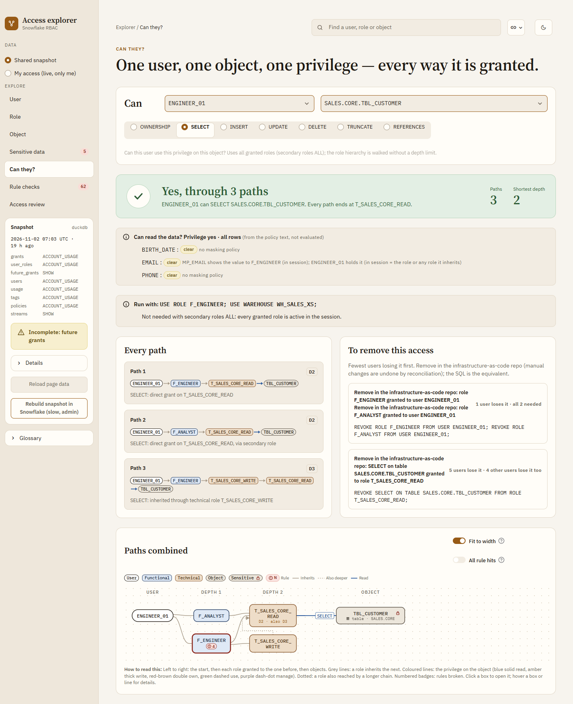

# Snowflake access explorer

See who can access what in Snowflake, and through which roles. It runs on your own machine, only reads from Snowflake, and never changes a grant.

**Full guide: [README.html](README.html)**, in this folder. It covers every screen with screenshots, how to read the graphs, all 23 rules, settings and limits. Open it in a browser: double-click it, or run `start README.html`. GitHub shows it as source code, so open your local copy.

## What it does

Key: solid = calls · dashed = data moves · numbers = order.

- **Every path, at any depth.** It walks the whole role hierarchy, database roles (`DB.ROLE`) included, so access inherited ten roles deep shows up next to direct grants, each with its full chain (`ANALYST_01 > GRP_ANALYSTS > F_ANALYST > T_SALES_CORE_READ > TABLE`).
- **Who reads sensitive data.** It uses classification tags and masking or row access policies to show which columns each role sees in clear.
- **Rule checks.** 23 checks of the role model, such as a technical role granted to a person, an admin role held by a user, dormant users or PUBLIC grants. Each finding comes with the fix as infrastructure-as-code text and the matching SQL.
- **What if.** Pick grants to take away (a role from a user or role, a privilege, a whole role, or everything on PUBLIC) and see who loses what, who keeps it another way, which objects and roles are left behind, and which findings go away or appear. It is a simulation: it prints the REVOKE text for your infrastructure as code and never runs it.
- **Readable graphs.** One lane per depth from the user, many database roles of one database folded into one box, huge boxes grouped by schema and type, hover explains each line in words, and each box shows its worst rule finding ("High · 3", click opens them). Snowflake's own built-in grants that every user gets through PUBLIC are one folded box, not findings.
- **Read-only.** It only reads from Snowflake. It never runs GRANT, REVOKE, CREATE or ALTER and writes nothing to Snowflake. Locally it keeps a copy of what it read in `.cache/` (git-ignored) for a day; no passwords.
- **Works with what you have.** It shows the whole account if your role can read it, and only your own access if not (My access).

## Questions it answers
| Page | Question |
|---|---|
| User | What can this user reach, through every role? Graph, privileges with their paths, sensitive data, roles used. |
| Role | Who holds this role, what does it give, and who loses access if it is revoked? |
| Object | Who can touch this table or view, and how? Which columns are masked for whom? |
| Can they? | Can user X do SELECT, INSERT, CREATE TABLE, etc. on Y, or leave Privilege on **Any** to see every access X has on Y? Yes, with every path and how to remove it, or no, with the role to ask for. |
| Sensitive data | Which objects are sensitive, who reads them, and which columns are unmasked? Two roles compared. |
| Rule checks | Where does the role model break its own rules? Severity, findings and fixes. |
| Access review | One row per user and object in a database, with the path, exported as CSV with Reviewer and Keep/Revoke columns. |
| What if | If we revoke this, who loses what, and what is left behind? Start here or from "What if revoked?" on role pages, paths, findings and Can they?. |

Find (top bar) opens any user, role or object. Every view is a link (`?page=role&name=F_ANALYST`), so you can share it.





More screens, and how to read them: [README.html](README.html).

## Quick start
Needs Python 3.10+ and git. No Node or npm: the web app comes built.
```
git clone https://github.com/darshanmeel/snowflake-access-explorer.git
cd snowflake-access-explorer
python -m venv .venv; .venv\Scripts\activate          # macOS/Linux: python3 -m venv .venv; source .venv/bin/activate
pip install -r requirements-web.txt
python run.py --fake                                  # try it on fake data: open http://localhost:8000
```
For your own account: `copy .env.example .env` (macOS/Linux: `cp`), fill in account, user, role and warehouse (step 3 below), then `python run.py`. A browser tab opens for the Snowflake login. The details follow.

## Run it
The **local web app (React)** is the recommended and default version: it runs on your machine and reads Snowflake with your own login. The Streamlit version runs the very same React app inside Streamlit, so both look and work the same. Data comes from Snowflake by default; fake data only with `--fake`. Both use the same code (`access.py`).

| | `SOURCE=direct` (default) | `SOURCE=objects` |
|---|---|---|
| Creates in Snowflake | Nothing: no tables, procedures or functions | Snapshot tables, `SP_ACCESS_SNAPSHOT`, `SP_ACCESS_FINDINGS`, table functions `TF_ACCESS_OF` / `TF_WHO_CAN` / `TF_CAN` (`sql/1_setup.sql`) |
| How the data is read | The app queries Snowflake with your role (`access.live()`) | The procedure reads it with its owner's rights into `TBL_ACCESS_` tables; the app reads the last snapshot |
| Use it when | You can't (or don't want to) create objects, or you just want to try it | A team wants one shared, scheduled copy, viewers with low rights, and SQL in worksheets without the app |
| Settings | nothing more | `ACCESS_SNAPSHOT=<DB>.<SCHEMA>`, or `SNOWFLAKE_DATABASE` and `SNOWFLAKE_SCHEMA` |

Data does not need to be real time. Once read, it is kept for 24 h in memory and in `.cache/` (one file per account and source, and one per user for My access). The sidebar shows **Data from &lt;time&gt;**; **Read Snowflake again** reads it again. For `objects`, schedule `SP_ACCESS_SNAPSHOT` as a daily task (README.html, Run modes and setup).

### 1. Install once (PowerShell; needs Python 3.10+ and git, no Node or npm)
```
git clone https://github.com/darshanmeel/snowflake-access-explorer.git
cd snowflake-access-explorer
python -m venv .venv; .venv\Scripts\activate          # macOS/Linux: python3 -m venv .venv; source .venv/bin/activate
pip install -r requirements-web.txt
```
If `activate` says running scripts is disabled, run `Set-ExecutionPolicy -Scope CurrentUser RemoteSigned` once, then activate again.
The web app comes built (`web/dist`, and `web/dist-st` for Streamlit), so running it needs only Python. Update: `git pull; pip install -r requirements-web.txt`.
Developers who change `web/src` rebuild both bundles with Node 20+ (`cd web; npm ci; npm run build; npm run build:st`) and commit them.

### 2. Start it
```
python run.py                    # local web app on your Snowflake data: http://localhost:8000
python run.py --fake             # fake data, no Snowflake, no .env
python run.py streamlit          # the Streamlit version: http://localhost:8501
python run.py --direct | --objects   # SOURCE for this run
python run.py --port 9000        # another port
```
Both apps can run side by side to compare them: `APP=web|streamlit` picks the default, `WEB_PORT` (8000) and `STREAMLIT_PORT` (8501) the ports. Stop with Ctrl+C.

The fake account has users, functional, technical and group roles, admin holders, sensitive tags, masking policies and at least one finding for each of the 23 rules. **My access** shows one demo user's slice (`ENGINEER_01`, or `DEMO_USER=<name>`).

### 3. Fill in `.env` for Snowflake
```
copy .env.example .env                                # macOS/Linux: cp .env.example .env
```
```
SNOWFLAKE_ACCOUNT=<org>-<account>
SNOWFLAKE_USER=<your Snowflake login name>
SNOWFLAKE_ROLE=<role>
SNOWFLAKE_WAREHOUSE=<WH>
```
- `<org>-<account>` is the start of your Snowflake URL: `https://<org>-<account>.snowflakecomputing.com`.
- Login is browser SSO by default: a tab opens. For a key pair add `SNOWFLAKE_PRIVATE_KEY_FILE=C:\keys\rsa_key.p8` (and `SNOWFLAKE_PRIVATE_KEY_PWD=<passphrase>` if encrypted).
- No passwords in the repo; `.env` is git-ignored. No comment after a value on the same line. A name missing or empty in `.env` comes from the environment variable; a variable set in the shell wins.
- One login per new connection. To reuse a login for about 4 h, an admin runs `ALTER ACCOUNT SET ALLOW_ID_TOKEN = TRUE;` once.

### Settings
| Name | Default | Meaning |
|---|---|---|
| `FAKE` | unset | `1` = fake data (also `python run.py --fake`); anything else = Snowflake |
| `SOURCE` | `direct` (`objects` if `ACCESS_SNAPSHOT` is set) | `direct` or `objects`, see above |
| `ACCESS_SNAPSHOT` | `SNOWFLAKE_DATABASE.SNOWFLAKE_SCHEMA` | `<DB>.<SCHEMA>` of the `TBL_ACCESS_` tables; `SOURCE=objects` without any of these is an error |
| `CACHE_HOURS` | `24` | Hours the local copy in `.cache/` is used; `0` = memory only |
| `BUILTIN` | `SNOWFLAKE.*,SYSTEM_COMPUTE_POOL_*,SYSTEM$*,SNOWFLAKE_LEARNING_*` | Names of Snowflake's built-in roles and objects, folded under PUBLIC and left out of rule checks (`?builtin=1` shows them) |
| `APP`, `WEB_PORT`, `STREAMLIT_PORT` | `web`, `8000`, `8501` | What `run.py` starts, and where |

More settings (`ROLE_PREFIXES`, `DORMANT_DAYS`, ...): README.html.

### What you see depends on your role
| Your role has | You see |
|---|---|
| Only a warehouse | **My access** (top bar): your own roles and everything they reach (User, Role, Object, Can they?, Rule checks on your own roles) |
| `MANAGE GRANTS` | The whole account, read with `SHOW` (slow: one query per role) |
| `IMPORTED PRIVILEGES` on DB `SNOWFLAKE` | The whole account, including tags, policies and query history (fast) |

- If something can't be read, the app still loads and shows **Incomplete** with what is missing and why.
- My access reads with your own rights and writes nothing to Snowflake. It has no sensitivity (tags need the governance views), Rule checks run on your own roles only, and Access review is not available in it.

### Objects in Snowflake (`SOURCE=objects`)
A developer whose role can create tables and procedures runs this once, from the same folder and `.env`:
```
copy settings.sql settings.local.sql      # fill in DB, SCHEMA, WH, DEV_ROLE, APP_ROLE (git-ignored)
python run_sql.py sql/1_setup.sql;     python run_sql.py sql/1_setup_verify.sql      # tables, procedures, functions
python run_sql.py sql/2_snapshot.sql;  python run_sql.py sql/2_snapshot_verify.sql   # CALL SP_ACCESS_SNAPSHOT('AUTO')
```
Then set `ACCESS_SNAPSHOT=<DB>.<SCHEMA>` in `.env` (and `SNOWFLAKE_ROLE=<APP_ROLE>` for viewers) and run `python run.py --objects`.
- `DEV_ROLE` needs `IMPORTED PRIVILEGES` on DB `SNOWFLAKE` (or `MANAGE GRANTS`) to see the whole account; viewers only need `APP_ROLE`.
- Fresh data: schedule `CALL SP_ACCESS_SNAPSHOT('AUTO')` as a **daily task**, or rerun `sql/2_snapshot.sql` (README.html, Run modes and setup). **Rebuild snapshot** in the app runs the procedure too.
- Without the app, in a worksheet: `SELECT * FROM TABLE(TF_ACCESS_OF('<USER>', NULL));`, `TF_WHO_CAN`, `TF_CAN`, `CALL SP_ACCESS_FINDINGS('{}')`.
- SnowSQL instead of `run_sql.py`: `!source` the same `sql/` files in order. Remove everything: `python run_sql.py sql/3_cleanup.sql`.

### Streamlit in Snowflake (SiS)
`app.py` also runs as a Streamlit app inside Snowflake: one Streamlit component (`web/dist-st/`) holds the same React app, and its data calls are answered in Python by the same code as the local server (`st_react.app`). If Snowflake blocks the component, `ST_REACT=native` runs plain Streamlit pages instead. It reads as the viewer, keeps data in memory only (no local disk, so no `.cache/`) for 24 h and writes nothing. Use `SOURCE=objects` there, with the daily task above so the data is fresh.

### Container Services (optional)
Only to give everyone the local web app without each person installing it: run `server.py` as a service. Not needed to use the app.

## Also in this repo
- **`sf.py` runs plain SQL from your machine.** It uses the same `.env` and logins. Run `python sf.py "select current_user(), current_role()"` or `python sf.py -f query.sql`, or from Python: `from sf import run; cols, rows = run("select 1")`.
- **Tests:** `python test_access.py`, `python test_sql.py` and `python test_server.py` (all set `FAKE=1` themselves). They include a check that every page renders.
- **Commit guardrail:** `.githooks/pre-commit` blocks a commit if a staged file matches a term in `~/.company-terms.txt`. Turn it on once with `git config core.hooksPath .githooks`, after creating that file (one regex per line). Without the file, the hook blocks every commit.
- **Roles and grants** are managed as infrastructure as code. This app only reads them and never changes them.

## Where to find more
[README.html](README.html) covers:
- every screen, one by one, with screenshots;
- how to read the graphs;
- the 23 rules;
- run modes and the one-time setup for snapshot tables;
- the role model;
- SQL functions for worksheets;
- data sources;
- all settings, and the limits.
