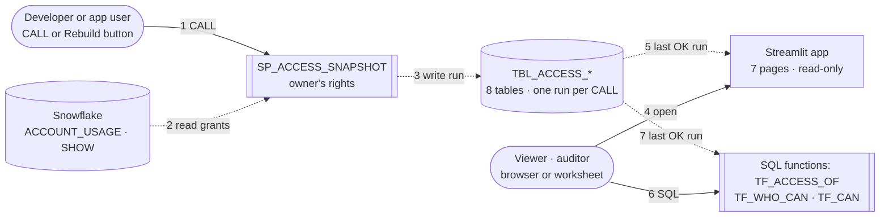
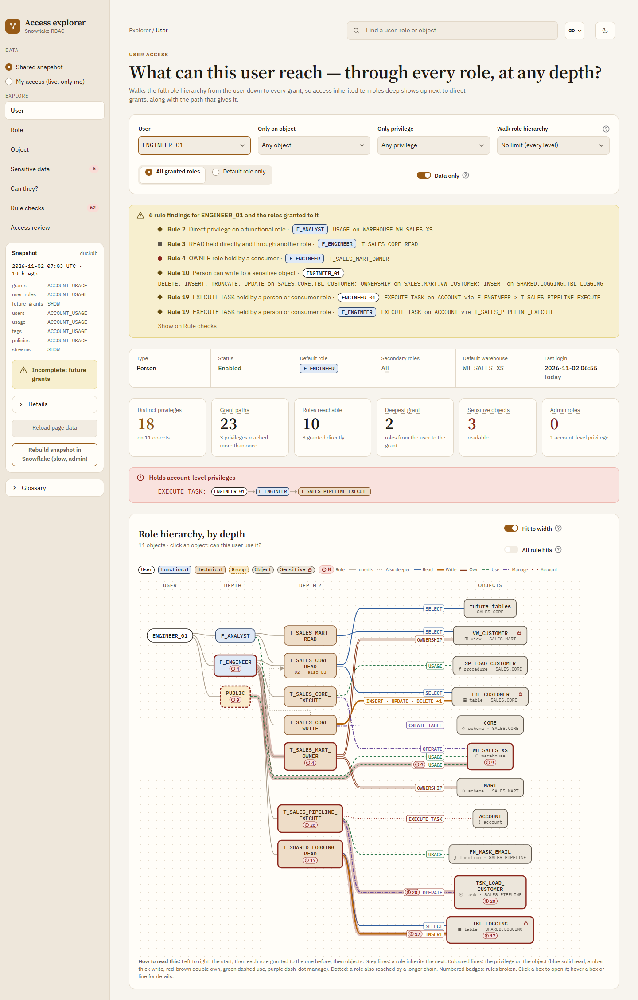
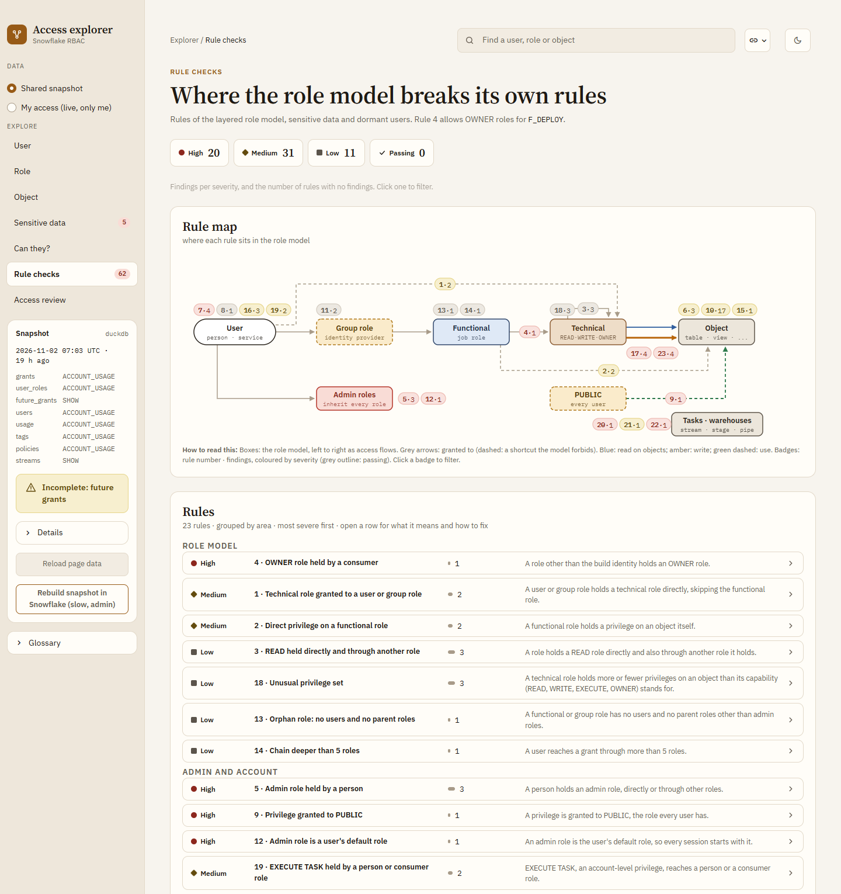
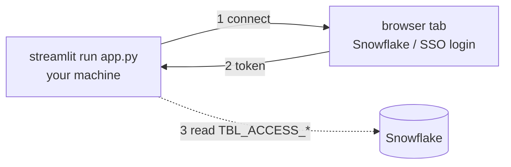
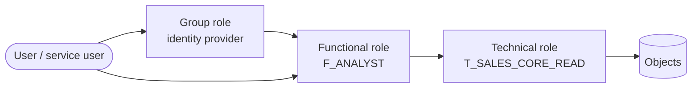

# Snowflake access explorer

Read-only Streamlit app: who has what in Snowflake, through which path, and where the role model breaks its own rules.
Every screen explained: [README.html](README.html).


Key: solid = calls · dashed = data moves · numbers = order. Build and read flow (L1): [README.html#flow](README.html#flow).




## Quick start

### Demo, no Snowflake (PowerShell, from this folder)
```
python -m venv .venv; .venv\Scripts\activate
pip install -r requirements.txt
$env:FAKE="1"; streamlit run app.py                                         # fake data in memory (FAKE=1 is the default)
python make_demo_db.py; $env:DUCKDB="demo.duckdb"; streamlit run app.py      # same data through the snapshot SQL
$env:BIG="1"; python make_demo_db.py; $env:DUCKDB="big.duckdb"; streamlit run app.py   # 2,000 objects, 300 roles
```

## Install on another machine (browser login)
Needs Python 3.10+, git and access to the private repo. The snapshot must already exist in Snowflake (one-time setup below).
```
git clone https://github.com/darshanmeel/snowflake-access-explorer.git
cd snowflake-access-explorer/access-explorer        # keep the folder layout: the app imports ../sf.py
python -m venv .venv; .venv\Scripts\activate          # macOS/Linux: python3 -m venv .venv; source .venv/bin/activate
pip install -r requirements.txt
```
Create `local.ps1` in this folder (git-ignored; macOS/Linux: `local.sh` with `export NAME="value"` lines, `source local.sh`):
```
$env:SNOWFLAKE_ACCOUNT="<org>-<account>"       # from the URL https://<org>-<account>.snowflakecomputing.com
$env:SNOWFLAKE_USER="<your Snowflake login name>"
$env:SNOWFLAKE_ROLE="<APP_ROLE>"
$env:SNOWFLAKE_WAREHOUSE="<WH>"
$env:ACCESS_SNAPSHOT="<DB>.<SCHEMA>"
$env:FAKE="0"; $env:DUCKDB=""
```
Run:
```
. .\local.ps1
streamlit run app.py                           # opens http://localhost:8501; a second tab asks for your Snowflake login
```

Key: solid = calls · dashed = data moves · numbers = order.

- Two logins only: key pair when `SNOWFLAKE_PRIVATE_KEY_FILE` is set, else browser SSO. Passwords are not supported;
  nothing is stored in the repo.
- One login per new connection (app load, Rebuild, My access, each `run_sql.py` file). To reuse it for ~4 h, an admin runs
  `ALTER ACCOUNT SET ALLOW_ID_TOKEN = TRUE;` once (Linux also: `pip install "snowflake-connector-python[secure-local-storage]"`).
- The login tab opens on the machine running Streamlit: run the app on your own machine. A shared server needs key pair
  (`SNOWFLAKE_PRIVATE_KEY_FILE`, `SNOWFLAKE_PRIVATE_KEY_PWD`) instead.
- App users need only `<APP_ROLE>` (table below); **My access** needs no extra grants.
- Update: `git pull`, then `pip install -r requirements.txt`.

## One-time setup in Snowflake (developer)
Clone and install as above, then (`local.ps1` without `SNOWFLAKE_ROLE`: `run_sql.py` uses `DEV_ROLE`):
```
copy settings.sql settings.local.sql      # fill in DB, SCHEMA, WH, DEV_ROLE, APP_ROLE (SnowSQL: also HERE)
. .\local.ps1                              # SNOWFLAKE_ACCOUNT, SNOWFLAKE_USER, SNOWFLAKE_WAREHOUSE
python run_sql.py sql/1_setup.sql;     python run_sql.py sql/1_setup_verify.sql
python run_sql.py sql/2_snapshot.sql;  python run_sql.py sql/2_snapshot_verify.sql   # = CALL SP_ACCESS_SNAPSHOT('AUTO')
```
1. `DEV_ROLE` needs `IMPORTED PRIVILEGES` on DB `SNOWFLAKE` (or `MANAGE GRANTS`); without it the snapshot holds only what that role sees (table below).
2. `1_setup.sql` grants `APP_ROLE` its access to the tables. Grant `APP_ROLE` to the people who use the app, through your infrastructure as code.
3. Optional, admin: `ALTER ACCOUNT SET ALLOW_ID_TOKEN = TRUE;` users then log in once per ~4 h instead of once per connection.
4. Keep data fresh: schedule the snapshot with a task (the owner needs `EXECUTE TASK`), or use the app's **Rebuild snapshot in Snowflake**, then **Reload page data**:
   ```
   CREATE TASK <DB>.<SCHEMA>.TSK_ACCESS_SNAPSHOT WAREHOUSE = <WH> SCHEDULE = 'USING CRON 0 6 * * * UTC'
     AS CALL <DB>.<SCHEMA>.SP_ACCESS_SNAPSHOT('AUTO');
   ALTER TASK <DB>.<SCHEMA>.TSK_ACCESS_SNAPSHOT RESUME;
   ```

- SnowSQL instead of `run_sql.py`: `!source` the same `sql/` files in order (set `HERE` in `settings.local.sql`).
- `1_setup_verify.sql` shows which ACCOUNT_USAGE views the role can read (SKIPPED = that dataset uses its fallback, see Data sources).
- Remove everything: `python run_sql.py sql/3_cleanup.sql; python run_sql.py sql/3_cleanup_verify.sql`.
- Checks: `python test_access.py` (reruns itself with `ROLE_PREFIXES=ZF_,ZT_`), `python test_sql.py`.

| Role | Needs |
|---|---|
| Developer `<DEV_ROLE>` (owns tables and procedure) | Create tables and procedures in `<SCHEMA>`. To see every grant: `IMPORTED PRIVILEGES` on DB `SNOWFLAKE` (or DB roles `SECURITY_VIEWER` + `GOVERNANCE_VIEWER`, the latter for query history, tags and policies), or `MANAGE GRANTS` for SHOW. Without them the snapshot holds only what the role sees. |
| App `<APP_ROLE>` | USAGE on database, schema, warehouse · SELECT on the 9 `TBL_ACCESS_` tables (8 snapshot tables + `TBL_ACCESS_FINDING`) · USAGE on `SP_ACCESS_SNAPSHOT` (rebuild button only) |
| Any user, My access | Nothing extra: a warehouse and a database whose INFORMATION_SCHEMA they can read |

- The procedure runs with its owner's rights: whoever clicks, a low-privilege user can't overwrite the snapshot with a partial one.
- A CALL while another run is RUNNING (under 1 h old) returns `SKIPPED`. The app reads only the last `STATUS = 'OK'` run.

## Role model

Key: arrow = is granted to the next box.

- Users get functional roles (directly or via a group role); privileges sit on technical roles only.
- Technical roles per database (`OWNER`) and per schema (`OWNER`, `READ`, `WRITE`, `EXECUTE`); READ is inside WRITE.
- Prefixes `F_` / `T_`; another naming: `ROLE_PREFIXES=<functional>,<technical>`. DB and schema names come from grant data, never from role names.
- Admin roles (`ACCOUNTADMIN`, `SECURITYADMIN`, `SYSADMIN`, `USERADMIN`, `ORGADMIN`): links into them are hidden; holders and account-level privileges show in red.
- Depth = roles from the start to the role holding the grant, holder included: `ANALYST_01 > GRP_ANALYSTS > F_ANALYST > T_SALES_CORE_READ` = 3.

## Pages
Details, screenshots and every KPI: [README.html](README.html).

| Page | Answers |
|---|---|
| User | What can this user reach, through every role, at any depth? Graph, privileges with paths, sensitive data, roles used. |
| Role | Who holds this role (up), what does it hold (down), what has / lacks it per object, who loses it if revoked? |
| Object | Who can touch this object and how; sensitivity, masking and what each role sees. |
| Sensitive data | Which objects are sensitive, who reads them, which columns are unmasked; two roles compared. |
| Can they? | Can user X do P on object Y? Every path, how to remove it, or which role to ask for. |
| Rule checks | 23 rules with severity, findings, fix as infrastructure-as-code text + SQL, people with admin roles. |
| Access review | One row per user and object in a database, shortest path on a line under each row, CSV with blank Reviewer and Keep/Revoke columns. |

- Data views (sidebar): **Shared snapshot** (the tables) or **My access (live, only me)** (own roles, own rights, nothing saved; kept in server memory per browser for 1 h).
- Find (top bar): any user, role or object; opens its page.
- Users and roles are separate: a user and a role with the same name get their own rows, counts, Find entries and graph boxes; the user shows as `NAME (user)` where both appear.
- Page, entity and filters live in the URL (`?page=role&name=F_ANALYST&depth=3`): every view is a link.
- Big accounts: objects roll up to schemas over 12 objects, to databases over 12 schemas (click a box: `?schema=`). Over 30 role boxes or 6 role lanes the User and Role graphs show a summary (`?full=1`: every role).

## Settings (env vars)
README.html copies this table and the Limits list (`python docs/make_readme.py`): edit them here.

| Variable | Default | Does |
|---|---|---|
| `FAKE` | `1` | `0` = Snowflake via `../sf.py` |
| `DUCKDB` | | DuckDB file with the snapshot tables (wins over `FAKE`) |
| `ACCESS_SNAPSHOT` | | `<DB>.<SCHEMA>` of the tables (Snowflake only) |
| `DEMO_USER` | `ENGINEER_01` | Default user, and the "me" of My access outside Snowflake |
| `ROLE_PREFIXES` | `F_,T_` | Functional and technical role prefixes |
| `BUILD_ROLES` | `<functional prefix>DEPLOY` | fnmatch patterns of the build identity: may hold OWNER roles (rule 4), skipped by rules 17, 19–23 |
| `MAX_HOPS` | `50` | Safety cap on role hops per walk |
| `MAX_PATHS` | `200` | Full chains listed per row; path counts are always exact |
| `CAP_PRIVS` | READ: `SELECT, REFERENCES, USAGE, READ` · WRITE: READ + `INSERT, UPDATE, DELETE, TRUNCATE, WRITE` · EXECUTE: `USAGE` · OWNER: `OWNERSHIP` | Rule 18: standard privileges per capability suffix, JSON |
| `SENSITIVE_TAGS` | `PRIVACY_CATEGORY=IDENTIFIER\|QUASI_IDENTIFIER\|SENSITIVE,SENSITIVITY=PII\|CONFIDENTIAL` | Tag (last name part, any case) = values that make data sensitive; no `=` = any value |
| `READ_PRIVS` | `SELECT,OWNERSHIP` | Privileges that count as "can read" |
| `DORMANT_DAYS` | `90` | No login for this long (or never) before the run's `FINISHED_AT` (rules 7, 16) |
| `MAX_DEPTH_RULE` | `5` | Rule 14 threshold |
| `READ_ROLE_PATTERNS` | `_READ$\|_READ_\|_R$\|_R_\|_RO$\|_RO_\|READONLY\|READ_ONLY\|VIEWER\|_VIEW$\|REPORTING\|_RPT` | Rule 17 name heuristic (regex, any case) |
| `READ_SHARE`, `READ_MIN_OBJECTS` | `0.8`, `5` | Rule 17 behaviour heuristic: share of tables/views a role only reads, over at least this many |

## SQL without the app
`sql/1_setup.sql` also creates three table functions and a findings procedure; all read the last OK run.
```sql
USE SCHEMA <DB>.<SCHEMA>;
SELECT * FROM TABLE(TF_ACCESS_OF('ANALYST_01', NULL)) ORDER BY DEPTH, OBJECT_NAME;   -- NULL = every level
SELECT * FROM TABLE(TF_WHO_CAN('SALES.CORE.TBL_CUSTOMER', 'SELECT', NULL)) WHERE GRANTEE_KIND = 'user';
SELECT * FROM TABLE(TF_CAN('ANALYST_01', 'SELECT', 'SALES.CORE.TBL_CUSTOMER')) ORDER BY HOPS;  -- no rows = no
CALL SP_ACCESS_FINDINGS('{"MAX_DEPTH_RULE": 4, "DORMANT_DAYS": 60}');                  -- into TBL_ACCESS_FINDING
```
| Object | Returns |
|---|---|
| `TF_ACCESS_OF(NAME, MAX_DEPTH)` | `PRIVILEGE, GRANTED_ON` (`FUTURE TABLE` for future grants)`, DATABASE_NAME, SCHEMA_NAME, OBJECT_NAME, DEPTH, PATH, HOLDER`; a user name walks as the user |
| `TF_WHO_CAN(OBJECT_NAME, PRIVILEGE, MAX_DEPTH)` | `GRANTEE, GRANTEE_KIND` (user / role)`, PRIVILEGE, DEPTH, PATH`; PRIVILEGE NULL = any |
| `TF_CAN(USER_NAME, PRIVILEGE, OBJECT_NAME)` | `PATH, HOPS` (= depth)`, HOLDER, VIA_OWNERSHIP`; one row per path |
| `SP_ACCESS_FINDINGS(P_SETTINGS)` | Returns `{run_id, findings, per_rule}`; that run's rows in `TBL_ACCESS_FINDING` replaced |

- Same walk as the app; `PATH` = `A > B > C`. Names match as stored, case-sensitive.
- `P_SETTINGS`: JSON with any key of the settings table from `ROLE_PREFIXES` down; unknown keys fail.
- The procedure runs `access.py` from stage `STG_ACCESS_CODE`: rerun `1_setup.sql` after changing `access.py`
  (worksheet only: upload it with Snowsight "+ Files").
- Walks stop at 50 hops without a flag: `MAX(DEPTH)` of 50 (user) or 51 (role) means the result may be cut.
- `SKIPPED: FUNCTION_...` in setup: the functions did not compile on this account; the rest still runs.

## Data sources (decided per dataset at every CALL)
| Dataset | ACCOUNT_USAGE (lag up to ~2 h) | Fallback | Table |
|---|---|---|---|
| Role -> object, role -> role | `GRANTS_TO_ROLES` | `SHOW ROLES` + `SHOW GRANTS TO ROLE` | `TBL_ACCESS_GRANT` |
| Role -> user | `GRANTS_TO_USERS` | `SHOW GRANTS OF ROLE` | `TBL_ACCESS_USER_ROLE` |
| Future grants | none | always `SHOW FUTURE GRANTS IN DATABASE / SCHEMA` | `TBL_ACCESS_GRANT` (`IS_FUTURE`) |
| User profile | `USERS` | `SHOW USERS` | `TBL_ACCESS_USER` |
| Roles, warehouses used | `QUERY_HISTORY`, 30 days | `INFORMATION_SCHEMA.QUERY_HISTORY`, 7 days | `TBL_ACCESS_USAGE` |
| Tags | `TAG_REFERENCES` (Enterprise) | per table: `INFORMATION_SCHEMA.TAG_REFERENCES(_ALL_COLUMNS)`, max 300 | `TBL_ACCESS_TAG` |
| Masking and row access policies, with text | `POLICY_REFERENCES` + `MASKING_POLICIES` / `ROW_ACCESS_POLICIES` | per table: `POLICY_REFERENCES`, text from `DESCRIBE` | `TBL_ACCESS_POLICY` |
| Streams (rule 22) | none | always `SHOW STREAMS IN ACCOUNT` | `TBL_ACCESS_STREAM` |
| Run log | | | `TBL_ACCESS_RUN` |

- `P_SOURCE`: `AUTO` (default: ACCOUNT_USAGE where readable, else SHOW) · `ACCOUNT_USAGE` (fail if not readable) · `SHOW` (live, 2 queries per role).
- Tags, policies, streams, usage: an error sets that source to `UNAVAILABLE`; the run stays OK. Any other failed dataset: the run is `FAILED` and its rows deleted.
- My access reads `CURRENT_AVAILABLE_ROLES()`, `SHOW GRANTS TO ROLE / USER`, `DESC USER`, `QUERY_HISTORY_BY_USER` (7 days) as the user.
- Column names of the tag/policy views and `SHOW STREAMS` are marked "to verify" in `sql/1_setup.sql`.

## Limits
- Data is as old as the last CALL, plus up to ~2 h ACCOUNT_USAGE lag; tags need Enterprise edition.
- Live session roles of other users can't be read: the app shows defaults and roles used in queries.
- SHOW fallback: 2 queries per role (slow on many roles); query history then 7 days or none.
- Database roles are not modelled.
- Masked / clear and all / filtered / no rows come from the policy text, not evaluated; subqueries, mapping tables, UDFs, NOT, CASE, user checks give "unknown".
- Sensitive reach counts `READ_PRIVS` on the object only; USAGE on its database/schema is not checked.
- Rule 17 is a heuristic (name or mostly-read behaviour); review before acting. Rule 13 skips technical roles.
- Object, Can they? and Access review list every path into an object: the slow part on very large, nested accounts.
- Pages render one at a time per app process (`access.py` keeps lookups in module globals, under a lock).
- My access has no tags or policies, so no sensitivity, rule checks or access review.
