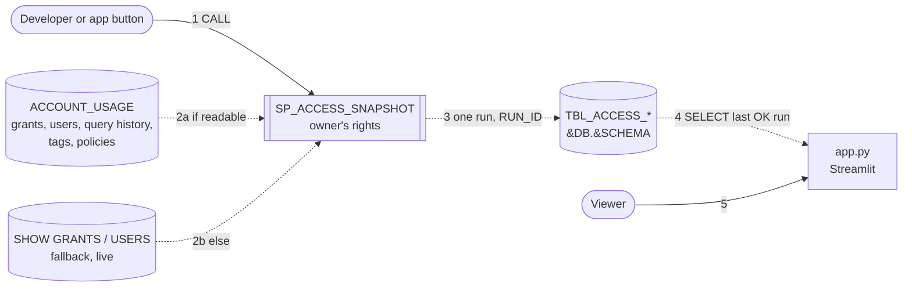
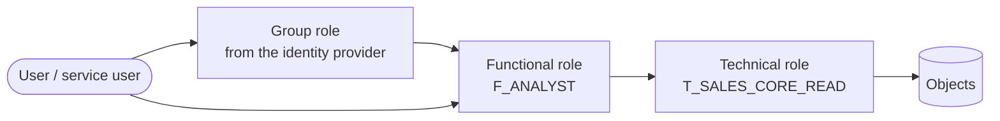
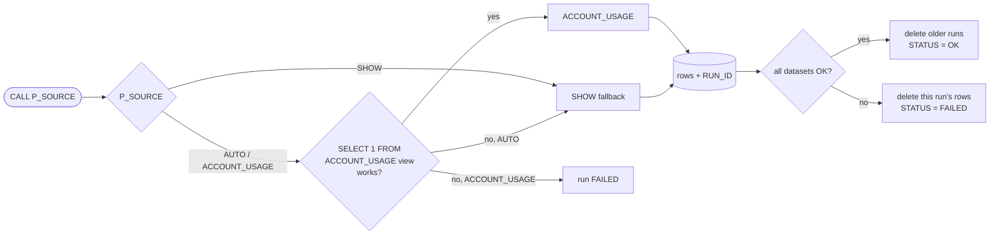
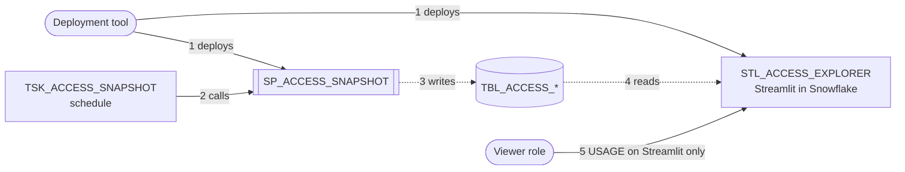

# Snowflake access explorer

Streamlit app: who has what in Snowflake, and through which path. Two data views:
- **Shared snapshot**: the `TBL_ACCESS_` tables. App users need no rights on ACCOUNT_USAGE or SHOW GRANTS.
- **My access (live, only me)**: the logged-in user's own roles and grants, read with their own rights. Nothing is saved.


Key: solid arrow = calls · dashed arrow = data moves · numbers = order.

- The procedure runs with its owner's rights (developer role). Only the owner needs grant-reading rights.
- The app role needs only SELECT on the 7 tables.
- No task yet. The CALL runs from `sql/2_snapshot.sql` or the app's **Refresh snapshot now** button.
- Whoever clicks, the CALL runs with the owner's rights: a low-privilege user can't overwrite the full snapshot with a partial one.
- A CALL while another run is RUNNING (under 1 h old) returns `SKIPPED`.

## Role model

Key: arrow = is granted to the next box.

- Users get functional roles (directly or through a group role). Privileges sit on technical roles only.
- Technical roles per database (`OWNER`) and per schema (`OWNER`, `READ`, `WRITE`, `EXECUTE`); READ is inside WRITE.
- Prefixes: `F_` functional, `T_` technical. Another naming: `ROLE_PREFIXES=<functional>,<technical>`.
- DB and schema names are never parsed from role names (they contain underscores); only grant data counts.
- Admin roles (`ACCOUNTADMIN`, `SECURITYADMIN`, `SYSADMIN`): the "every role -> SYSADMIN" links are hidden; any holder is shown in red.

## My access (no shared tables needed)
| Need | Read as the logged-in user | Fallback |
|---|---|---|
| Roles | `CURRENT_AVAILABLE_ROLES()` (granted + inherited) | none needed |
| Role -> object, role -> role | `SHOW GRANTS TO ROLE` per role | `INFORMATION_SCHEMA.APPLICABLE_ROLES` (links only) |
| Roles granted to me | `SHOW GRANTS TO USER` | `APPLICABLE_ROLES` where grantee = me · else roles no other role holds |
| Profile | `DESC USER` | none |
| Roles, warehouses used | `INFORMATION_SCHEMA.QUERY_HISTORY_BY_USER`, 7 days | none |

- Kept in server memory only, per browser (its XSRF cookie), for 1 h: chip and graph links reload the page. No temp tables: they need CREATE TABLE rights and add nothing.

## Source per dataset (decided at every CALL)


Key: diamond = decision · the check runs once per view.

| Dataset | ACCOUNT_USAGE (lag up to ~2 h) | Fallback | Table |
|---|---|---|---|
| Role -> object, role -> role | `GRANTS_TO_ROLES`, `deleted_on is null` | `SHOW ROLES` + `SHOW GRANTS TO ROLE` per role | `TBL_ACCESS_GRANT` |
| Role -> user | `GRANTS_TO_USERS`, `deleted_on is null` | `SHOW GRANTS OF ROLE` per role | `TBL_ACCESS_USER_ROLE` |
| Future grants | none | always `SHOW FUTURE GRANTS IN DATABASE / SCHEMA` | `TBL_ACCESS_GRANT` (`IS_FUTURE`) |
| User profile | `USERS` | `SHOW USERS` | `TBL_ACCESS_USER` |
| Roles, secondary roles, warehouses used | `QUERY_HISTORY`, 30 days | `INFORMATION_SCHEMA.QUERY_HISTORY`, 7 days, else none | `TBL_ACCESS_USAGE` |
| Tags on databases, schemas, tables/views, columns | `TAG_REFERENCES`, `object_deleted is null` (Enterprise edition) | per table/view: `<db>.INFORMATION_SCHEMA.TAG_REFERENCES` + `TAG_REFERENCES_ALL_COLUMNS`, max 300 (`TAG_FALLBACK_MAX`), else none | `TBL_ACCESS_TAG` |
| Masking and row access policies, with their text | `POLICY_REFERENCES` + `MASKING_POLICIES` / `ROW_ACCESS_POLICIES` | per table/view: `<db>.INFORMATION_SCHEMA.POLICY_REFERENCES`, text from `DESCRIBE` (empty without rights), else none | `TBL_ACCESS_POLICY` |
| Run log: source, row counts, notes per dataset | | | `TBL_ACCESS_RUN` |

- `P_SOURCE`: `AUTO` (default) · `ACCOUNT_USAGE` (fail if not readable) · `SHOW` (live, 2 queries per role, slower).
- Readers never see half a snapshot: the app reads only the last `STATUS = 'OK'` run.
- Grant rows keep the ACCOUNT_USAGE shape, so both sources give the same tables.
- Tags and policies: an error sets the source to `UNAVAILABLE` and the run stays OK (as with usage). Tag inheritance (database > schema > table > column) is resolved in the app.
- Column names of the tag/policy views are marked "to verify" in `sql/1_setup.sql` until checked on a real account.

## What the app answers
| Tab | Question |
|---|---|
| User | Profile (default role, default secondary roles, warehouse, namespace, type, disabled, last login). Privileges with every path. "All granted roles" vs "default role only". Roles and warehouses used. Red: admin roles, account-level privileges. |
| Role | Down: what it holds, with paths. Up: roles and users that hold it. Red: admin roles, account-level privileges. |
| Object | Type filter, then who has which privilege, with paths. Red: admin role holders. |
| Combination | "Only on object" + "Only privilege" in User and Role: can X do P on Y, and how? |
| Rule checks | 1 technical role on a user or group role · 2 direct privilege on a functional role · 3 READ held directly and through WRITE · 4 OWNER role held by a consumer (except `BUILD_ROLES`, default `<functional prefix>DEPLOY`) · 5 admin role held by a person · 6 sensitive column without a masking policy · 7 dormant or disabled person can read sensitive data · 8 disabled user still holds roles · 9 privilege granted to PUBLIC · 10 person can write to a sensitive object · 11 sensitive object reachable through a group role · 12 admin role as default role · 13 orphan functional/group role · 14 chain deeper than `MAX_DEPTH_RULE` · 15 future grant in a schema with sensitive data · 16 dormant user still holds roles · 17 read-only role can write (by name or by behaviour). Each finding: fix as infrastructure-as-code text + equivalent SQL, users affected. |

Each row shows the full path, e.g. `ANALYST_01 -> GRP_ANALYSTS -> F_ANALYST -> T_SALES_CORE_READ`.

## Files
| File | Does |
|---|---|
| `settings.sql` | Template of the names: database, schema, warehouse, developer role, app role |
| `settings.local.sql` | Real names (git-ignored): `settings.sql` copied and filled in |
| `sql/1_setup.sql` | 7 tables, the procedure, SELECT for the app role |
| `sql/2_snapshot.sql` | `CALL SP_ACCESS_SNAPSHOT('AUTO')` |
| `sql/3_cleanup.sql` | Drops the procedure and the tables |
| `sql/*_verify.sql` | Checks per step: OK / MISSING / WRONG / SKIPPED, then VERIFIED |
| `run_sql.py` | Runs a `sql/` file through `../sf.py` (or use SnowSQL: `deploy_snowsql.sql`) |
| `access.py` | Fake data, `snapshot()`, `mine()`, graph walks, rule checks (no Streamlit) |
| `app.py` | Streamlit UI: data loaders, one function per tab, `main()`; graphs from `ui.lane_graph` (inputs from `access.down_graph` / `role_graph` / `object_graph`) |
| `make_demo_db.py` | Fake data into `demo.duckdb`, same tables as Snowflake (`write(con, data)` for tests) |
| `take_screens.py` | Screenshots of the DuckDB demo (Playwright + Edge, app on port 8599) |
| `.streamlit/config.toml` | "Paper" look: warm paper, ink, burnt amber; Fraunces / IBM Plex in `app.py` |

## Run
```
python -m venv .venv; .venv\Scripts\activate
pip install streamlit pandas duckdb snowflake-connector-python
streamlit run app.py                                          # fake data, in memory
python make_demo_db.py; $env:DUCKDB="demo.duckdb"; streamlit run app.py   # fake data through the snapshot SQL
```
Real data (PowerShell, from this folder):
```
copy settings.sql settings.local.sql                          # then fill in the names
$env:SNOWFLAKE_ACCOUNT="<org>-<account>"; $env:SNOWFLAKE_USER="<your user>"
$env:SNOWFLAKE_ROLE="<DEV_ROLE>"; $env:SNOWFLAKE_WAREHOUSE="<WH>"
$env:ROLE_PREFIXES="F_,T_"; $env:BUILD_ROLES="F_DEPLOY"       # only if your naming differs
python run_sql.py sql/1_setup.sql;     python run_sql.py sql/1_setup_verify.sql
python run_sql.py sql/2_snapshot.sql;  python run_sql.py sql/2_snapshot_verify.sql
$env:FAKE="0"; $env:ACCESS_SNAPSHOT="<DB>.<SCHEMA>"; streamlit run app.py
```
- Keep these env vars in a git-ignored `local.ps1` and load it with `. .\local.ps1`.
- Rerun `2_snapshot.sql` for fresh data, then click **Reload snapshot** in the app.
- `1_setup_verify.sql` shows which ACCOUNT_USAGE views the role can read (SKIPPED = that dataset falls back to SHOW).

## Roles and grants
| Role | Needs |
|---|---|
| Developer `<DEV_ROLE>` (owns the tables and procedure) | Create tables and procedures in `<SCHEMA>`. To see every grant, one of: `IMPORTED PRIVILEGES` on DB `SNOWFLAKE` (or DB roles `SECURITY_VIEWER` + `GOVERNANCE_VIEWER`, the latter also for tags and policies) · `MANAGE GRANTS` on account for SHOW. Without them the snapshot holds only what the role can see. |
| App `<APP_ROLE>` | USAGE on database, schema and warehouse · SELECT on the 7 `TBL_ACCESS_` tables · USAGE on the procedure (Refresh button only) |
| Any user, "My access" | Nothing extra: a warehouse and a database whose INFORMATION_SCHEMA they can read |

## Settings (env vars, defaults)
| Variable | Default | Does |
|---|---|---|
| `ROLE_PREFIXES` | `F_,T_` | Functional and technical role prefixes |
| `BUILD_ROLES` | `<functional prefix>DEPLOY` | fnmatch patterns allowed to hold OWNER roles (rule 4), skipped by rule 17 |
| `MAX_HOPS` | `50` | Safety cap on role hops per walk |
| `SENSITIVE_TAGS` | `PRIVACY_CATEGORY=IDENTIFIER\|QUASI_IDENTIFIER\|SENSITIVE,SENSITIVITY=PII\|CONFIDENTIAL` | Tag (last part of its name, any case) = values that make data sensitive; no `=` = any value. `SEMANTIC_CATEGORY` is detail only |
| `READ_PRIVS` | `SELECT,OWNERSHIP` | Privileges that count as "can read" (owners read) |
| `DORMANT_DAYS` | `90` | No login for this long, from the run's `FINISHED_AT`; never logged in counts (rules 7, 16) |
| `MAX_DEPTH_RULE` | `5` | Rule 14 threshold |
| `READ_ROLE_PATTERNS` | `_READ$\|_READ_\|_R$\|_R_\|_RO$\|_RO_\|READONLY\|READ_ONLY\|VIEWER\|_VIEW$\|REPORTING\|_RPT` | Rule 17 name heuristic (regex, any case, capability words only) |
| `READ_SHARE`, `READ_MIN_OBJECTS` | `0.8`, `5` | Rule 17 behaviour heuristic: share of tables/views a role can only read, over at least this many |

- Depth = number of roles from the start to the role holding the grant, holder included (a user is not a role). `ANALYST_01 > GRP_ANALYSTS > F_ANALYST > T_SALES_CORE_READ` = 3; a grant holder alone = 1. The same on every page.
- Privilege classes (arrows, badges): read = SELECT, REFERENCES, USAGE on database/schema · write = INSERT, UPDATE, DELETE, TRUNCATE, CREATE ... · own = OWNERSHIP, account privileges · use = everything else (USAGE on procedure/function/warehouse, OPERATE, MONITOR).

## SQL access without the app
`sql/1_setup.sql` also creates three table functions and a findings procedure. All read the last OK snapshot run,
so `CALL SP_ACCESS_SNAPSHOT()` first.
```sql
USE SCHEMA <DB>.<SCHEMA>;
-- every privilege a user (granted roles + PUBLIC) or a role reaches; MAX_DEPTH NULL = every level (cap 50 hops)
SELECT * FROM TABLE(TF_ACCESS_OF('ANALYST_01', NULL)) ORDER BY DEPTH, OBJECT_NAME;
SELECT * FROM TABLE(TF_ACCESS_OF('F_ANALYST', 2)) WHERE DATABASE_NAME = 'SALES';
-- who reaches a privilege on an object (PRIVILEGE NULL = any), users and roles
SELECT * FROM TABLE(TF_WHO_CAN('SALES.CORE.TBL_CUSTOMER', 'SELECT', NULL)) WHERE GRANTEE_KIND = 'user';
-- can a user do it? one row per path (VIA_OWNERSHIP = through OWNERSHIP, which implies every privilege), no rows = no
SELECT * FROM TABLE(TF_CAN('ANALYST_01', 'SELECT', 'SALES.CORE.TBL_CUSTOMER')) ORDER BY HOPS;
-- the app's rule checks, stored per run in TBL_ACCESS_FINDING; returns {run_id, findings, per_rule}
CALL SP_ACCESS_FINDINGS();
CALL SP_ACCESS_FINDINGS('{"MAX_DEPTH_RULE": 4, "DORMANT_DAYS": 60}');
SELECT RULE_NUM, TITLE, SEVERITY, GRANTEE, DETAIL, PATH FROM TBL_ACCESS_FINDING
WHERE RUN_ID = (SELECT RUN_ID FROM TBL_ACCESS_RUN WHERE STATUS = 'OK' ORDER BY FINISHED_AT DESC LIMIT 1);
```
| Object | Returns |
|---|---|
| `TF_ACCESS_OF(NAME, MAX_DEPTH)` | `PRIVILEGE, GRANTED_ON` (`FUTURE TABLE` for future grants)`, DATABASE_NAME, SCHEMA_NAME, OBJECT_NAME` (full name)`, DEPTH, PATH, HOLDER`. A name that is a user walks as the user. |
| `TF_WHO_CAN(OBJECT_NAME, PRIVILEGE, MAX_DEPTH)` | `GRANTEE, GRANTEE_KIND` (user / role)`, PRIVILEGE, DEPTH, PATH` (grantee > ... > holder) |
| `TF_CAN(USER_NAME, PRIVILEGE, OBJECT_NAME)` | `PATH` (user > ... > holder > object)`, HOPS` (= depth)`, HOLDER, VIA_OWNERSHIP`. A role name walks as the role (the app's Can they? walks users only). |
| `SP_ACCESS_FINDINGS(P_SETTINGS)` | Rule findings of the last OK run into `TBL_ACCESS_FINDING` (that run's rows replaced) |

- Same rules as the app: every simple path, links granted to an admin role dropped, depth as in Settings, `PATH` = `A > B > C`.
- `P_SETTINGS`: JSON text with any of `ROLE_PREFIXES, BUILD_ROLES, SENSITIVE_TAGS, READ_PRIVS, DORMANT_DAYS, MAX_DEPTH_RULE,
  READ_ROLE_PATTERNS, READ_SHARE, READ_MIN_OBJECTS, MAX_HOPS` (table above); missing keys use the defaults. Unknown keys fail.
- The procedure runs `access.py`, which setup PUTs to stage `STG_ACCESS_CODE`: rerun `1_setup.sql` after changing `access.py`.
- App role: SELECT on `TBL_ACCESS_FINDING`, USAGE on the three functions (not on `SP_ACCESS_FINDINGS`, which writes).
- `python test_sql.py` runs the function bodies from `1_setup.sql` on DuckDB and compares them with `access.py`.
- Names are matched as stored, case-sensitive: `'ANALYST_01'`, not `'analyst_01'`.
- Walks stop at 50 hops without a flag (the `MAX_HOPS` setting is not read): `MAX(DEPTH)` of 50 (user) or 51 (role)
  means the result may be cut. Every simple path is listed, so a dense role graph can return very many rows.
- A role cycle check covers roles only, so a role named like the user is walked (the app skips it).
- If setup prints `SKIPPED: FUNCTION_...`, the functions did not compile on this account; the rest of setup still runs.
- Setup from a worksheet only (no `run_sql.py` / SnowSQL, so no `PUT`): upload `access.py` uncompressed to
  `STG_ACCESS_CODE` with Snowsight's "+ Files" before `PROCEDURE_FINDINGS`.

## Later: Streamlit in Snowflake (designed, not built)

Key: solid arrow = then/calls · dashed arrow = data moves.

- The proc owner gets its grant-reading rights through infrastructure as code.
- `with_query()` in `app.py` becomes `get_active_session().sql(sql).collect()`; `access.py` stays unchanged.
- The app runs with its owner's rights: viewers need only USAGE on the Streamlit.
- "My access" then needs caller's rights for the Streamlit (to confirm); otherwise it shows the owner's access.

## Limits
- Shared data is as old as the last CALL, plus up to ~2 h ACCOUNT_USAGE lag.
- Live session roles of other users can't be read: the app shows defaults and roles used in queries.
- SHOW fallback: 2 queries per role (slow for many roles); query history then covers 7 days or nothing.
- One viewer at a time per app process: `access.build()` keeps the lookups in module variables.
- Database roles are not modelled; function signatures can differ between ACCOUNT_USAGE and SHOW.
- Masked / clear comes from the policy text (`IS_ROLE_IN_SESSION`, `CURRENT_ROLE()`), not evaluated; subqueries, mapping tables, UDFs and database roles give "cannot derive".
- Tags lag up to ~2 h (ACCOUNT_USAGE) and need Enterprise edition; tag-based policies match only tags present in `TBL_ACCESS_TAG`.
- Sensitive reach counts `READ_PRIVS` on the object only; USAGE on its database/schema is not checked.
- My access (live) mode has no tags or policies, so no sensitivity.
- Rule 17 is a heuristic: a name match or a mostly-read role that writes; review before acting. Rule 13 skips technical roles (unused capability roles exist by design).
