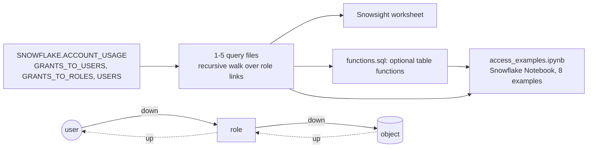

# Access queries

Plain SQL that answers "who has what, and through which roles" straight from `SNOWFLAKE.ACCOUNT_USAGE`.
Standalone: no app, no snapshot tables, no procedure, nothing to install. Copy this folder and use it.



## Files

| File | Answers | Inputs (`SET`) | Output columns |
|---|---|---|---|
| `1_user_roles.sql` | Every role a user holds, direct and inherited (account and database roles) | `USER_NAME` | `ROLE_NAME, ROLE_KIND, DEPTH, PATH, WAYS` |
| `2_user_access.sql` | Every privilege a user finally has, on which object, through which role | `USER_NAME` | `PRIVILEGE, GRANTED_ON, OBJECT_NAME, VIA_ROLE, DEPTH, PATH, WAYS` |
| `3_role_access.sql` | The same, starting from a role (its grants and those of every role below it) | `ROLE_NAME` | `PRIVILEGE, GRANTED_ON, OBJECT_NAME, VIA_ROLE, DEPTH, PATH, WAYS` |
| `4_role_holders.sql` | Upwards: every role that holds a role, and every user at the end | `ROLE_NAME` | `HOLDER, HOLDER_KIND, DEPTH, PATH, WAYS` |
| `5_object_users.sql` | Who reaches an object: holder roles, the roles above them, the final users | `OBJECT_NAME`, `PRIVILEGE` (`''` = any) | `GRANTEE, GRANTEE_KIND, PRIVILEGE, GRANTED_ON, HOLDER, DEPTH, PATH, WAYS` |
| `functions.sql` | Optional: the five as table functions `AQ_USER_ROLES`, `AQ_USER_ACCESS`, `AQ_ROLE_ACCESS`, `AQ_ROLE_HOLDERS`, `AQ_OBJECT_USERS` | arguments = the `SET` names, same order | the same columns |
| `access_examples.ipynb` | Snowflake Notebook, 8 examples, each twice: path A creates and calls the functions, path B runs the query directly | | |
| `make_notebook.py` | Builds `access_examples.ipynb` from the query files and `functions.sql` (run it after changing them) | | |
| `test_queries.py` | Checks the files against the app's `access.py` on fake data (DuckDB), and `functions.sql` against the files | | |

Every file also takes `MAX_DEPTH` (default 50, the app's limit; `NULL` = 50) and `SHOW_BUILTIN` (default `FALSE`).

- **One row per answer**, with its shortest `PATH` and `WAYS` = how many role paths lead there.
  Example: `ENGINEER_01` reaches `T_SALES_CORE_READ` 3 ways; the row shows the shortest.
  Every path instead: delete the `QUALIFY` line (in `2` and `3`: `SELECT * FROM WALK` lists every path to each role;
  paths are counted per role and summed per object, never listed per privilege, so they stay fast).
- **`DEPTH`** = roles from the start to the role, that role included; a user is not a role.
  `ANALYST_01 > GRP_ANALYSTS > F_ANALYST > T_SALES_CORE_READ` is depth 3. In `3`, `4` and `5` the starting
  or grant-holding role itself is depth 1.
- **`PATH`**: `user > role > role`; in `4` and `5` read from the holder down: `holder > ... > role`.

## How to run

**(a) Worksheet, nothing created.** Open a file in a Snowsight worksheet, change the `SET` lines, select all, Run.

```sql
SET USER_NAME = 'ANALYST_01';
SET MAX_DEPTH = 50;
SET SHOW_BUILTIN = FALSE;
-- then the query of 1_user_roles.sql
```

**(b) Table functions, optional.** In `functions.sql` replace `AQ_DB.AQ_SCHEMA` with your database and schema, run it,
then:

```sql
SELECT * FROM TABLE(AQ_DB.AQ_SCHEMA.AQ_USER_ROLES('ANALYST_01')) ORDER BY DEPTH, ROLE_NAME;
SELECT * FROM TABLE(AQ_DB.AQ_SCHEMA.AQ_USER_ACCESS('ANALYST_01', 50, TRUE)) ORDER BY OBJECT_NAME, PRIVILEGE;
SELECT * FROM TABLE(AQ_DB.AQ_SCHEMA.AQ_OBJECT_USERS('SALES.CORE.TBL_CUSTOMER', 'SELECT'))
ORDER BY GRANTEE_KIND DESC, GRANTEE, PRIVILEGE;
```

- Only the first argument (and `PRIVILEGE` of `AQ_OBJECT_USERS`, default `''`) is needed; the rest default as in the files.
- Snowflake does not keep a function's row order: add the `ORDER BY` (the file's last line) on the outer `SELECT`.

- Needs a role that may create functions there (USAGE on the database, USAGE + CREATE FUNCTION on the schema).
- If a statement fails (a recursive CTE or ACCOUNT_USAGE not allowed in a function in your account), use (a).
- A function reads ACCOUNT_USAGE with its owner's rights: grant USAGE on it only to roles that may see every grant.
- Each function body is its file's query with `$NAME` replaced by `NAME`, without the last `ORDER BY`;
  `test_queries.py` fails if they drift.

**(c) Snowflake Notebook.** `access_examples.ipynb`: Snowsight > Projects > Notebooks > Import .ipynb, pick a warehouse.
Run the inputs cell (`SET USER_NAME`, `ROLE_NAME`, `OBJECT_NAME`, `PRIVILEGE`, `MAX_DEPTH`, `MIN_DEPTH`; replace the example
names), then one path:

- **Path A:** replace `AQ_DB.AQ_SCHEMA` with your database and schema, run the five `CREATE` cells (they may fail where
  functions cannot hold a recursive query: use B), then the eight example cells that call the functions.
- **Path B:** the same eight examples as plain queries, nothing created.
- The eight: a user's roles; a user's access; does a user reach an object and how; everything a role grants; who holds a
  role (upwards, users included); which users can use an object; users that reach it through more than `MIN_DEPTH` roles;
  a user's access summed up as objects per role and privilege.
- The cells are generated, not typed: `python access_queries/make_notebook.py` rewrites the file, `test_queries.py`
  fails when it is out of date or a cell differs from its file.

## Privileges and latency

- Read access to `SNOWFLAKE.ACCOUNT_USAGE`: `IMPORTED PRIVILEGES` on database `SNOWFLAKE`, or the database role
  `SNOWFLAKE.SECURITY_VIEWER` (or `SNOWFLAKE.GOVERNANCE_VIEWER`) granted to your role, plus a warehouse.
- ACCOUNT_USAGE lags up to about 2 hours: a grant made a minute ago may not show yet.
- Reads only `GRANTS_TO_USERS`, `GRANTS_TO_ROLES` and `USERS`, active rows only (`DELETED_ON IS NULL`). No business data.

## Rules (the same as the app's `access.py`)

- **Role link** = `USAGE` on `GRANTED_ON = 'ROLE'` or `'DATABASE_ROLE'`. Any other grant, `OWNERSHIP` of a role too,
  is a privilege on an object.
- **Database roles** are named `DB.ROLE`. ACCOUNT_USAGE stores the grantee bare; the database comes from the granted
  object (`NAME` for a database grant, else `TABLE_CATALOG`), as the app's direct mode does.
- **Object names**: `DB`, `DB.SCHEMA`, `DB.SCHEMA.OBJECT`; account objects (warehouse, integration, ...) by bare name.
  Compared exactly as stored: unquoted names are upper case.
- **Admin roles** (`ACCOUNTADMIN`, `SECURITYADMIN`, `SYSADMIN`, `USERADMIN`, `ORGADMIN`): links granted *to* them are
  left out, since every custom role sits under `SYSADMIN` and every user would seem to reach everything through it.
  *Holding* an admin role is kept: `4_role_holders.sql` with `SECURITYADMIN` lists who has it.
- **PUBLIC**: every user holds it, granted or not (users from `USERS` and `GRANTS_TO_USERS`). An unknown user name
  returns no rows.
- **Snowflake's own grants** through PUBLIC (`SNOWFLAKE.*` database roles, `SYSTEM_COMPUTE_POOL_*`, `SYSTEM$*`,
  `SNOWFLAKE_LEARNING_*`) are hidden; `SHOW_BUILTIN = TRUE` shows them (hundreds of rows).
- **Cycles** stop by themselves (a role never repeats on a path).
- **`MAX_DEPTH`** cuts longer chains with no sign in the output: roles past it are left out and `WAYS` counts only
  the paths within it. To check, rerun with a higher value and compare the row count.

## Limits

- No future grants: they are not in ACCOUNT_USAGE (`SHOW FUTURE GRANTS IN SCHEMA ...` lists them).
- `5_object_users.sql` counts only grants on that exact object: a grant on its schema or database is not followed.
  Ask for the schema (`DB.SCHEMA`) or database (`DB`) separately.
- Shows granted access, not masking or row access policies.
- Every simple role path is walked once (cost grows with the number of role paths, not with privileges). On an
  account with very many nested roles this can be slow; a lower `MAX_DEPTH` is faster but drops deeper rows.

## Example output (the app's fake data, `access.fake()`, on DuckDB)

`1_user_roles.sql`, `USER_NAME = 'ANALYST_01'` (a user through a group role; 4 of 6 rows):

| ROLE_NAME | ROLE_KIND | DEPTH | PATH | WAYS |
|---|---|---|---|---|
| GRP_ANALYSTS | ROLE | 1 | ANALYST_01 > GRP_ANALYSTS | 1 |
| PUBLIC | ROLE | 1 | ANALYST_01 > PUBLIC | 1 |
| F_ANALYST | ROLE | 2 | ANALYST_01 > GRP_ANALYSTS > F_ANALYST | 1 |
| T_SALES_CORE_READ | ROLE | 3 | ANALYST_01 > GRP_ANALYSTS > F_ANALYST > T_SALES_CORE_READ | 1 |

`3_role_access.sql`, `ROLE_NAME = 'HR.SC_W_PEOPLE'` (a database role holding another; 3 of 5 rows):

| PRIVILEGE | GRANTED_ON | OBJECT_NAME | VIA_ROLE | DEPTH | PATH | WAYS |
|---|---|---|---|---|---|---|
| USAGE | SCHEMA | HR.PEOPLE | HR.SC_R_PEOPLE | 2 | HR.SC_W_PEOPLE > HR.SC_R_PEOPLE | 1 |
| INSERT | TABLE | HR.PEOPLE.TBL_EMPLOYEE | HR.SC_W_PEOPLE | 1 | HR.SC_W_PEOPLE | 1 |
| SELECT | TABLE | HR.PEOPLE.TBL_EMPLOYEE | HR.SC_R_PEOPLE | 2 | HR.SC_W_PEOPLE > HR.SC_R_PEOPLE | 1 |

`5_object_users.sql`, `OBJECT_NAME = 'SALES.CORE.TBL_CUSTOMER'`, `PRIVILEGE = 'SELECT'` (3 of 12 rows):

| GRANTEE | GRANTEE_KIND | PRIVILEGE | GRANTED_ON | HOLDER | DEPTH | PATH | WAYS |
|---|---|---|---|---|---|---|---|
| ANALYST_01 | USER | SELECT | TABLE | T_SALES_CORE_READ | 3 | ANALYST_01 > GRP_ANALYSTS > F_ANALYST > T_SALES_CORE_READ | 1 |
| ENGINEER_01 | USER | SELECT | TABLE | T_SALES_CORE_READ | 2 | ENGINEER_01 > F_ANALYST > T_SALES_CORE_READ | 3 |
| F_ANALYST | ROLE | SELECT | TABLE | T_SALES_CORE_READ | 2 | F_ANALYST > T_SALES_CORE_READ | 1 |

## Test

```
pip install -r requirements-dev.txt
python access_queries/test_queries.py
```

Builds fake `SNOWFLAKE.ACCOUNT_USAGE` tables in DuckDB from the app's fake data (plus deleted rows that must be
ignored, a role cycle, a deleted user, a user named like a role, users with no grants (one disabled), an explicit
PUBLIC grant, OWNERSHIP on a role, PUBLIC holding a custom role), runs every file for several users, roles and objects
(a user through a group role, a role reached through 3 paths, admin holders, database roles, `MAX_DEPTH` 0 to 9,
`SHOW_BUILTIN` off and on, also for Snowflake's own roles and objects), and
compares roles, objects, users, shortest depth, path and ways with `access.py`. Exits 1 on any difference. Without
duckdb it says so and stops.
