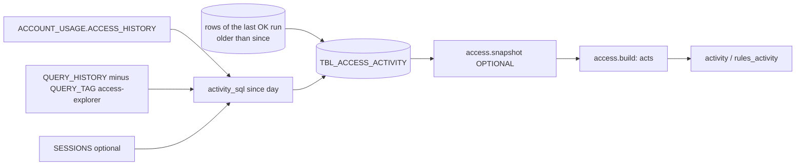

<!-- generated by darshan-singh-meel-knowledge-graph -->
Table use per day, user, role, client, object, action and statement, aggregated from ACCESS_HISTORY + QUERY_HISTORY + SESSIONS (query metadata only); feeds the Activity tabs and rules 24-28.

DDL: `sql/1_setup.sql:108-120`. Grain: run x day x user x role x client x object x action x query type (`GROUP BY 1, 2, 3, 4, 5, 6, 7`, `sql/1_setup.sql:556`). No PK declared; that grain is the logical key (inferred from the GROUP BY).

| Column | Type | Meaning | Sensitivity | Line |
|---|---|---|---|---|
| RUN_ID | VARCHAR(36) | run (logical FK -> TBL_ACCESS_RUN) | – | 110 |
| DAY | DATE | `QUERY_START_TIME::DATE` | – | 111 |
| USER_NAME | VARCHAR(255) | login name (logical FK -> TBL_ACCESS_USER, inferred) | personal (login name) | 112 |
| ROLE_NAME | VARCHAR(255) | the query's primary role (QUERY_HISTORY) | – | 113 |
| CLIENT | VARCHAR(255) | `SESSIONS.CLIENT_APPLICATION_ID` without its version; NULL when SESSIONS is not readable | – | 114 |
| OBJECT_NAME | VARCHAR(2000) | DB.SCHEMA.OBJECT as ACCESS_HISTORY names it | – | 115 |
| ACTION | VARCHAR(10) | READ (`DIRECT_OBJECTS_ACCESSED`), WRITE (`OBJECTS_MODIFIED`), DDL (`OBJECT_MODIFIED_BY_DDL`) | – | 116 |
| QUERY_TYPE | VARCHAR(100) | QUERY_HISTORY.QUERY_TYPE (SELECT, INSERT, MERGE, ALTER_TABLE_..., ...) | – | 117 |
| QUERIES | NUMBER | `COUNT(DISTINCT QUERY_ID)` | – | 118 |
| LAST_USED | TIMESTAMP_LTZ | `MAX(QUERY_START_TIME)` | personal (activity time) | 119 |

- SQL: `sql/1_setup.sql:528-556`, same text as `access.py:921-949` (checked by `test_sql.py:302`); window `ACTIVITY_DAYS = 60` (`sql/1_setup.sql:170`, `access.py:63`); the app's queries left out by `QUERY_TAG` (`sql/1_setup.sql:171`, `:552`).
- Written: `sql/1_setup.sql:559-582` — previous OK run's rows with `first <= DAY < since` copied under the new `RUN_ID`, then `activity_sql(since)` inserted (`sql/1_setup.sql:573-578`); not readable -> UNAVAILABLE, no fallback, the run stays OK; an error deletes this run's rows (`sql/1_setup.sql:580-582`).
- Versioning: one copy per run (`RUN_ID`); after an OK run other runs' rows are deleted like every `DATA` table (`sql/1_setup.sql:163`, `sql/1_setup.sql:630-635`); a FAILED run drops its rows (`sql/1_setup.sql:623-625`).
- Read as optional table (None if missing): `access.py:60-61`, `access.py:464-468`; lookup `acts` `access.py:983`, `access.py:1063`; Direct mode builds the same rows in memory (`access.py:883-892`).
- Granted to `&APP_ROLE` (may fail): `sql/1_setup.sql:880-881`. Verify: `sql/2_snapshot_verify.sql:39-42`. Dropped: `sql/3_cleanup.sql:65-66`.
- DuckDB copy: same columns, `cache.py:177-178`; DuckDB test of the procedure step: `test_sql.py:298-311`.
- Readers: `activity()`, `activity_graph()`, `activity_sensitive()`, `rules_activity()` (`access.py:4262-4397`, `access.py:5153-5204`) — see [logic/activity.md](../logic/activity.md).
