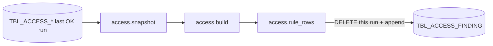

Rule findings per run, written by `SP_ACCESS_FINDINGS` (access.py's rule checks run inside Snowflake) for worksheet use.

DDL: `sql/1_setup.sql:109-119`. Grain: run x finding (inferred).

| Column | Type | Meaning | Line |
|---|---|---|---|
| RUN_ID | VARCHAR(36) | snapshot run checked | 110 |
| RULE_NUM | VARCHAR(10) | rule 1..23 | 111 |
| TITLE | VARCHAR(500) | | 112 |
| SEVERITY | VARCHAR(20) | High, Medium, Low | 113 |
| GRANTEE | VARCHAR(2000) | user, role or object (may be a user name) | 114 |
| KIND | VARCHAR(20) | user, admin, functional, technical, group, object | 115 |
| DETAIL | VARCHAR | | 116 |
| PATH | VARCHAR | `A > B > C` | 117 |
| CREATED_AT | TIMESTAMP_LTZ | default CURRENT_TIMESTAMP() | 118 |

- Procedure: `sql/1_setup.sql:683-745`; code from stage `STG_ACCESS_CODE` (`:676-681,689`).
- Flow: settings -> `access.snapshot` -> `build` -> `rule_rows` (`sql/1_setup.sql:713-725`); write in a transaction (`:730-740`).
- Not cleaned by SP_ACCESS_SNAPSHOT (`DATA` excludes it, `sql/1_setup.sql:147`): older runs' findings stay (inferred).
- Readers: SELECT granted to APP_ROLE `sql/1_setup.sql:785`; no reader in `access.py` / `server.py` (grep); not in the DuckDB copy (`cache.py:141-158`).
- Test: `test_sql.py:224-226` runs the DDL and procedure body on DuckDB.
