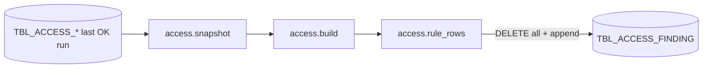

<!-- generated by darshan-singh-meel-knowledge-graph -->
Rule findings of the last run only, written by `SP_ACCESS_FINDINGS` (access.py's rule checks run inside Snowflake) for worksheet use.

DDL: `sql/1_setup.sql:161-171`. Grain: one row per finding of the last run (`DELETE FROM` the whole table before the append, `sql/1_setup.sql:1502`).

| Column | Type | Meaning | Line |
|---|---|---|---|
| RUN_ID | VARCHAR(36) | snapshot run checked | 132 |
| RULE_NUM | VARCHAR(10) | rule 1..29 | 133 |
| TITLE | VARCHAR(500) | | 134 |
| SEVERITY | VARCHAR(20) | High, Medium, Low | 135 |
| GRANTEE | VARCHAR(2000) | user, role or object (may be a user name) | 136 |
| KIND | VARCHAR(20) | user, admin, functional, technical, group, object | 137 |
| DETAIL | VARCHAR | | 138 |
| PATH | VARCHAR | `A > B > C` | 139 |
| CREATED_AT | TIMESTAMP_LTZ | default CURRENT_TIMESTAMP() | 140 |

- Procedure: `sql/1_setup.sql:1453-1515`; code from stage `STG_ACCESS_CODE` (`sql/1_setup.sql:1447-1451`, IMPORTS `sql/1_setup.sql:1459`).
- Flow: settings -> `access.snapshot` -> `build` -> `rule_rows` (`sql/1_setup.sql:1483-1495`); write in a transaction (`sql/1_setup.sql:1500-1509`).
- Not cleaned by SP_ACCESS_SNAPSHOT (`DATA` excludes it, `sql/1_setup.sql:202`); `SP_ACCESS_FINDINGS` empties it itself on every call, so only the last run's findings stay (`sql/1_setup.sql:1502`; README.md:294).
- Readers: SELECT granted to APP_ROLE `sql/1_setup.sql:1558`; no reader in `access.py` / `server.py` (grep); not in the DuckDB copy (`access.py:84-104`).
- Test: `test_sql.py:273-275` runs the DDL and procedure body on DuckDB.
