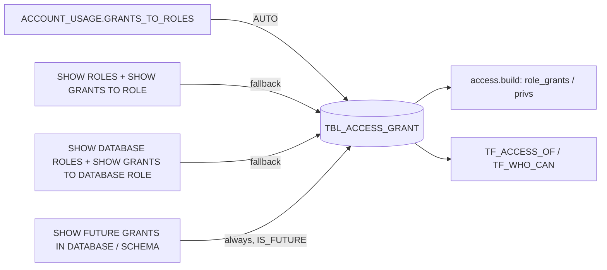

<!-- generated by darshan-singh-meel-knowledge-graph -->
Every grant to a role or database role: role -> object, role -> role (the role hierarchy) and future grants (`IS_FUTURE`).

DDL: `sql/1_setup.sql:24-33`. Grain: run x grantee x privilege x granted_on x object x future (inferred, no constraint).

| Column | Type | Meaning | Line |
|---|---|---|---|
| RUN_ID | VARCHAR(36) | run (logical FK) | 25 |
| GRANTEE_ROLE | VARCHAR(255) | role; database role as `DB.ROLE` | 26 |
| PRIVILEGE | VARCHAR(255) | USAGE, SELECT, OWNERSHIP, ... | 27 |
| GRANTED_ON | VARCHAR(255) | TABLE, VIEW, ROLE, DATABASE_ROLE, SCHEMA, ACCOUNT, ... | 28 |
| OBJECT_NAME | VARCHAR(2000) | `DB.SCHEMA.OBJECT` unquoted; future: `DB.SCHEMA.<TABLE>` | 29 |
| IS_FUTURE | BOOLEAN | future grant | 30 |
| GRANT_OPTION | BOOLEAN | with grant option | 31 |
| GRANTED_BY | VARCHAR(255) | granting role; NULL on future grants (`sql/1_setup.sql:477`) | 32 |

- ACCOUNT_USAGE path: `sql/1_setup.sql:374-382` (`DELETED_ON IS NULL`, `GRANTED_TO IN ('ROLE','DATABASE_ROLE')`; DB role grantee qualified `DB.ROLE` at `sql/1_setup.sql:375-376`; OBJECT_NAME built at `sql/1_setup.sql:378-380`; refused in full -> SHOW path, timed out -> the run fails, `sql/1_setup.sql:386-388`).
- SHOW path: roles `sql/1_setup.sql:394-403`, database roles `sql/1_setup.sql:409-432`, saved `sql/1_setup.sql:433`.
- Future grants: `sql/1_setup.sql:441-481` (STANDARD databases only `sql/1_setup.sql:448`; INFORMATION_SCHEMA skipped `sql/1_setup.sql:455`).
- Role link = USAGE on ROLE / DATABASE_ROLE, admin grantees dropped: `access.py:1534-1538`, `sql/1_setup.sql:982-986`.
- Other rows -> `privs` / `kinds`: `access.py:1540-1543`. Database roles collected: `access.py:1544-1547`.
- Built-in grants hidden unless `builtin=1`: `access.py:1505-1507,917-919`.
- Same shape from `live()`: `access.py:983-1020,622-642,666-670`; from `mine()`: `access.py:856-868` (no GRANT_OPTION / GRANTED_BY keys).
- Per-object fallbacks of tags / policies list tables and views from this table: `sql/1_setup.sql:547-551`.
