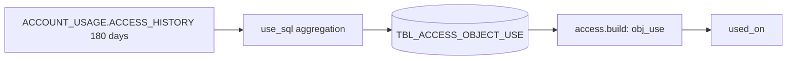

Objects each user read or wrote per ISO week, aggregated from ACCESS_HISTORY (query metadata only); feeds Granted vs used.

DDL: `sql/1_setup.sql:98-106`. Grain: run x user x object x week x action (`GROUP BY 1, 2, 3, 4`, `sql/1_setup.sql:478`).

| Column | Type | Meaning | Line |
|---|---|---|---|
| RUN_ID | VARCHAR(36) | run | 99 |
| USER_NAME | VARCHAR(255) | user | 100 |
| OBJECT_NAME | VARCHAR(2000) | as ACCESS_HISTORY names it | 101 |
| WEEK | DATE | Monday of the ISO week | 102 |
| ACTION | VARCHAR(10) | READ (DIRECT_OBJECTS_ACCESSED) / WRITE (OBJECTS_MODIFIED) | 103 |
| QUERIES | NUMBER | distinct queries | 104 |
| LAST_USED | TIMESTAMP_LTZ | last query | 105 |

- SQL: `sql/1_setup.sql:464-478`, same text as `access.py:839-853`; window `USE_DAYS=180` (`sql/1_setup.sql:153`, `access.py:60`).
- Written: `sql/1_setup.sql:481-494`; not readable -> UNAVAILABLE, no fallback, run stays OK.
- Read as optional table (None if missing): `access.py:59,411-415`; lookups `access.py:954-955`; `used_on` `access.py:4119-4130`.
- `mine()` returns no OBJECT_USE key (`access.py:551-553`); `build` tolerates it (`access.py:954`).
