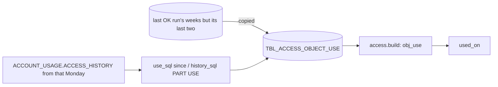

<!-- generated by darshan-singh-meel-knowledge-graph -->
Objects each user read or wrote per ISO week, aggregated from ACCESS_HISTORY (query metadata only); feeds Granted vs used.

DDL: `sql/1_setup.sql:98-106`. Grain: run x user x object x week x action (`GROUP BY 1, 2, 3, 4`, `sql/1_setup.sql:992`).

| Column | Type | Meaning | Line |
|---|---|---|---|
| RUN_ID | VARCHAR(36) | run | 99 |
| USER_NAME | VARCHAR(255) | user | 100 |
| OBJECT_NAME | VARCHAR(2000) | as ACCESS_HISTORY names it | 101 |
| WEEK | DATE | Monday of the ISO week | 102 |
| ACTION | VARCHAR(10) | READ (DIRECT_OBJECTS_ACCESSED) / WRITE (OBJECTS_MODIFIED) | 103 |
| QUERIES | NUMBER | distinct queries | 104 |
| LAST_USED | TIMESTAMP_LTZ | last query | 105 |

- SQL: `sql/1_setup.sql:969-992`, same text as `access.py:1659-1682`; window `USE_DAYS=180` (`sql/1_setup.sql:208`, `access.py:105`).
- Written: `sql/1_setup.sql:995-1019`: the last OK run's weeks are copied but its last two, then ACCESS_HISTORY is read from that Monday, normally inside the one `INSERT ALL` of `history()` shared with TBL_ACCESS_ACTIVITY (`sql/1_setup.sql:1119-1149`); not readable -> UNAVAILABLE, `ACTIVITY=0` -> SKIPPED, no fallback, run stays OK.
- `DATA_RETENTION_TIME_IN_DAYS = 0` (`sql/1_setup.sql:106`, `sql/1_setup.sql:154-155`).
- Read as optional table (None if missing): `access.py:82` (`OPTIONAL`), `access.py:567`, `access.py:581-589` (a failed read of an OPTIONAL table becomes None); lookups `access.py:1895-1896`; `used_on` `access.py:6581-6593`.
- `mine()` returns no OBJECT_USE key (`access.py:971-973`); `build` tolerates it (`access.py:1895`).
