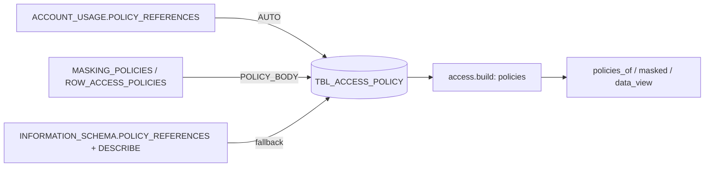

Masking and row access policies, where they are attached (object/column or tag) and their text.

DDL: `sql/1_setup.sql:78-87`. Grain: run x policy x object x column, or one row per tag for a tag-based policy (inferred).

| Column | Type | Meaning | Line |
|---|---|---|---|
| RUN_ID | VARCHAR(36) | run | 79 |
| POLICY_NAME | VARCHAR(500) | `DB.SCHEMA.POLICY` | 80 |
| POLICY_KIND | VARCHAR(50) | MASKING_POLICY, ROW_ACCESS_POLICY | 81 |
| OBJECT_NAME | VARCHAR(2000) | object; empty for a policy set on a tag | 82 |
| COLUMN_NAME | VARCHAR(255) | masked column | 83 |
| ARG_COLUMNS | VARCHAR(2000) | row access / conditional masking args | 84 |
| TAG_NAME | VARCHAR(500) | tag of a tag-based policy | 85 |
| POLICY_BODY | VARCHAR | policy text; role checks parsed, not evaluated | 86 |

- ACCOUNT_USAGE: `sql/1_setup.sql:423-434` (LEFT JOIN MASKING_POLICIES / ROW_ACCESS_POLICIES on POLICY_ID, `DELETED IS NULL`).
- Fallback: `sql/1_setup.sql:436-457`; body via DESCRIBE, NULL when refused (`:447-450`).
- Error -> UNAVAILABLE: `sql/1_setup.sql:458-460`.
- Read: `access.py:952`; `policies_of` `access.py:2151-2164` (row / column / tag-based via TAG_NAME); `masked` `access.py:2167-2173`.
- POLICY_BODY may contain role names or literals; whether it can hold personal data: unclear.
- Unclear: tag-domain rows and POLICY_STATUS marked "to verify" `sql/1_setup.sql:421-422`.
