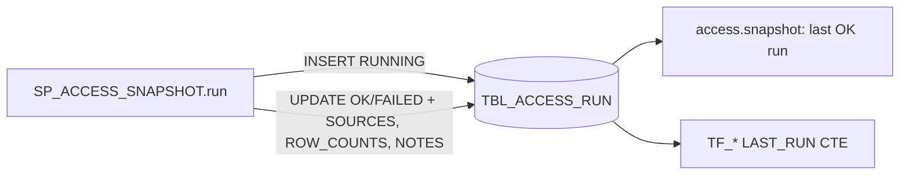

<!-- generated by darshan-singh-meel-knowledge-graph -->
Run log: one row per CALL of `SP_ACCESS_SNAPSHOT`, kept forever; readers pick the newest `STATUS = 'OK'` row.

DDL: `sql/1_setup.sql:13-21`.

| Column | Type | Meaning | Line |
|---|---|---|---|
| RUN_ID | VARCHAR(36) | uuid4 (`sql/1_setup.sql:1156`) | 14 |
| STARTED_AT | TIMESTAMP_LTZ | CALL start | 15 |
| FINISHED_AT | TIMESTAMP_LTZ | end; ordering key for "last run" | 16 |
| STATUS | VARCHAR(10) | RUNNING, OK, FAILED | 17 |
| SOURCES | VARIANT | dataset -> ACCOUNT_USAGE / SHOW / INFORMATION_SCHEMA / UNAVAILABLE | 18 |
| ROW_COUNTS | VARIANT | dataset -> rows | 19 |
| NOTES | VARIANT | dataset -> fallback reason, skipped roles, error | 20 |

- Written: INSERT `sql/1_setup.sql:1159`; UPDATE `sql/1_setup.sql:1224-1227`; row counts `sql/1_setup.sql:1218-1220`.
- Busy guard (insert first, then look: the run's RUNNING row goes in, then the earliest RUNNING run of the last hour (ORDER BY STARTED_AT, RUN_ID) goes on and any other deletes its own row and returns SKIPPED, so two CALLs a moment apart can no longer both start): `sql/1_setup.sql:1157-1165`; test `test_run_overlap` (`test_sql.py:559`).
- Read: `access.py:548-575` (RUN_ID, FINISHED_AT, SOURCES, NOTES; VARIANT parsed from JSON text); `sql/1_setup.sql:1260` (TF LAST_RUN); `sql/2_snapshot_verify.sql:5-6`.
- Dataset keys in SOURCES: grants, user_roles, future_grants, users, usage, tags, policies, streams, object_use (`sql/1_setup.sql:1187-1203`).
- Triggered from the app: Rebuild snapshot -> `CALL SP_ACCESS_SNAPSHOT('AUTO')` (`server.py:4092-4149`).
