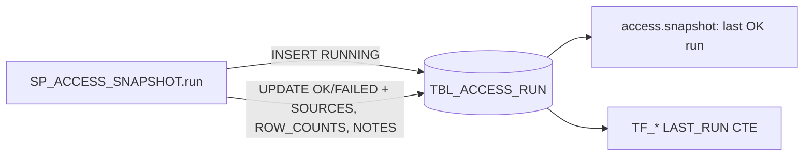

Run log: one row per CALL of `SP_ACCESS_SNAPSHOT`, kept forever; readers pick the newest `STATUS = 'OK'` row.

DDL: `sql/1_setup.sql:13-21`.

| Column | Type | Meaning | Line |
|---|---|---|---|
| RUN_ID | VARCHAR(36) | uuid4 (`sql/1_setup.sql:505`) | 14 |
| STARTED_AT | TIMESTAMP_LTZ | CALL start | 15 |
| FINISHED_AT | TIMESTAMP_LTZ | end; ordering key for "last run" | 16 |
| STATUS | VARCHAR(10) | RUNNING, OK, FAILED | 17 |
| SOURCES | VARIANT | dataset -> ACCOUNT_USAGE / SHOW / INFORMATION_SCHEMA / UNAVAILABLE | 18 |
| ROW_COUNTS | VARIANT | dataset -> rows | 19 |
| NOTES | VARIANT | dataset -> fallback reason, skipped roles, error | 20 |

- Written: INSERT `sql/1_setup.sql:506`; UPDATE `sql/1_setup.sql:533-536`; row counts `sql/1_setup.sql:527-529`.
- Busy guard: a RUNNING run started within 1 h -> SKIPPED: `sql/1_setup.sql:501-504`.
- Read: `access.py:403-409` (RUN_ID, FINISHED_AT, SOURCES, NOTES; VARIANT parsed from JSON text); `sql/1_setup.sql:566,626`; `sql/2_snapshot_verify.sql:5-6`.
- Dataset keys in SOURCES: grants, user_roles, future_grants, users, usage, tags, policies, streams, object_use (`sql/1_setup.sql:515-523`).
- Triggered from the app: Rebuild snapshot -> `CALL SP_ACCESS_SNAPSHOT('AUTO')` (`server.py:2126-2140`).
