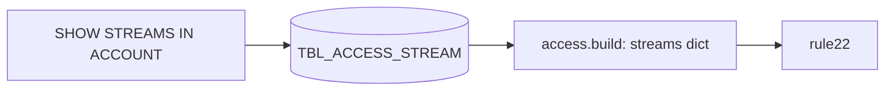

<!-- generated by darshan-singh-meel-knowledge-graph -->
Streams and the table they read; input of rule 22 (stream on a sensitive table without table read).

DDL: `sql/1_setup.sql:90-95`. Grain: run x stream.

| Column | Type | Meaning | Line |
|---|---|---|---|
| RUN_ID | VARCHAR(36) | run | 91 |
| STREAM_NAME | VARCHAR(2000) | `DB.SCHEMA.STREAM` | 92 |
| SOURCE_NAME | VARCHAR(2000) | `DB.SCHEMA.TABLE` it reads | 93 |
| SOURCE_TYPE | VARCHAR(50) | Table, View, ... | 94 |

- Written: `sql/1_setup.sql:489-500` (no ACCOUNT_USAGE view; only streams the owner role sees; error -> UNAVAILABLE).
- Read: `access.py:1087` (`streams[STREAM_NAME] = SOURCE_NAME`); rule 22 `access.py:5428-5440` (source in `sensitive()`, stream readers via `on`).
- Unclear: SHOW STREAMS column names marked "to verify" `sql/1_setup.sql:492`.
