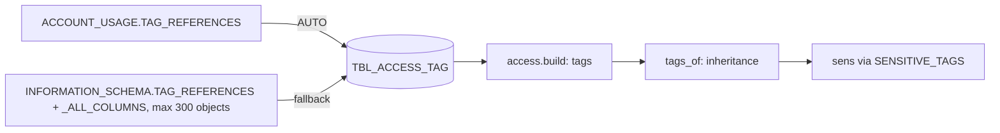

<!-- generated by darshan-singh-meel-knowledge-graph -->
Tags on databases, schemas, tables/views and columns; the basis of "sensitive" objects and columns.

DDL: `sql/1_setup.sql:67-75`. Grain: run x object x domain x column x tag (inferred).

| Column | Type | Meaning | Line |
|---|---|---|---|
| RUN_ID | VARCHAR(36) | run | 68 |
| OBJECT_NAME | VARCHAR(2000) | DB · DB.SCHEMA · DB.SCHEMA.OBJECT, by DOMAIN | 69 |
| DOMAIN | VARCHAR(50) | DATABASE, SCHEMA, TABLE, COLUMN | 70 |
| COLUMN_NAME | VARCHAR(255) | column when DOMAIN = COLUMN | 71 |
| TAG_NAME | VARCHAR(500) | `TAG_DB.TAG_SCHEMA.TAG_NAME` | 72 |
| TAG_VALUE | VARCHAR(500) | value | 73 |
| APPLY_METHOD | VARCHAR(50) | MANUAL, CLASSIFIED, PROPAGATED, INHERITED, ... | 74 |

- ACCOUNT_USAGE: `sql/1_setup.sql:408-415` (`OBJECT_DELETED IS NULL`; Enterprise edition, `:374-375`).
- Fallback per table/view of the grant data: `sql/1_setup.sql:417-434` (objects from `data_objects` `:349-353`; cap `TAG_FALLBACK_MAX=300` `:152`).
- Error -> UNAVAILABLE, this run's rows deleted, run stays OK: `sql/1_setup.sql:435-437`.
- Read: `access.py:1085`; inheritance DB > schema > table > column `access.py:2225-2241`; sensitive set `access.py:1091-1095`; `SENSITIVE_TAGS` default `access.py:74-75`.
- Unclear: OBJECT_NAME / APPLY_METHOD semantics marked "to verify" `sql/1_setup.sql:406-407,382-383`.
