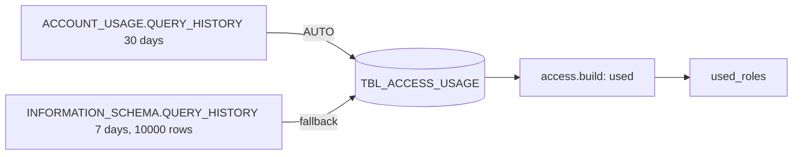

<!-- generated by darshan-singh-meel-knowledge-graph -->
Roles, secondary roles and warehouses each user actually used, aggregated from query history.

DDL: `sql/1_setup.sql:57-64`. Grain: run x user x kind x name (`GROUP BY 2, 4`, `sql/1_setup.sql:347-355`).

| Column | Type | Meaning | Line |
|---|---|---|---|
| RUN_ID | VARCHAR(36) | run | 58 |
| USER_NAME | VARCHAR(255) | user | 59 |
| KIND | VARCHAR(20) | ROLE, SECONDARY ROLE, WAREHOUSE | 60 |
| NAME | VARCHAR(255) | role or warehouse | 61 |
| QUERIES | NUMBER | query count | 62 |
| LAST_USED | TIMESTAMP_LTZ | last query | 63 |

- Aggregation SQL: `sql/1_setup.sql:344-356`; SECONDARY ROLE from `SECONDARY_ROLE_STATS:roleNames`, ACCOUNT_USAGE only (`:324-329`).
- Window: 30 days (`DAYS`, `sql/1_setup.sql:175,325-326`); fallback 7 days / 10000 queries (`:342-344`); else UNAVAILABLE (`:345-346`).
- Read: `access.py:1079-1080` -> `used_roles` `access.py:2203-2206`.
- NAME -> role when KIND is ROLE / SECONDARY ROLE: inferred link to `TBL_ACCESS_GRANT.GRANTEE_ROLE`.
- My access: per-user aggregation, 30 days ACCOUNT_USAGE else `QUERY_HISTORY_BY_USER` 7 days (`access.py:601-616`).
