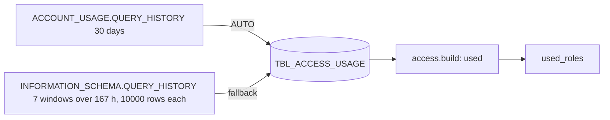

<!-- generated by darshan-singh-meel-knowledge-graph -->
Roles, secondary roles and warehouses each user actually used, aggregated from query history.

DDL: `sql/1_setup.sql:57-64`. Grain: run x user x kind x name (`GROUP BY 2, 4`, `sql/1_setup.sql:519-528`).

| Column | Type | Meaning | Line |
|---|---|---|---|
| RUN_ID | VARCHAR(36) | run | 58 |
| USER_NAME | VARCHAR(255) | user | 59 |
| KIND | VARCHAR(20) | ROLE, SECONDARY ROLE, WAREHOUSE | 60 |
| NAME | VARCHAR(255) | role or warehouse | 61 |
| QUERIES | NUMBER | query count | 62 |
| LAST_USED | TIMESTAMP_LTZ | last query | 63 |

- Aggregation SQL: `sql/1_setup.sql:516-529`; SECONDARY ROLE from `SECONDARY_ROLE_STATS:roleNames`, ACCOUNT_USAGE only (`sql/1_setup.sql:524-528`).
- Window: 30 days (`DAYS`, `sql/1_setup.sql:206`, `sql/1_setup.sql:533-534`); fallback INFORMATION_SCHEMA.QUERY_HISTORY in 7 time windows over the last 167 h (hour marks 167, 144, ..., 24, now), each call at most 10000 queries, the owner's view only (`sql/1_setup.sql:536-542`, as `access.week`); else UNAVAILABLE (`sql/1_setup.sql:543-544`).
- Read: `access.py:1559-1560` -> `used_roles` `access.py:2845-2848`.
- NAME -> role when KIND is ROLE / SECONDARY ROLE: inferred link to `TBL_ACCESS_GRANT.GRANTEE_ROLE`.
- My access: per-user aggregation, 30 days ACCOUNT_USAGE else `QUERY_HISTORY_BY_USER` 7 days (`access.py:911-922`).
