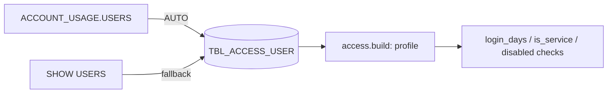

<!-- generated by darshan-singh-meel-knowledge-graph -->
User profile per run: type, disabled flag, defaults and last login.

DDL: `sql/1_setup.sql:44-54`. Grain: run x user.

| Column | Type | Meaning | Line |
|---|---|---|---|
| RUN_ID | VARCHAR(36) | run | 45 |
| USER_NAME | VARCHAR(255) | user (personal identifier) | 46 |
| TYPE | VARCHAR(50) | PERSON, SERVICE, LEGACY_SERVICE; empty = PERSON | 47 |
| DISABLED | BOOLEAN | disabled | 48 |
| DEFAULT_ROLE | VARCHAR(255) | default role | 49 |
| DEFAULT_SECONDARY_ROLES | VARCHAR(255) | e.g. `["ALL"]` | 50 |
| DEFAULT_WAREHOUSE | VARCHAR(255) | | 51 |
| DEFAULT_NAMESPACE | VARCHAR(500) | | 52 |
| LAST_SUCCESS_LOGIN | TIMESTAMP_LTZ | last login (personal activity data) | 53 |

- Written: `sql/1_setup.sql:508-511` (`OBJECT_CONSTRUCT(*)`: the secondary-roles column name varies, `sql/1_setup.sql:507`) or `sql/1_setup.sql:518-525` (SHOW, when the full read is refused; a timeout fails the run, `sql/1_setup.sql:513-514`).
- Read: `access.py:1885` (`profile`); `login_days` `access.py:3254-3256`; service / disabled `access.py:3265-3269`; default role `access.py:2497,3254`.
- My access: from `DESC USER`; LAST_SUCCESS_LOGIN None + `LOGIN_UNKNOWN=True` (`access.py:943-948`).
- Which rules use which column (dormant, disabled, default role): inferred from CLAUDE.md rule list, not traced per rule here.
