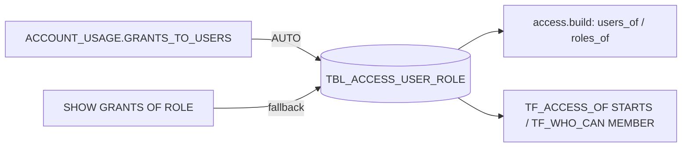

Role -> user grants: which account roles each user holds directly.

DDL: `sql/1_setup.sql:36-41`. Grain: run x user x role.

| Column | Type | Meaning | Line |
|---|---|---|---|
| RUN_ID | VARCHAR(36) | run | 37 |
| USER_NAME | VARCHAR(255) | user (personal identifier) | 38 |
| ROLE_NAME | VARCHAR(255) | granted role | 39 |
| GRANTED_BY | VARCHAR(255) | granting role | 40 |

- Written: `sql/1_setup.sql:221-222` (ACCOUNT_USAGE, `DELETED_ON IS NULL`) or `:232-234,255` (SHOW, `granted_to = USER`).
- Source recorded together with grants: `sql/1_setup.sql:223,257`.
- Read: `access.py:934,938-940`; `sql/1_setup.sql:567-569,583-584` (TF_ACCESS_OF), `:631-635` (TF_WHO_CAN; PUBLIC added for every user).
- My access: ROLE_NAME from `SHOW GRANTS TO USER`, else APPLICABLE_ROLES, else CURRENT_AVAILABLE_ROLES (`access.py:514-523,551`).
