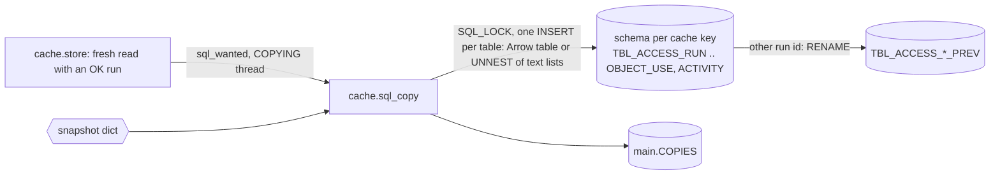

<!-- generated by darshan-singh-meel-knowledge-graph -->
DuckDB copy: after each read from Snowflake, `cache.sql_copy` writes the snapshot dict to `.cache/access.duckdb` as the `TBL_ACCESS_` tables (plus `_PREV` of the read before), for the user to query with SQL; the app never reads it.

## Layout

- File: `.cache/access.duckdb` (`cache.py:209-210`); git-ignored `.cache/` (`.gitignore:7`).
- One schema per cache key: `schema(key)` = key with non-word chars -> `_`, lower case (`cache.py:213-215`); key from `cache.name` (`cache.py:58-64`).
- Tables: the 9 `TBL_ACCESS_` data + run tables, columns from `COLUMNS` (`access.py:79-99`, `cache.py:204`); `TBL_ACCESS_FINDING` is not copied.
- `COPIES` in main: SCHEMA_NAME, CACHE_KEY, RUN_ID, READ_AT, PREV_RUN_ID (`cache.py:271-272`), one row per schema (delete + insert `cache.py:297-299`).

## Type mapping (Snowflake -> DuckDB)

| Snowflake (`sql/1_setup.sql`) | DuckDB (`access.py:79-99`) |
|---|---|
| VARCHAR(n) | VARCHAR |
| TIMESTAMP_LTZ | TIMESTAMPTZ |
| VARIANT (RUN.SOURCES / ROW_COUNTS / NOTES) | JSON |
| NUMBER (QUERIES) | BIGINT |
| BOOLEAN, DATE | BOOLEAN, DATE |

- Values loaded as text then `TRY_CAST` to the column type (`cache.py:286-296`): bad values become NULL.

## Write steps (`cache.py:239-305`)

1. Skip with a note when duckdb is not installed (`cache.py:244-248`). The whole write holds `SQL_LOCK` and runs as `access.step("DuckDB copy (access.duckdb)")` in the load log: every cache key writes the one file (`cache.py:266`).
2. Run id: snapshot RUN_ID; for `""`, `direct`, `live`, `fake` -> `<rid or read>-YYYYmmddHHMMSS` per read (`cache.py:253-256`).
3. `TBL_ACCESS_RUN` row is synthesized: STARTED_AT NULL, STATUS OK, ROW_COUNTS from the dict lists (`cache.py:258-262`).
4. One transaction (`cache.py:270`, `cache.py:300`); if `COPIES` has another run id for this schema -> drop old `_PREV`, rename current to `_PREV` (`cache.py:274-280`).
5. Recreate each table and load it in one INSERT, with a line "DuckDB copy: TBL_ACCESS_<t>, N rows": one text list per column (`text()` only for values not text yet: dicts / lists as compact JSON, booleans true / false), RUN_ID repeated as the run id; with pyarrow the lists are registered as an Arrow table `src` and inserted with `TRY_CAST("<col>" AS <type>) FROM src` (one scan, about 5x faster on a million rows), else `TRY_CAST(UNNEST(?::VARCHAR[]) AS <type>)`; no temp file (`cache.py:281-296`, `cache.py:230-236`).
6. Record in `COPIES`; PREV_RUN_ID = the replaced run (`cache.py:297-299`). Failure -> note in `SQL[key]` (`cache.py:304-305`); nothing to clean up.

## When it is written

- `sql_wanted`: never inside Snowflake; fake data only with `DUCKDB=1`; Snowflake reads when a local copy may be kept (`CACHE_HOURS > 0`); there is no off switch (`cache.py:218-223`).
- Started by `cache.store` in a daemon thread (`COPYING[key]`, `cache.py:150-153`) after a fresh read that has an OK run (a no-run read is never copied, `cache.py:148`); the app never waits for it; `sql_info` says "Being written now" while the thread runs (`cache.py:314-316`).
- UI info: `sql_info` (`cache.py:308-317`), sent by `server.py:3090,2108`.
- Example queries (EXCEPT against `_PREV`): `README.md:246-261`.

## Unclear

- `COPIES` grows one row per cache key and is never pruned (inferred from `cache.py:297-299`; no delete of other schemas found).
