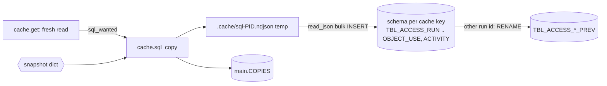

<!-- generated by darshan-singh-meel-knowledge-graph -->
DuckDB copy: after each read from Snowflake, `cache.sql_copy` writes the snapshot dict to `.cache/access.duckdb` as the `TBL_ACCESS_` tables (plus `_PREV` of the read before), for the user to query with SQL; the app never reads it.

## Layout

- File: `.cache/access.duckdb` (`cache.py:184-185`); git-ignored `.cache/` (`.gitignore:7`).
- One schema per cache key: `schema(key)` = key with non-word chars -> `_`, lower case (`cache.py:188-190`); key from `cache.name` (`cache.py:43-48`).
- Tables: the 9 `TBL_ACCESS_` data + run tables, columns from `COLUMNS` (`cache.py:160-180`); `TBL_ACCESS_FINDING` is not copied.
- `COPIES` in main: SCHEMA_NAME, CACHE_KEY, RUN_ID, READ_AT, PREV_RUN_ID (`cache.py:232-233`), one row per schema (delete + insert `cache.py:252-254`).

## Type mapping (Snowflake -> DuckDB)

| Snowflake (`sql/1_setup.sql`) | DuckDB (`cache.py:160-180`) |
|---|---|
| VARCHAR(n) | VARCHAR |
| TIMESTAMP_LTZ | TIMESTAMPTZ |
| VARIANT (RUN.SOURCES / ROW_COUNTS / NOTES) | JSON |
| NUMBER (QUERIES) | BIGINT |
| BOOLEAN, DATE | BOOLEAN, DATE |

- Values loaded as VARCHAR then `TRY_CAST` to the column type (`cache.py:249-251`): bad values become NULL.

## Write steps (`cache.py:205-262`)

1. Skip with a note when duckdb is not installed (`cache.py:210-214`).
2. Run id: snapshot RUN_ID; for `""`, `direct`, `live`, `fake` -> `<rid or read>-YYYYmmddHHMMSS` per read (`cache.py:215-218`).
3. `TBL_ACCESS_RUN` row is synthesized: STARTED_AT NULL, STATUS OK, ROW_COUNTS from the dict lists (`cache.py:220-224`).
4. One transaction (`cache.py:231,233`); if `COPIES` has another run id for this schema -> drop old `_PREV`, rename current to `_PREV` (`cache.py:235-241`).
5. Recreate each table and bulk load from a JSON lines temp file, RUN_ID set to the run id (`cache.py:242-251`).
6. Record in `COPIES`; PREV_RUN_ID = the replaced run (`cache.py:252-254`). Failure -> note in `SQL[key]` (`cache.py:259-260`); temp file removed (`cache.py:261-262`).

## When it is written

- `sql_wanted`: never inside Snowflake or with `DUCKDB=0`; fake data only with `DUCKDB=1`; Snowflake reads when a local copy may be kept (`CACHE_HOURS > 0`) (`cache.py:193-198`).
- Called from `cache.get` only on a fresh read, before the `.pkl` write (`cache.py:122-125`).
- UI info: `sql_info` (`cache.py:265-273`), sent by `server.py:2149,2108`.
- Example queries (EXCEPT against `_PREV`): `README.md:209-224`.

## Unclear

- `COPIES` grows one row per cache key and is never pruned (inferred from `cache.py:252-254`; no delete of other schemas found).
