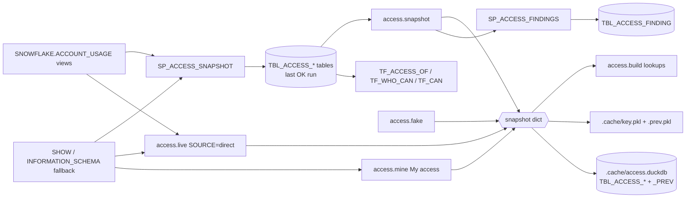
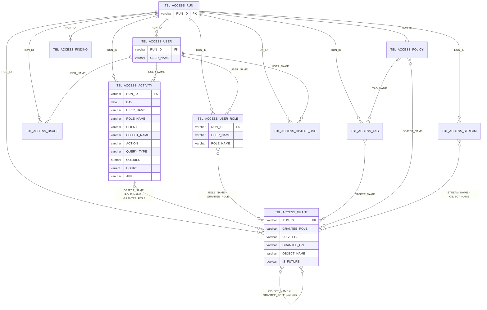

<!-- generated by darshan-singh-meel-knowledge-graph -->
Data model: 11 Snowflake `TBL_ACCESS_` tables (10 snapshot + findings), one in-memory snapshot dict, and a local DuckDB copy; all metadata, never business data.

## Flow

- SP writes: `sql/1_setup.sql:608-659`; snapshot read: `access.py:465-484`; live: `access.py:634-922`; mine: `access.py:544-627`.
- Cache / DuckDB: `cache.py:107-133`, `cache.py:205-262`. Findings: `sql/1_setup.sql:832-863`.

## ER diagram (logical; no PK/FK declared in DDL)

- Role link: `GRANTED_ON IN ('ROLE','DATABASE_ROLE') AND PRIVILEGE='USAGE'`, grantee not an admin role: `sql/1_setup.sql:696-700`, `access.py:1063-1067`.
- Tag inheritance: a tag row counts for an object when its `OBJECT_NAME` equals the object (own or column tag), or equals the object's `DB.SCHEMA` (SCHEMA row) or `DB` (DATABASE row) from `split_name(obj)`: exact matches, not a prefix match (`access.py:2234-2250`).
- Tag-based policy (`OBJECT_NAME` empty) joins by `TAG_NAME`: `access.py:2304-2307`.
- Stream → sensitive source (rule 22): `access.py:5459-5471`.
- Activity → grants (inferred): rules 24-28 use only objects known from the grants (`o in kinds`, `access.py:5522`), and `used_path` walks from `ROLE_NAME` to a grant on `OBJECT_NAME` (`access.py:4603-4605`).
- Full list with evidence: `data/model.json` → `relationships`.

## Versioning

- Every data row carries `RUN_ID`; after an OK run all other runs' rows are deleted, except those of a run still RUNNING and started within the last day (an older one is taken as dead): `sql/1_setup.sql:653-658`.
- FAILED run deletes its own rows: `sql/1_setup.sql:646-648`. A second CALL within 1 h of a RUNNING one is SKIPPED (insert first, then look: the run's RUNNING row goes in, then the earliest RUNNING run of the last hour (ORDER BY STARTED_AT, RUN_ID) goes on and any other deletes its own row and returns SKIPPED, so two CALLs a moment apart can no longer both start): `sql/1_setup.sql:613-621`.
- `TBL_ACCESS_ACTIVITY` is carried forward: the new run copies the previous OK run's rows older than the day before its last day, then reads only from there (`sql/1_setup.sql:591-601`); 60 days kept (`ACTIVITY_DAYS`, `sql/1_setup.sql:178`). Its `DAY` and `HOURS` are UTC (`sql/1_setup.sql:120`, `sql/1_setup.sql:554`).
- `TBL_ACCESS_RUN` keeps every run (`sql/1_setup.sql:13`). `TBL_ACCESS_FINDING` keeps only the last run: each `SP_ACCESS_FINDINGS` call deletes every row, then appends, in one transaction (`sql/1_setup.sql:849-851`).
- Readers take the newest OK run: `access.py:467-468` (ORDER BY FINISHED_AT), `sql/1_setup.sql:685` (MAX_BY).

## Views and derived sets

| View | Built from | Rows |
|---|---|---|
| `TF_ACCESS_OF(NAME, MAX_DEPTH)` (`sql/1_setup.sql:676-735`) | RUN, USER_ROLE, USER, GRANT (last OK run) | one per path × privilege a user/role reaches |
| `TF_WHO_CAN(OBJECT_NAME, PRIVILEGE, MAX_DEPTH)` (`sql/1_setup.sql:737-778`) | RUN, USER_ROLE, USER, GRANT | one per role or user × path to the object |
| `TF_CAN(USER_NAME, PRIVILEGE, OBJECT_NAME)` (`sql/1_setup.sql:780-792`) | `TF_ACCESS_OF` | one per path; no rows = no access |
| snapshot dict (`access.py:465-484`) | TBL_ACCESS_* of last OK run, or live / mine / fake | one list of row dicts per table + `run` |
| DuckDB `TBL_ACCESS_*` (`cache.py:237-251`) | snapshot dict of one read | same as the Snowflake table |
| DuckDB `TBL_ACCESS_*_PREV` (`cache.py:239-241`) | DuckDB tables of the read before | same as the Snowflake table |
| `.cache/<key>.prev.pkl` (`cache.py:72-90`) | replaced `.pkl` of another run | whole dict (What changed, `server.py:1730`) |

## Pages

- Tables: [TBL_ACCESS_RUN](TBL_ACCESS_RUN.md) · [GRANT](TBL_ACCESS_GRANT.md) · [USER_ROLE](TBL_ACCESS_USER_ROLE.md) · [USER](TBL_ACCESS_USER.md) · [USAGE](TBL_ACCESS_USAGE.md) · [TAG](TBL_ACCESS_TAG.md) · [POLICY](TBL_ACCESS_POLICY.md) · [STREAM](TBL_ACCESS_STREAM.md) · [OBJECT_USE](TBL_ACCESS_OBJECT_USE.md) · [ACTIVITY](TBL_ACCESS_ACTIVITY.md) · [FINDING](TBL_ACCESS_FINDING.md)
- [snapshot-dict.md](snapshot-dict.md) · [duckdb-copy.md](duckdb-copy.md)

## Unclear

- No PK, UNIQUE or FK constraints in any DDL (`sql/1_setup.sql:13-141`): every key is logical.
- Source column semantics marked "to verify" in setup: tags `sql/1_setup.sql:407-408`, policies `:421-422`, DESCRIBE body `:447`, SHOW STREAMS columns `:466`.
- `TBL_ACCESS_FINDING`: no reader in the app (grep of `access.py`, `server.py`); not in the DuckDB copy (`cache.py:160-180`).
