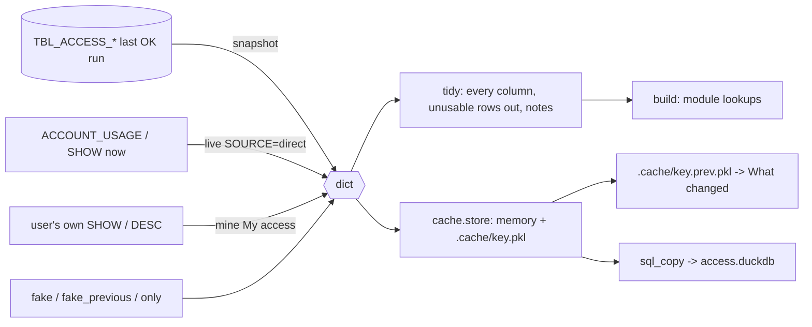

<!-- generated by darshan-singh-meel-knowledge-graph -->
The snapshot dict: the one in-memory shape every loader returns and `access.build()` consumes; one key per `TBL_ACCESS_` table plus `run`.

## Keys

| Key | Table | Row keys | Consumed in `build` |
|---|---|---|---|
| `run` | `TBL_ACCESS_RUN` (one row) | RUN_ID, FINISHED_AT, SOURCES, NOTES (`access.py:548-575`) | `access.py:1891` |
| `GRANT` | `TBL_ACCESS_GRANT` | GRANTEE_ROLE, PRIVILEGE, GRANTED_ON, OBJECT_NAME, IS_FUTURE, GRANT_OPTION, GRANTED_BY | `access.py:1852-1871` |
| `USER_ROLE` | `TBL_ACCESS_USER_ROLE` | USER_NAME, ROLE_NAME, GRANTED_BY | `access.py:1875` |
| `USER` | `TBL_ACCESS_USER` | USER_NAME, TYPE, DISABLED, DEFAULT_*, LAST_SUCCESS_LOGIN | `access.py:1885` |
| `USAGE` | `TBL_ACCESS_USAGE` | USER_NAME, KIND, NAME, QUERIES, LAST_USED | `access.py:1886-1887` |
| `TAG` | `TBL_ACCESS_TAG` | OBJECT_NAME, DOMAIN, COLUMN_NAME, TAG_NAME, TAG_VALUE, APPLY_METHOD | `access.py:1892` |
| `POLICY` | `TBL_ACCESS_POLICY` | POLICY_NAME, POLICY_KIND, OBJECT_NAME, COLUMN_NAME, ARG_COLUMNS, TAG_NAME, POLICY_BODY | `access.py:1893` |
| `STREAM` | `TBL_ACCESS_STREAM` | STREAM_NAME, SOURCE_NAME, SOURCE_TYPE | `access.py:1894` |
| `OBJECT_USE` | `TBL_ACCESS_OBJECT_USE` (optional) | USER_NAME, OBJECT_NAME, WEEK, ACTION, QUERIES, LAST_USED | `access.py:1895-1896` |
| `ACTIVITY` | `TBL_ACCESS_ACTIVITY` (optional) | DAY, USER_NAME, ROLE_NAME, CLIENT, OBJECT_NAME, ACTION, QUERY_TYPE, QUERIES, LAST_USED | `access.py:1897` (`acts`) |

- Mapping key -> table: `TABLES` / `OPTIONAL` `access.py:81-82`, `SELECT * EXCLUDE (RUN_ID) FROM {where}.TBL_ACCESS_{t}` `access.py:581`.
- No producer's rows carry RUN_ID: `snapshot()` reads `SELECT * EXCLUDE (RUN_ID)` (`access.py:581`); `live()` / `mine()` rows have no RUN_ID key (`access.py:1262-1303,483-484`).
- `ACTIVITY=0`: `OBJECT_USE` and `ACTIVITY` are `[]` and `run.SOURCES` say `SKIPPED` (`access.py:605-606`, `access.py:1613`, `access.py:1625`).
- `OBJECT_USE` and `ACTIVITY` are None when the table is missing (older setup): `access.py:589`; `act_state()` then explains it (`access.py:6033-6035`). Direct mode reads `ACTIVITY` incrementally from the kept dict (`server.py:172-174`, `access.py:1615-1625`).

## Shape guaranteed by `tidy()` (`access.py:1952-2012`)

- Once per data set and code version: tidy() returns early when d["_tidy"] equals tidy_stamp() (`access.py:1958`) and sets `_tidy` before it returns (`access.py:2011`), so a rebuild of the same set (restart, What if) skips the row scan; `test_missing_names` checks it (`test_access.py:921-924`).
- `run` is a dict with dict `SOURCES` and `NOTES`; every table key is a list of dicts with every column of `sql/1_setup.sql` (`COLUMNS`, `access.py:84-104`; missing columns None; `GRANT_OPTION`, `GRANTED_BY` filled without a note, `QUIET` `access.py:1908`); an `OPTIONAL` table that is None stays None.
- A missing table -> `[]`, its source `UNAVAILABLE`, a note (`access.py:1965-1971`).
- Rows without the `NEED` columns (`access.py:1909-1912`), a parseable DAY / WEEK or an action READ / WRITE / DDL (`usable`, `access.py:1937-1943`) are left out; NOTES `missing_names` counts them with up to 3 short examples (`access.py:1997-2006`).
- Snapshot tables lacking newer columns -> NOTES `missing_columns` ("run sql/1_setup.sql again") (`access.py:2007-2009`; not for live / direct reads).
- ACTIVITY `HOURS` becomes `{hour: queries}` (`hours`, `access.py:1920-1934`).
- Explained on the page by `server.note_info` (`server.py:590-645`); [business_rule:missing_data_never_fails](../logic/rules.md).

## Producers

| Producer | `run.RUN_ID` | Evidence | Notes |
|---|---|---|---|
| `snapshot(query, where, old)` | uuid of the last OK run | `access.py:546-609` | no OK run, no RUN_ID or `TBL_ACCESS_RUN` unreadable -> every table `[]`, RUN_ID None, every source UNAVAILABLE, NOTES `no_run` (`access.py:556-565`); a table that fails -> `[]`, UNAVAILABLE, noted, in `run.UNREAD` (`access.py:590-594`); the run held (`old`) is returned as is (`access.py:568-573`) |
| `live(query)` | `"direct"` | `access.py:1222-1656` | same sources as SP_ACCESS_SNAPSHOT; `FINISHED_AT` = CURRENT_TIMESTAMP (`access.py:1247`, `access.py:1656`) |
| `mine(query, db)` | `"live"` | `access.py:815-973` | TAG / POLICY / STREAM empty, no OBJECT_USE; tags/policies UNAVAILABLE (`access.py:967`) |
| `fake()` | `"fake"` | `access.py:218-439` | `access.py:435,344-345` |
| `fake_previous()` | `"fake-previous"` | `access.py:532-543` | What changed demo |
| `only(d, user)` | `"live"` | `access.py:1785-1794` | demo of mine() |

- Shared data chosen by `server.read_shared` `server.py:164-176` (fake / live / snapshot by MODE and SOURCE from `cache.config()` `cache.py:43-56`, `server.py:27`), cached via `load_shared` `server.py:220-241` (stage 1 parts in `.cache/reads/<key>/`, [flows/two-stage-load.md](../flows/two-stage-load.md)).
- My access: `server.py:300-307` (`cache.get(cache.name("mine", ...), a.mine)`).
- SP_ACCESS_FINDINGS also builds it inside Snowflake: `sql/1_setup.sql:1493-1494`.

## Kept where

- Memory `cache.MEM`, 24 h (`TTL`): `cache.py:30-31,95-98`.
- `.cache/<key>.pkl` for `CACHE_HOURS` (24, 0 = memory only), not inside Snowflake: `cache.py:29,51-57,99-114`.
- Previous run kept as `<key>.prev.pkl` (only if a different RUN_ID / FINISHED_AT): `cache.py:90-99`; read by `cache.prev` `cache.py:102-108` for What changed `server.py:3120`.
- `drop` sets the file aside as `.old.pkl` (Read again): `cache.py:190-200`.
- Cache key = account, source/what, snapshot location, user, role: `cache.py:59-65`; server `KEY` `server.py:29`.
- `build()` keeps `KEEP_BUILT` (3) built data sets: `access.py:1814-1815,903-909`.
