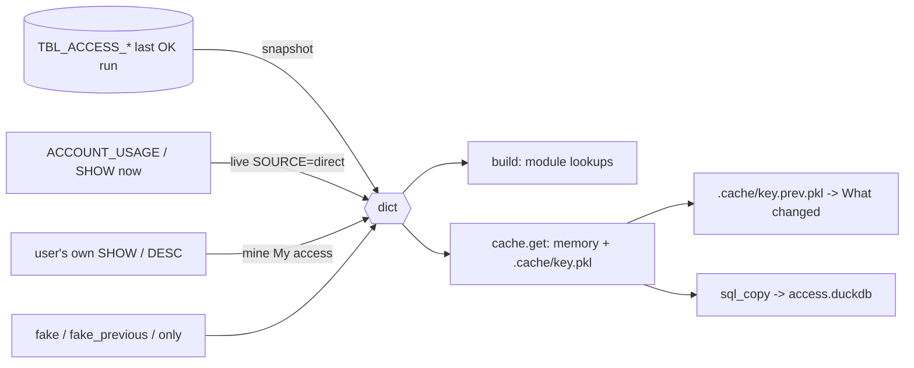

The snapshot dict: the one in-memory shape every loader returns and `access.build()` consumes; one key per `TBL_ACCESS_` table plus `run`.

## Keys

| Key | Table | Row keys | Consumed in `build` |
|---|---|---|---|
| `run` | `TBL_ACCESS_RUN` (one row) | RUN_ID, FINISHED_AT, SOURCES, NOTES (`access.py:403-409`) | `access.py:950` |
| `GRANT` | `TBL_ACCESS_GRANT` | GRANTEE_ROLE, PRIVILEGE, GRANTED_ON, OBJECT_NAME, IS_FUTURE, GRANT_OPTION, GRANTED_BY | `access.py:916-933` |
| `USER_ROLE` | `TBL_ACCESS_USER_ROLE` | USER_NAME, ROLE_NAME, GRANTED_BY | `access.py:934` |
| `USER` | `TBL_ACCESS_USER` | USER_NAME, TYPE, DISABLED, DEFAULT_*, LAST_SUCCESS_LOGIN | `access.py:944` |
| `USAGE` | `TBL_ACCESS_USAGE` | USER_NAME, KIND, NAME, QUERIES, LAST_USED | `access.py:945-946` |
| `TAG` | `TBL_ACCESS_TAG` | OBJECT_NAME, DOMAIN, COLUMN_NAME, TAG_NAME, TAG_VALUE, APPLY_METHOD | `access.py:951` |
| `POLICY` | `TBL_ACCESS_POLICY` | POLICY_NAME, POLICY_KIND, OBJECT_NAME, COLUMN_NAME, ARG_COLUMNS, TAG_NAME, POLICY_BODY | `access.py:952` |
| `STREAM` | `TBL_ACCESS_STREAM` | STREAM_NAME, SOURCE_NAME, SOURCE_TYPE | `access.py:953` |
| `OBJECT_USE` | `TBL_ACCESS_OBJECT_USE` (optional) | USER_NAME, OBJECT_NAME, WEEK, ACTION, QUERIES, LAST_USED | `access.py:954-955` |

- Mapping key -> table: `TABLES` / `OPTIONAL` `access.py:58-59`, `SELECT * FROM {where}.TBL_ACCESS_{t}` `access.py:410,413`.
- `snapshot()` rows also carry RUN_ID (SELECT *); `live()` / `mine()` rows have no RUN_ID key (`access.py:602-611,483-484`).
- `OBJECT_USE` is None when the table is missing (older setup): `access.py:411-415`.

## Producers

| Producer | `run.RUN_ID` | Evidence | Notes |
|---|---|---|---|
| `snapshot(query, where)` | uuid of the last OK run | `access.py:401-416` | raises when no OK run (`:405-406`) |
| `live(query)` | `"direct"` | `access.py:560-836` | same sources as SP_ACCESS_SNAPSHOT; `FINISHED_AT` = CURRENT_TIMESTAMP (`:588,836`) |
| `mine(query, db)` | `"live"` | `access.py:470-553` | TAG / POLICY / STREAM empty, no OBJECT_USE; tags/policies UNAVAILABLE (`:548-549`) |
| `fake()` | `"fake"` | `access.py:130-345` | `access.py:341,344-345` |
| `fake_previous()` | `"fake-previous"` | `access.py:387-398` | What changed demo |
| `only(d, user)` | `"live"` | `access.py:856-865` | demo of mine() |

- Shared data chosen by `server.read_shared` `server.py:87-88` (fake / live / snapshot by MODE and SOURCE from `cache.config()` `cache.py:27-40`, `server.py:21`), cached via `load_shared` `server.py:91-100`.
- My access: `server.py:157-161` (`cache.get(cache.name("mine", ...), a.mine)`).
- SP_ACCESS_FINDINGS also builds it inside Snowflake: `sql/1_setup.sql:743-744`.

## Kept where

- Memory `cache.MEM`, 24 h (`TTL`): `cache.py:22-23,95-98`.
- `.cache/<key>.pkl` for `CACHE_HOURS` (24, 0 = memory only), not inside Snowflake: `cache.py:21,51-57,99-114`.
- Previous run kept as `<key>.prev.pkl` (only if a different RUN_ID / FINISHED_AT): `cache.py:67-81`; read by `cache.prev` `cache.py:84-90` for What changed `server.py:1655`.
- `drop` sets the file aside as `.old.pkl` (Read again): `cache.py:132-140`.
- Cache key = account, source/what, snapshot location, user, role: `cache.py:43-48`; server `KEY` `server.py:23`.
- `build()` keeps `KEEP_BUILT` (3) built data sets: `access.py:883-884,903-909`.
