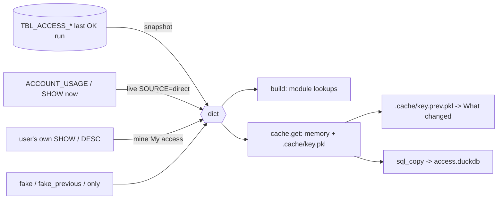

<!-- generated by darshan-singh-meel-knowledge-graph -->
The snapshot dict: the one in-memory shape every loader returns and `access.build()` consumes; one key per `TBL_ACCESS_` table plus `run`.

## Keys

| Key | Table | Row keys | Consumed in `build` |
|---|---|---|---|
| `run` | `TBL_ACCESS_RUN` (one row) | RUN_ID, FINISHED_AT, SOURCES, NOTES (`access.py:476-494`) | `access.py:1355` |
| `GRANT` | `TBL_ACCESS_GRANT` | GRANTEE_ROLE, PRIVILEGE, GRANTED_ON, OBJECT_NAME, IS_FUTURE, GRANT_OPTION, GRANTED_BY | `access.py:1321-1338` |
| `USER_ROLE` | `TBL_ACCESS_USER_ROLE` | USER_NAME, ROLE_NAME, GRANTED_BY | `access.py:1339` |
| `USER` | `TBL_ACCESS_USER` | USER_NAME, TYPE, DISABLED, DEFAULT_*, LAST_SUCCESS_LOGIN | `access.py:1349` |
| `USAGE` | `TBL_ACCESS_USAGE` | USER_NAME, KIND, NAME, QUERIES, LAST_USED | `access.py:1350-1351` |
| `TAG` | `TBL_ACCESS_TAG` | OBJECT_NAME, DOMAIN, COLUMN_NAME, TAG_NAME, TAG_VALUE, APPLY_METHOD | `access.py:1356` |
| `POLICY` | `TBL_ACCESS_POLICY` | POLICY_NAME, POLICY_KIND, OBJECT_NAME, COLUMN_NAME, ARG_COLUMNS, TAG_NAME, POLICY_BODY | `access.py:1357` |
| `STREAM` | `TBL_ACCESS_STREAM` | STREAM_NAME, SOURCE_NAME, SOURCE_TYPE | `access.py:1358` |
| `OBJECT_USE` | `TBL_ACCESS_OBJECT_USE` (optional) | USER_NAME, OBJECT_NAME, WEEK, ACTION, QUERIES, LAST_USED | `access.py:1359-1360` |
| `ACTIVITY` | `TBL_ACCESS_ACTIVITY` (optional) | DAY, USER_NAME, ROLE_NAME, CLIENT, OBJECT_NAME, ACTION, QUERY_TYPE, QUERIES, LAST_USED | `access.py:1361` (`acts`) |

- Mapping key -> table: `TABLES` / `OPTIONAL` `access.py:64-65`, `SELECT * FROM {where}.TBL_ACCESS_{t}` `access.py:495,413`.
- No producer's rows carry RUN_ID: `snapshot()` reads `SELECT * EXCLUDE (RUN_ID)` (`access.py:494-496`); `live()` / `mine()` rows have no RUN_ID key (`access.py:807-840,483-484`).
- `ACTIVITY=0`: `OBJECT_USE` and `ACTIVITY` are `[]` and `run.SOURCES` say `SKIPPED` (`access.py:508-511`, `access.py:825-826`).
- `OBJECT_USE` and `ACTIVITY` are None when the table is missing (older setup): `access.py:496-500`; `act_state()` then explains it (`access.py:4550-4552`). Direct mode reads `ACTIVITY` incrementally from the kept dict (`server.py:124-126`, `access.py:1123-1133`).

## Producers

| Producer | `run.RUN_ID` | Evidence | Notes |
|---|---|---|---|
| `snapshot(query, where, old)` | uuid of the last OK run | `access.py:474-513` | raises when no OK run (`access.py:484-485`); the run held (`old`) is returned as is (`access.py:486-492`) |
| `live(query)` | `"direct"` | `access.py:767-1143` | same sources as SP_ACCESS_SNAPSHOT; `FINISHED_AT` = CURRENT_TIMESTAMP (`:588,836`) |
| `mine(query, db)` | `"live"` | `access.py:655-753` | TAG / POLICY / STREAM empty, no OBJECT_USE; tags/policies UNAVAILABLE (`:548-549`) |
| `fake()` | `"fake"` | `access.py:164-380` | `access.py:376,344-345` |
| `fake_previous()` | `"fake-previous"` | `access.py:460-471` | What changed demo |
| `only(d, user)` | `"live"` | `access.py:1260-1269` | demo of mine() |

- Shared data chosen by `server.read_shared` `server.py:121-122` (fake / live / snapshot by MODE and SOURCE from `cache.config()` `cache.py:35-48`, `server.py:21`), cached via `load_shared` `server.py:130-139`.
- My access: `server.py:196-200` (`cache.get(cache.name("mine", ...), a.mine)`).
- SP_ACCESS_FINDINGS also builds it inside Snowflake: `sql/1_setup.sql:1124-1125`.

## Kept where

- Memory `cache.MEM`, 24 h (`TTL`): `cache.py:22-23,95-98`.
- `.cache/<key>.pkl` for `CACHE_HOURS` (24, 0 = memory only), not inside Snowflake: `cache.py:21,51-57,99-114`.
- Previous run kept as `<key>.prev.pkl` (only if a different RUN_ID / FINISHED_AT): `cache.py:76-90`; read by `cache.prev` `cache.py:93-99` for What changed `server.py:1769`.
- `drop` sets the file aside as `.old.pkl` (Read again): `cache.py:156-166`.
- Cache key = account, source/what, snapshot location, user, role: `cache.py:51-57`; server `KEY` `server.py:23`.
- `build()` keeps `KEEP_BUILT` (3) built data sets: `access.py:1288-1289,903-909`.
