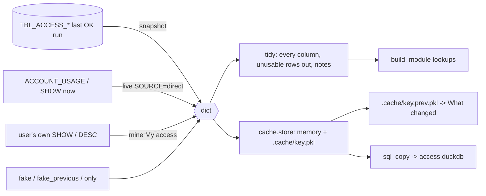

<!-- generated by darshan-singh-meel-knowledge-graph -->
The snapshot dict: the one in-memory shape every loader returns and `access.build()` consumes; one key per `TBL_ACCESS_` table plus `run`.

## Keys

| Key | Table | Row keys | Consumed in `build` |
|---|---|---|---|
| `run` | `TBL_ACCESS_RUN` (one row) | RUN_ID, FINISHED_AT, SOURCES, NOTES (`access.py:510-537`) | `access.py:1491` |
| `GRANT` | `TBL_ACCESS_GRANT` | GRANTEE_ROLE, PRIVILEGE, GRANTED_ON, OBJECT_NAME, IS_FUTURE, GRANT_OPTION, GRANTED_BY | `access.py:1457-1474` |
| `USER_ROLE` | `TBL_ACCESS_USER_ROLE` | USER_NAME, ROLE_NAME, GRANTED_BY | `access.py:1475` |
| `USER` | `TBL_ACCESS_USER` | USER_NAME, TYPE, DISABLED, DEFAULT_*, LAST_SUCCESS_LOGIN | `access.py:1485` |
| `USAGE` | `TBL_ACCESS_USAGE` | USER_NAME, KIND, NAME, QUERIES, LAST_USED | `access.py:1486-1487` |
| `TAG` | `TBL_ACCESS_TAG` | OBJECT_NAME, DOMAIN, COLUMN_NAME, TAG_NAME, TAG_VALUE, APPLY_METHOD | `access.py:1492` |
| `POLICY` | `TBL_ACCESS_POLICY` | POLICY_NAME, POLICY_KIND, OBJECT_NAME, COLUMN_NAME, ARG_COLUMNS, TAG_NAME, POLICY_BODY | `access.py:1493` |
| `STREAM` | `TBL_ACCESS_STREAM` | STREAM_NAME, SOURCE_NAME, SOURCE_TYPE | `access.py:1494` |
| `OBJECT_USE` | `TBL_ACCESS_OBJECT_USE` (optional) | USER_NAME, OBJECT_NAME, WEEK, ACTION, QUERIES, LAST_USED | `access.py:1495-1496` |
| `ACTIVITY` | `TBL_ACCESS_ACTIVITY` (optional) | DAY, USER_NAME, ROLE_NAME, CLIENT, OBJECT_NAME, ACTION, QUERY_TYPE, QUERIES, LAST_USED | `access.py:1497` (`acts`) |

- Mapping key -> table: `TABLES` / `OPTIONAL` `access.py:67-68`, `SELECT * EXCLUDE (RUN_ID) FROM {where}.TBL_ACCESS_{t}` `access.py:543`.
- No producer's rows carry RUN_ID: `snapshot()` reads `SELECT * EXCLUDE (RUN_ID)` (`access.py:543`); `live()` / `mine()` rows have no RUN_ID key (`access.py:923-956,483-484`).
- `ACTIVITY=0`: `OBJECT_USE` and `ACTIVITY` are `[]` and `run.SOURCES` say `SKIPPED` (`access.py:567-568`, `access.py:1253`, `access.py:1265`).
- `OBJECT_USE` and `ACTIVITY` are None when the table is missing (older setup): `access.py:551`; `act_state()` then explains it (`access.py:4934-4936`). Direct mode reads `ACTIVITY` incrementally from the kept dict (`server.py:143-145`, `access.py:1255-1265`).

## Shape guaranteed by `tidy()` (`access.py:1545-1597`)

- Once per data set and code version is the intent: tidy() returns early when d["_tidy"] equals tidy_stamp() (`access.py:1551`); nothing in the repo sets `_tidy`, so it runs on every build() that is not cached (`access.py:1452`; not verified).
- `run` is a dict with dict `SOURCES` and `NOTES`; every table key is a list of dicts with every column of `sql/1_setup.sql` (`COLUMNS`, `access.py:70-90`; missing columns None; `GRANT_OPTION`, `GRANTED_BY` filled without a note, `QUIET` `access.py:1507`); an `OPTIONAL` table that is None stays None.
- A missing table -> `[]`, its source `UNAVAILABLE`, a note (`access.py:1558-1564`).
- Rows without the `NEED` columns (`access.py:1508-1511`), a parseable DAY / WEEK or an action READ / WRITE / DDL (`usable`, `access.py:1536-1542`) are left out; NOTES `missing_names` counts them with up to 3 short examples (`access.py:1584-1593`).
- Snapshot tables lacking newer columns -> NOTES `missing_columns` ("run sql/1_setup.sql again") (`access.py:1594-1596`; not for live / direct reads).
- ACTIVITY `HOURS` becomes `{hour: queries}` (`hours`, `access.py:1519-1533`).
- Explained on the page by `server.note_info` (`server.py:503-554`); [business_rule:missing_data_never_fails](../logic/rules.md).

## Producers

| Producer | `run.RUN_ID` | Evidence | Notes |
|---|---|---|---|
| `snapshot(query, where, old)` | uuid of the last OK run | `access.py:508-571` | no OK run, no RUN_ID or `TBL_ACCESS_RUN` unreadable -> every table `[]`, RUN_ID None, every source UNAVAILABLE, NOTES `no_run` (`access.py:518-527`); a table that fails -> `[]`, UNAVAILABLE, noted, in `run.UNREAD` (`access.py:552-556`); the run held (`old`) is returned as is (`access.py:530-535`) |
| `live(query)` | `"direct"` | `access.py:883-1275` | same sources as SP_ACCESS_SNAPSHOT; `FINISHED_AT` = CURRENT_TIMESTAMP (`:588,836`) |
| `mine(query, db)` | `"live"` | `access.py:757-869` | TAG / POLICY / STREAM empty, no OBJECT_USE; tags/policies UNAVAILABLE (`:548-549`) |
| `fake()` | `"fake"` | `access.py:189-405` | `access.py:401,344-345` |
| `fake_previous()` | `"fake-previous"` | `access.py:494-505` | What changed demo |
| `only(d, user)` | `"live"` | `access.py:1396-1405` | demo of mine() |

- Shared data chosen by `server.read_shared` `server.py:139-147` (fake / live / snapshot by MODE and SOURCE from `cache.config()` `cache.py:41-54`, `server.py:23`), cached via `load_shared` `server.py:177-196` (stage 1 parts in `.cache/reads/<key>/`, [flows/two-stage-load.md](../flows/two-stage-load.md)).
- My access: `server.py:254-261` (`cache.get(cache.name("mine", ...), a.mine)`).
- SP_ACCESS_FINDINGS also builds it inside Snowflake: `sql/1_setup.sql:1160-1161`.

## Kept where

- Memory `cache.MEM`, 24 h (`TTL`): `cache.py:28-29,95-98`.
- `.cache/<key>.pkl` for `CACHE_HOURS` (24, 0 = memory only), not inside Snowflake: `cache.py:27,51-57,99-114`.
- Previous run kept as `<key>.prev.pkl` (only if a different RUN_ID / FINISHED_AT): `cache.py:82-96`; read by `cache.prev` `cache.py:99-105` for What changed `server.py:1871`.
- `drop` sets the file aside as `.old.pkl` (Read again): `cache.py:184-194`.
- Cache key = account, source/what, snapshot location, user, role: `cache.py:57-63`; server `KEY` `server.py:25`.
- `build()` keeps `KEEP_BUILT` (3) built data sets: `access.py:1424-1425,903-909`.
