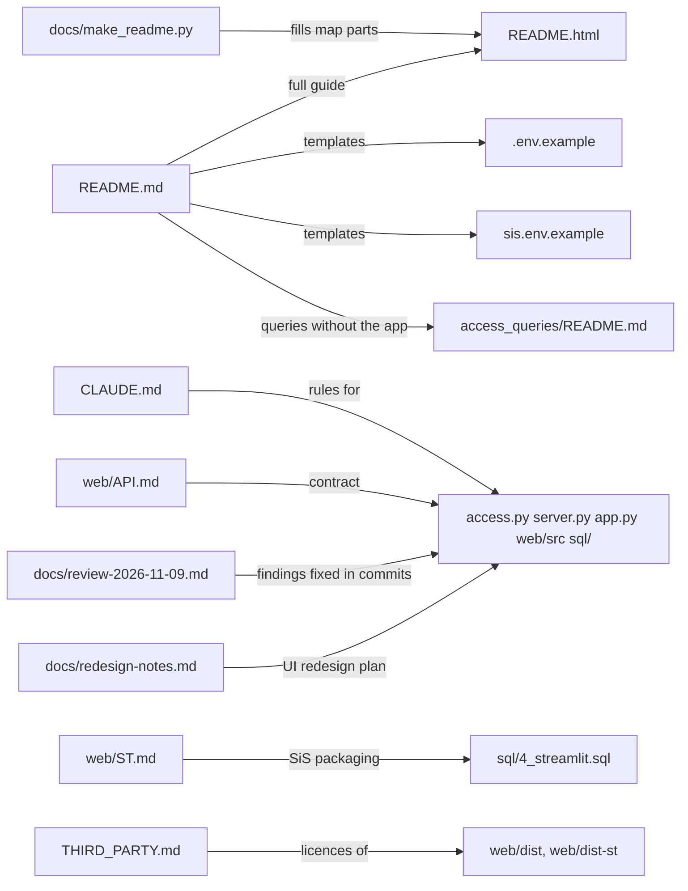

<!-- generated by darshan-singh-meel-knowledge-graph -->
Index of non-code documents in the repo: one summary page each, with what it relates to.

| Page | Source | One line |
|---|---|---|
| [readme-md.md](readme-md.md) | README.md | Quick start, run modes, settings, deploy options, queries without the app |
| [readme-html.md](readme-html.md) | README.html | Full guide: every screen, 29 rules, Activity tabs, run modes, settings, limits |
| [claude-md.md](claude-md.md) | CLAUDE.md | Project standards and hard rules |
| [web-api-md.md](web-api-md.md) | web/API.md | JSON API contract of server.py |
| [web-st-md.md](web-st-md.md) | web/ST.md | React app as a Streamlit component, SiS packaging |
| [review-2026-11-09.md](review-2026-11-09.md) | docs/review-2026-11-09.md | Whole-app review findings |
| (no page) | reviews/review-2026-11-10-2027.html | Local HTML whole-repo review 2026-11-10 (Must fix / Should fix / Other / Questions / Unused files); untracked; its fixes: admin paths per role, cache lock, run.py HOST, snapshot busy check, findings last run only, CSV formula cells, server-written SQL |
| [redesign-notes.md](redesign-notes.md) | docs/redesign-notes.md | UI redesign notes and phases |
| [make-readme-py.md](make-readme-py.md) | docs/make_readme.py | Generator for README.html diagrams and rule table |
| [env-example.md](env-example.md) | .env.example | Local settings template (names only) |
| [sis-env-example.md](sis-env-example.md) | sis.env.example | Streamlit-in-Snowflake settings template |
| [third-party-md.md](third-party-md.md) | THIRD_PARTY.md | Third-party licences |
| [settings-sql.md](settings-sql.md) | settings.sql | SQL names template for run_sql.py / SnowSQL |
| [../modules/access-queries.md](../modules/access-queries.md) | access_queries/README.md | Standalone ACCOUNT_USAGE queries: how to run, privileges, rules, limits, example output |
