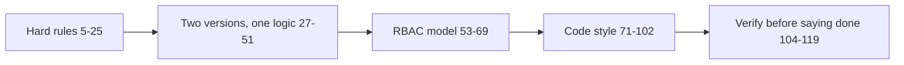

<!-- generated by darshan-singh-meel-knowledge-graph -->
CLAUDE.md (119 lines): project standards for anyone (human or agent) changing the repo — hard rules (read-only, no secrets), two versions with one logic, the RBAC model, code style, and the verify checklist.

## Sections
- Hard rules — CLAUDE.md:5: read-only, never GRANT/REVOKE/CREATE/ALTER/DROP, IaC — CLAUDE.md:6-7; writes only `.cache/` locally (`<key>.pkl`, `<key>.prev.pkl` for What changed, the comparison `<key>.diff.pkl` made by the refresh while the replaced data is still built, `server.compared`), one file per user for My access, the SQL copy `access.duckdb` — CLAUDE.md:8-14; reads only `TBL_ACCESS_` in shared view — CLAUDE.md:15-16; SOURCE rules — CLAUDE.md:17-19; direct mode in step with the procedure — CLAUDE.md:20-21; no credentials/accounts/company names — CLAUDE.md:22-23; no business-data queries — CLAUDE.md:24; commit/hook rule — CLAUDE.md:25.
- Activity: `SP_ACCESS_SNAPSHOT` fills `TBL_ACCESS_ACTIVITY` from ACCESS_HISTORY + QUERY_HISTORY + SESSIONS as an optional step, copying the days the last OK run has; `access.activity_start` does the same in Direct mode — CLAUDE.md:15-16. Rules 24-28 come from `TBL_ACCESS_ACTIVITY`; the verify command lists all 29 rules, 29 = Streamlit app shows its owner's sensitive data — CLAUDE.md:105-113.
- Two versions, one logic — CLAUDE.md:27: local web (run.py), SiS via st_react, committed bundles, 4_streamlit.sql, host checks, read-only test, change both versions together.
- RBAC model — CLAUDE.md:53: account + database roles, FUNC/TECH prefixes, What if never runs — CLAUDE.md:64; admin roles: the "every role -> SYSADMIN" hierarchy hidden in graphs and kept out of the walks (`a.admin_links`), an admin role reaches only what its real links reach (`a.admin_below`: ACCOUNTADMIN = SYSADMIN + SECURITYADMIN + its own grants, SYSADMIN = the roles granted to it), SECURITYADMIN / USERADMIN / ORGADMIN read no data (`a.ADMIN_POWER`), holders and account privileges in red — CLAUDE.md:65-69.
- Code style — CLAUDE.md:71: `access_queries/` is standalone ACCOUNT_USAGE SQL kept equal to `access.py` by `access_queries/test_queries.py`; change order file -> `functions.sql` -> `make_notebook.py` — CLAUDE.md:72; allowed packages, file roles, SQL file conventions, cache, walks, graph styles, UI tabs with one exception: the Activity tab is one access log of stacked sections shaped by the object's type — CLAUDE.md:98-99; test_sql keeps SQL functions equal — CLAUDE.md:83-84.
- DuckDB: the SQL copy `.cache/access.duckdb` is always on (`DUCKDB=1` also copies fake data), duckdb is in both requirements files — CLAUDE.md:11-13; allowed packages include duckdb — CLAUDE.md:74; the rule checks over every user and role use the counted walk in an in-memory DuckDB (`a.duck()`, `lose_all`, `read_shares`), equal to the Python walk (`test_duck_reach`), Python without duckdb or with a role loop — CLAUDE.md:82.
- Verify before saying done — CLAUDE.md:104-119, incl. `python access_queries/test_queries.py` green — CLAUDE.md:117 (see processes/test.md).

## Relates to
- Every process page; code files access.py, server.py, app.py, cache.py, sf.py, ui.py, st_react.py, web/src, sql/, access_queries/ (modules/access-queries.md).
