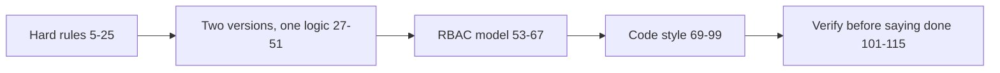

<!-- generated by darshan-singh-meel-knowledge-graph -->
CLAUDE.md (116 lines): project standards for anyone (human or agent) changing the repo — hard rules (read-only, no secrets), two versions with one logic, the RBAC model, code style, and the verify checklist.

## Sections
- Hard rules — CLAUDE.md:5: read-only, never GRANT/REVOKE/CREATE/ALTER/DROP, IaC — CLAUDE.md:6-7; writes only `.cache/` locally — CLAUDE.md:8-14; reads only `TBL_ACCESS_` in shared view — CLAUDE.md:15-16; SOURCE rules — CLAUDE.md:17-19; direct mode in step with the procedure — CLAUDE.md:20-21; no credentials/accounts/company names — CLAUDE.md:22-23; no business-data queries — CLAUDE.md:24; commit/hook rule — CLAUDE.md:25.
- Activity: `SP_ACCESS_SNAPSHOT` fills `TBL_ACCESS_ACTIVITY` from ACCESS_HISTORY + QUERY_HISTORY + SESSIONS as an optional step, copying the days the last OK run has; `access.activity_start` does the same in Direct mode — CLAUDE.md:15-16. Rules 24-28 come from `TBL_ACCESS_ACTIVITY` — CLAUDE.md:109-110.
- Two versions, one logic — CLAUDE.md:27: local web (run.py), SiS via st_react, committed bundles, 4_streamlit.sql, host checks, read-only test, change both versions together.
- RBAC model — CLAUDE.md:53: account + database roles, FUNC/TECH prefixes, admin roles in red, What if never runs — CLAUDE.md:64.
- Code style — CLAUDE.md:69: `access_queries/` is standalone ACCOUNT_USAGE SQL kept equal to `access.py` by `access_queries/test_queries.py`; change order file -> `functions.sql` -> `make_notebook.py` — CLAUDE.md:70; allowed packages, file roles, SQL file conventions, cache, walks, graph styles, UI tabs; test_sql keeps SQL functions equal — CLAUDE.md:81-82.
- Verify before saying done — CLAUDE.md:101-116, incl. `python access_queries/test_queries.py` green — CLAUDE.md:114 (see processes/test.md).

## Relates to
- Every process page; code files access.py, server.py, app.py, cache.py, sf.py, ui.py, st_react.py, web/src, sql/, access_queries/ (modules/access-queries.md).
