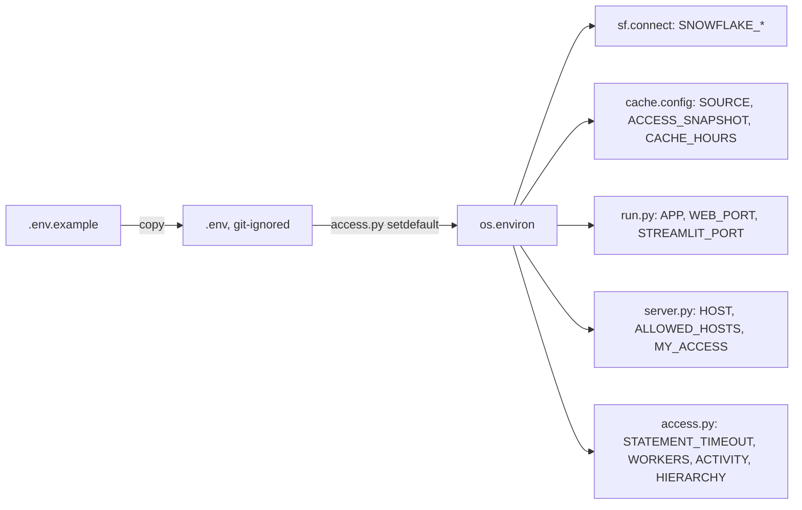

<!-- generated by darshan-singh-meel-knowledge-graph -->
.env.example (48 lines): template for the git-ignored `.env` that local runs (run.py, server.py, app.py, run_sql.py, sf.py) load; names and placeholders only.

## Names (no values stored)
- Format rules — .env.example:1.
- `FAKE` (commented) — .env.example:4; `SOURCE` — .env.example:6; `ACCESS_SNAPSHOT` — .env.example:8; `CACHE_HOURS` — .env.example:10.
- `APP`, `WEB_PORT`, `STREAMLIT_PORT` (commented) — .env.example:12-14.
- `ALLOWED_HOSTS`, `MY_ACCESS` (commented; HOST mentioned in comment) — .env.example:15-18.
- `SNOWFLAKE_ACCOUNT`, `SNOWFLAKE_USER`, `SNOWFLAKE_ROLE`, `SNOWFLAKE_WAREHOUSE` — .env.example:21-25; `SNOWFLAKE_DATABASE`, `SNOWFLAKE_SCHEMA` (commented) — .env.example:26-27.
- `SNOWFLAKE_HOST` (commented): the PrivateLink host `<org>-<account>.privatelink` + Snowflake domain, read by sf.connect() as `host=` (sf.py:29); `SNOWFLAKE_ACCOUNT` stays `<org>-<account>` — .env.example:36-37, README.md:183-198, processes/privatelink-login.md.
- Secret refs: `SNOWFLAKE_PRIVATE_KEY_FILE`, `SNOWFLAKE_PRIVATE_KEY_PWD` (commented) — .env.example:28-29.
- `ROLE_PREFIXES` (commented) — .env.example:31-32.
- `CSV=0` (commented): hides every CSV button and refuses CSV downloads (server.csv_on, server.py:2350-2351) — .env.example:38-39.
- `STATEMENT_TIMEOUT` (seconds per statement, the snapshot CALL included in the comment's wording; sf.limit leaves the CALL out), `WORKERS` (heavy reads at once), `ACTIVITY=0`, `HIERARCHY=0`, all commented — .env.example:41-48 (mapped from the commit diff).
- `QUERY_TAG` (default access-explorer), `STREAMLIT_APP` (default ST_ACCESS_EXPLORER), both commented: the app's own queries left out of the Activity tabs; same values as in settings.local.sql — .env.example:33-35, read at access.py:68-69.

## Relates to
- access.py:23-30 (loader), sf.py:19-43, cache.py:35-47, run.py:29-41, server.py:165-181, server.py:2364-2368; README.md:166-223; processes/setup-local.md.
