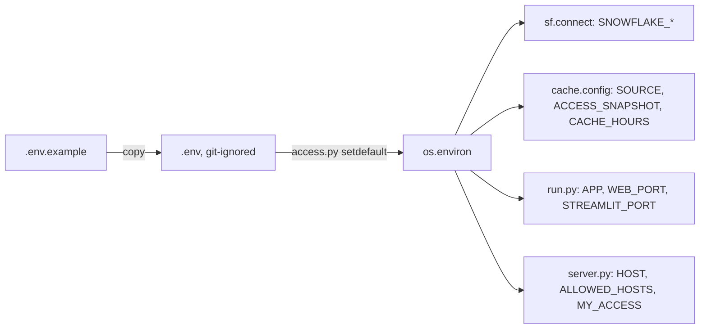

<!-- generated by darshan-singh-meel-knowledge-graph -->
.env.example (32 lines): template for the git-ignored `.env` that local runs (run.py, server.py, app.py, run_sql.py, sf.py) load; names and placeholders only.

## Names (no values stored)
- Format rules — .env.example:1.
- `FAKE` (commented) — .env.example:4; `SOURCE` — .env.example:6; `ACCESS_SNAPSHOT` — .env.example:8; `CACHE_HOURS` — .env.example:10.
- `APP`, `WEB_PORT`, `STREAMLIT_PORT` (commented) — .env.example:12-14.
- `ALLOWED_HOSTS`, `MY_ACCESS` (commented; HOST mentioned in comment) — .env.example:15-18.
- `SNOWFLAKE_ACCOUNT`, `SNOWFLAKE_USER`, `SNOWFLAKE_ROLE`, `SNOWFLAKE_WAREHOUSE` — .env.example:21-25; `SNOWFLAKE_DATABASE`, `SNOWFLAKE_SCHEMA` (commented) — .env.example:26-27.
- Secret refs: `SNOWFLAKE_PRIVATE_KEY_FILE`, `SNOWFLAKE_PRIVATE_KEY_PWD` (commented) — .env.example:28-29.
- `ROLE_PREFIXES` (commented) — .env.example:31-32.

## Relates to
- access.py:19-26 (loader), sf.py:19-42, cache.py:27-39, run.py:29-41, server.py:131-147, server.py:2289-2293; README.md:145-174; processes/setup-local.md.
