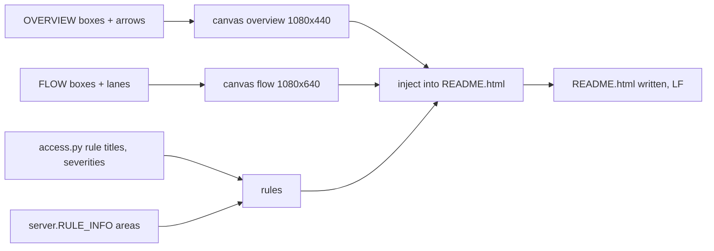

<!-- generated by darshan-singh-meel-knowledge-graph -->
docs/make_readme.py (155 lines): a small generator that fills the generated parts of README.html between `<!--map:NAME-->` markers — the overview diagram, the snapshot flow diagram and the 23-rule table.

## Content
- Purpose and usage `python docs/make_readme.py` — docs/make_readme.py:1-4.
- Imports access and server from the repo root — docs/make_readme.py:10-13.
- Overview canvas spec — docs/make_readme.py:15-25; helpers `mid`, `side`, `crosses`, `box_html`, `canvas` — docs/make_readme.py:43-99; `rules()` — docs/make_readme.py:125; `inject()` — docs/make_readme.py:142.
- Main: injects overview, flow, rules; writes README.html — docs/make_readme.py:148-155.

## Relates to
- README.html (markers README.html:136, 159, 419); access.py; server.py RULE_INFO; test_readme_rules checks the output is current — test_access.py:1767-1777.
- Code, not a doc; listed here because it only serves documentation.
