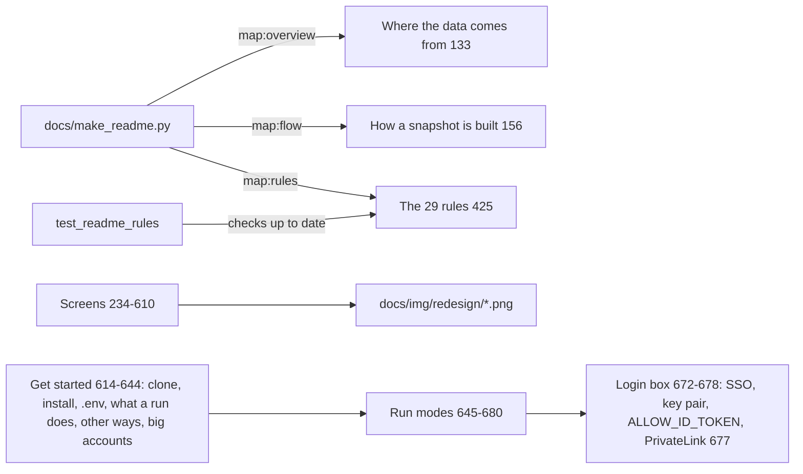

<!-- generated by darshan-singh-meel-knowledge-graph -->
README.html (766 lines): the full user guide as one HTML page — data-flow diagrams, how to read graphs, every screen with screenshots and `?page=` URL, the 29 rules (24-28 on table activity, 29 Streamlit app exposure), the Activity tabs (one access log of stacked sections; business hours `WORK_HOURS`), run modes, login (SSO, key pair, PrivateLink) and setup, SiS options, DuckDB, role model, worksheet SQL, data sources, settings and limits.

## Sections (verified headings)
- Title "Snowflake access explorer"; loads Google Fonts — README.html:6-9.
- Where the data comes from — README.html:133 (generated, `<!--map:overview-->` README.html:136).
- How a snapshot is built and read — README.html:156 (generated, `<!--map:flow-->` README.html:159).
- Finding your way — README.html:172 (SQL behind this page 193); How to read a graph — README.html:200.
- Screens (`<h2>` lines): Home 235, A person or role 254 (Tabs 267), Who has access 277 (Tabs 292, Activity 295), Can they? 303, Request access 327, Access graph 347, What they see 368, Compare 388, Risks & fixes 404 (The 29 rules 425, `<!--map:rules-->` 426), What if 432, Review & sign-off 452, Sensitive data 473, Sensitive data flow 493, Granted vs used 507, What changed 527, User/Role paths 547, Big accounts 573, My access 592.
- Get started — README.html:614: clone, venv, `pip install -r requirements-web.txt`, `python run.py --fake` (README.html:615-620); Your own account: `.env` from `.env.example` (README.html:621-622); What a run does: login, export (every read a Parquet part in `.cache/reads/`, a stopped load resumes), build (role graph, 29 rules, DuckDB copy), parts read again only on Rebuild snapshot / Read Snowflake again or `--export --fresh` (README.html:623-628); Other ways table incl. `--export` / `--build` (README.html:629-638); Big accounts: `STATEMENT_TIMEOUT`, `WORKERS`, `ACTIVITY`, `HIERARCHY` (README.html:639-643).
- Run modes and what you need — README.html:645-680: Which way to run it 647 (role table 649), mode table 655, Direct mode 663, Login 672.
- Login box — README.html:672-678: browser SSO by default (tab opens on the machine running the app) 674; key pair `SNOWFLAKE_PRIVATE_KEY_FILE` (+ `_PWD`) 675; `ALLOW_ID_TOKEN` 676; PrivateLink 677.
- PrivateLink item — README.html:677: keep `SNOWFLAKE_ACCOUNT=<org>-<account>` and set `SNOWFLAKE_HOST=<org>-<account>.privatelink` + Snowflake domain (`regionless-privatelink-account-url` or `privatelink-account-url` from `SYSTEM$GET_PRIVATELINK_CONFIG()`); that host and the OCSP host (`privatelink-ocsp-url`) resolve to the private endpoint; key pair works as is; browser SSO needs the SAML integration on the PrivateLink URLs (`SAML2_SNOWFLAKE_ACS_URL`, `SAML2_SNOWFLAKE_ISSUER_URL`); not needed inside Snowflake. Longer version: README.md:186-201; see processes/privatelink-login.md.
- One-time snapshot setup + daily task `TSK_ACCESS_SNAPSHOT` + roles table — README.html:681-695 (task SQL 686-688, roles table 690).
- Streamlit in Snowflake: two options, the app's name from `STREAMLIT_APP` (default ST_ACCESS_EXPLORER) — README.html:696-709; Query with SQL (DuckDB) — README.html:710; Role model — README.html:727; SQL without the app — README.html:735; Data sources — README.html:748; Settings — README.html:756; Limits — README.html:759.

## Relates to
- Generated parts: docs/make_readme.py — docs/make_readme.py:125-155; checked by test_readme_rules — test_access.py:2095-2105.
- The daily task SQL is in README.html:686-688 and README.md:281-283 (Objects in Snowflake); no setup script creates the task.
