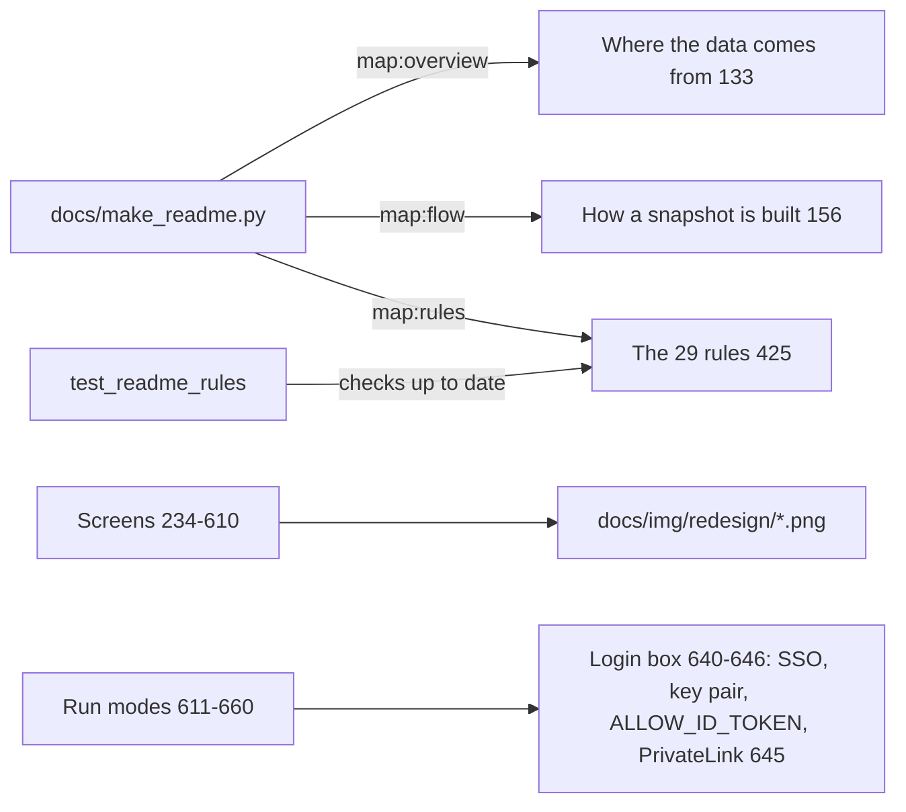

<!-- generated by darshan-singh-meel-knowledge-graph -->
README.html (734 lines): the full user guide as one HTML page — data-flow diagrams, how to read graphs, every screen with screenshots and `?page=` URL, the 29 rules (24-28 on table activity, 29 Streamlit app exposure), the Activity tabs (one access log of stacked sections; business hours `WORK_HOURS`), run modes, login (SSO, key pair, PrivateLink) and setup, SiS options, DuckDB, role model, worksheet SQL, data sources, settings and limits.

## Sections (verified headings)
- Title "Snowflake access explorer"; loads Google Fonts — README.html:6-9.
- Where the data comes from — README.html:133 (generated, `<!--map:overview-->` README.html:136).
- How a snapshot is built and read — README.html:156 (generated, `<!--map:flow-->` README.html:159).
- Finding your way — README.html:172 (SQL behind this page 193); How to read a graph — README.html:199.
- Screens (`<h2>` lines): Home 235, A person or role 254 (Tabs 267), Who has access 277 (Tabs 292, Activity 295), Can they? 303, Request access 327, Access graph 347, What they see 368, Compare 388, Risks & fixes 404 (The 29 rules 425, `<!--map:rules-->` 426), What if 432, Review & sign-off 452, Sensitive data 473, Sensitive data flow 493, Granted vs used 507, What changed 527, User/Role paths 547, Big accounts 573, My access 592.
- Run modes and what you need — README.html:611-647: Which way to run it 615, mode table, Direct mode 631, Login 640-646.
- Login box — README.html:640-646: browser SSO by default (tab opens on the machine running the app) 642; key pair `SNOWFLAKE_PRIVATE_KEY_FILE` (+ `_PWD`) 643; `ALLOW_ID_TOKEN` 644; PrivateLink `<li id="privatelink">` 645.
- PrivateLink item — README.html:645: `SNOWFLAKE_ACCOUNT=<org>-<account>.privatelink` (`regionless-privatelink-account-url` or `privatelink-account-url` from `SYSTEM$GET_PRIVATELINK_CONFIG()`, without `.snowflakecomputing.com`); account and OCSP host (`privatelink-ocsp-url`) resolve to the private endpoint; key pair works as is; browser SSO needs the SAML integration on the PrivateLink URLs (`SAML2_SNOWFLAKE_ACS_URL`, `SAML2_SNOWFLAKE_ISSUER_URL`); not needed inside Snowflake. Longer version: README.md:181-195; see processes/privatelink-login.md.
- One-time snapshot setup + daily task `TSK_ACCESS_SNAPSHOT` + roles table — README.html:649-660 (task SQL 654-656, roles table 658).
- Streamlit in Snowflake: two options — README.html:664; Query with SQL (DuckDB) — README.html:678; Role model — README.html:695; SQL without the app — README.html:703; Data sources — README.html:716-720; Settings (env vars, `WORK_HOURS` business hours, local time, shifted from UTC by the Activity tab's slider) — README.html:724-726; Limits — README.html:727.

## Relates to
- Generated parts: docs/make_readme.py — docs/make_readme.py:125-155; checked by test_readme_rules — test_access.py:1796-1806.
- The daily task SQL is in README.html:654-656 and README.md:267-269 (Objects in Snowflake); no setup script creates the task.
