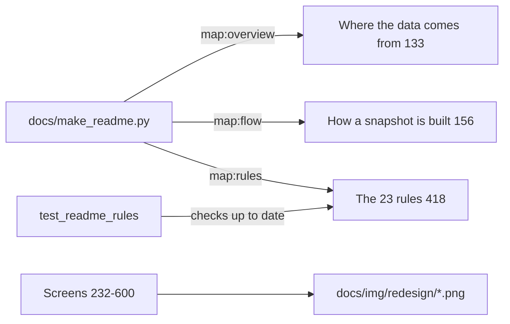

README.html (718 lines): the full user guide as one HTML page — data-flow diagrams, how to read graphs, every screen with screenshots and `?page=` URL, the 23 rules, run modes and setup, SiS options, DuckDB, role model, worksheet SQL, data sources, settings and limits.

## Sections (verified headings)
- Title "Snowflake access explorer"; loads Google Fonts — README.html:6-9.
- Where the data comes from — README.html:133 (generated, `<!--map:overview-->` README.html:136).
- How a snapshot is built and read — README.html:156 (generated, `<!--map:flow-->` README.html:159).
- Finding your way — README.html:172; How to read a graph — README.html:196.
- Screens: Home 232, A person or role 251, Who has access 273, Can they? 296, Request access 320, Access graph 340, What they see 361, Compare 381, Risks & fixes 397 (23 rules 418, `<!--map:rules-->` 419), What if 425, Review & sign-off 445, Sensitive data 466, Sensitive data flow 486, Granted vs used 500, What changed 520, User/Role paths 540, Big accounts 566, My access 585 — README.html line numbers as listed.
- Run modes and what you need — README.html:606; one-time snapshot setup + daily task `TSK_ACCESS_SNAPSHOT` + roles table — README.html:633-642.
- Streamlit in Snowflake: two options — README.html:648; Query with SQL (DuckDB) — README.html:662; Role model — README.html:679; SQL without the app — README.html:687; Data sources — README.html:700-703; Settings (env vars) — README.html:708-710; Limits — README.html:711.

## Relates to
- Generated parts: docs/make_readme.py — docs/make_readme.py:148-155; checked by test_readme_rules — test_access.py:1688-1698.
- Only place the daily task SQL is written — README.html:638-640.
