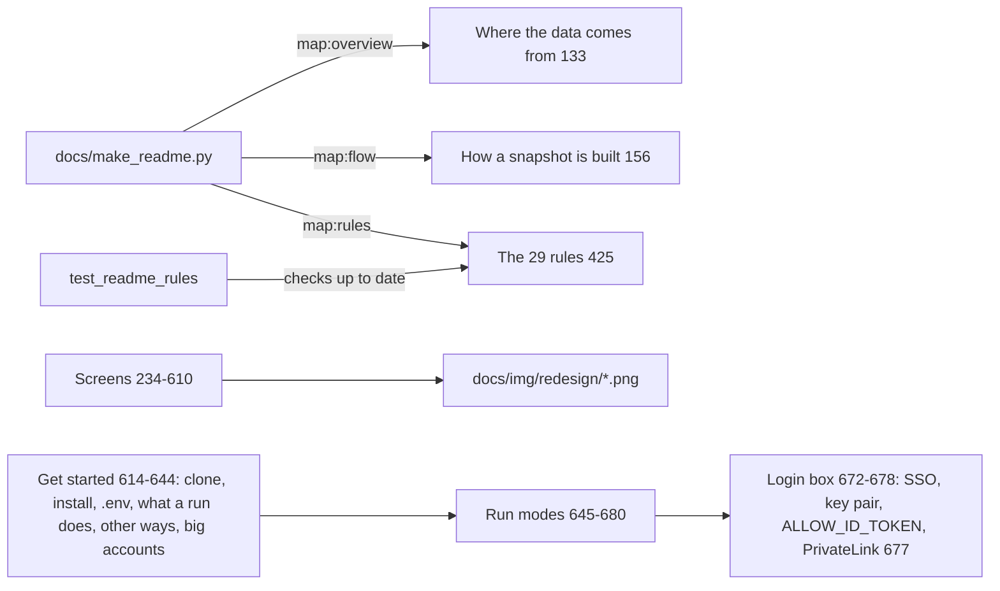

<!-- generated by darshan-singh-meel-knowledge-graph -->
README.html (769 lines): the full user guide as one HTML page — data-flow diagrams, how to read graphs, every screen with screenshots and `?page=` URL, the 29 rules (24-28 on table activity, 29 Streamlit app exposure), the Activity tabs (one access log of stacked sections; business hours `WORK_HOURS`), run modes, login (SSO, key pair, PrivateLink) and setup, SiS options, DuckDB, role model, worksheet SQL, data sources, settings and limits.

## Sections (verified headings)
- Title "Snowflake access explorer"; loads Google Fonts — README.html:6-9.
- Where the data comes from — README.html:133 (generated, `<!--map:overview-->` README.html:136).
- How a snapshot is built and read — README.html:156 (generated, `<!--map:flow-->` README.html:159).
- Finding your way — README.html:173 (SQL behind this page 196); How to read a graph — README.html:202.
- Screens (`<h2>` lines): Home 238, A person or role 257 (Tabs 270), Who has access 280 (Tabs 295, Activity 298), Can they? 306, Request access 330, Access graph 350, What they see 371, Compare 391, Risks & fixes 407 (The 29 rules 428, `<!--map:rules-->` 429), What if 435, Review & sign-off 455, Sensitive data 476, Sensitive data flow 496, Granted vs used 510, What changed 530, User/Role paths 550, Big accounts 576, My access 595.
- Get started — README.html:645: clone, venv, `pip install -r requirements-web.txt`, `python run.py --fake` (README.html:646-651); Your own account: `.env` from `.env.example` (README.html:652-653); What a run does: login, export (every read a Parquet part in `.cache/reads/`, a stopped load resumes), build (role graph, 29 rules, DuckDB copy), parts read again only on Rebuild snapshot / Read Snowflake again or `--export --fresh` (README.html:654-660); Other ways table incl. `--export` / `--build` (README.html:661-672); Big accounts: `STATEMENT_TIMEOUT`, `WORKERS`, `ACTIVITY`, `HIERARCHY` (README.html:673-677).
- Run modes and what you need — README.html:679-715: Which way to run it 650 (role table 652), mode table 658, Direct mode 666, Login 675.
- Login box — README.html:707-713: browser SSO by default (tab opens on the machine running the app) 677; key pair `SNOWFLAKE_PRIVATE_KEY_FILE` (+ `_PWD`) 678; `ALLOW_ID_TOKEN` 679; PrivateLink 680.
- PrivateLink item — README.html:712: keep `SNOWFLAKE_ACCOUNT=<org>-<account>` and set `SNOWFLAKE_HOST=<org>-<account>.privatelink` + Snowflake domain (`regionless-privatelink-account-url` or `privatelink-account-url` from `SYSTEM$GET_PRIVATELINK_CONFIG()`); that host and the OCSP host (`privatelink-ocsp-url`) resolve to the private endpoint; key pair works as is; browser SSO needs the SAML integration on the PrivateLink URLs (`SAML2_SNOWFLAKE_ACS_URL`, `SAML2_SNOWFLAKE_ISSUER_URL`); not needed inside Snowflake. Longer version: README.md:192-207; see processes/privatelink-login.md.
- One-time snapshot setup + daily task `TSK_ACCESS_SNAPSHOT` + roles table — README.html:716-730 (task SQL 689-691, roles table 693).
- Streamlit in Snowflake: two options, the app's name from `STREAMLIT_APP` (default ST_ACCESS_EXPLORER) — README.html:731-744; Query with SQL (DuckDB) — README.html:745; Role model — README.html:762; SQL without the app — README.html:770; Data sources — README.html:783; Settings — README.html:791; Limits — README.html:794.
- Big accounts: What changed made at refresh while the replaced data is built (README.html:565); lazy combined boxes over 300 members and lanes over 24 folded (README.html:610); long tables paged on the server, 50 rows, Risks & fixes 100, CSV every row (README.html:611).
- Read order: ACCOUNT_USAGE, then INFORMATION_SCHEMA (query history, tags, policies), then `SHOW`; a timed-out full ACCOUNT_USAGE read gets no fallback (unread under Incomplete; `P_SOURCE=AUTO` fails the run); no warehouse (000606) stops the load — README.html:701-702, README.html:786.

## Relates to
- Generated parts: docs/make_readme.py — docs/make_readme.py:125-155; checked by test_readme_rules — test_access.py:2400-2410.
- The daily task SQL is in README.html:721-723 and README.md:296-298 (Objects in Snowflake); no setup script creates the task.
