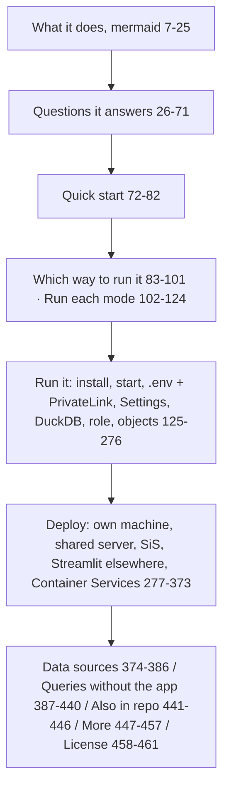

<!-- generated by darshan-singh-meel-knowledge-graph -->
README.md (473 lines): the entry doc — what the app does, quick start, every run mode, settings, the `.env` login (browser SSO, key pair, PrivateLink), objects setup, four deploy targets, data sources, the standalone queries; points to README.html for the full guide.

## Sections (verified headings)
- Title + summary; full guide link to README.html — README.md:1-5.
- What it does (mermaid) — README.md:7; Questions it answers — README.md:26.
- Quick start — README.md:72-82; Which way to run it (by what the role can do: local or Streamlit in Snowflake) — README.md:83-101; Run each mode — README.md:102-124.
- Run it (direct vs objects table) — README.md:125-142; Install — README.md:144-153; Start — README.md:155-168; `.env` — README.md:170-185; PrivateLink — README.md:186-201; Settings — README.md:203-226 (`SNOWFLAKE_HOST`, unset, the PrivateLink host — README.md:217; `QUERY_TAG` default access-explorer and `STREAMLIT_APP` default ST_ACCESS_EXPLORER, same values in `.env`, `sis/.env` and settings.local.sql — README.md:220-221; `CSV`, unset = on, `0` hides every CSV button and refuses the downloads in both versions — README.md:222); DuckDB SQL copy — README.md:227; role-based visibility — README.md:258-270; Objects in Snowflake — README.md:271-290.
- Deploy — README.md:291-300; own machine — README.md:301; shared server — README.md:305-324 (PrivateLink bullet README.md:317); SiS — README.md:325-366 (the app is created and opened under its `STREAMLIT_APP` name — README.md:356, README.md:358); Streamlit elsewhere — README.md:367-378; Container Services — README.md:379-387.
- Data sources — README.md:388-401; the Activity tabs and their 60 days of ACCESS_HISTORY + QUERY_HISTORY + SESSIONS — README.md:391-394; Activity tabs on the access and object pages — README.md:32-33; `ACTIVITY` in the DuckDB tables — README.md:231; the app's own queries left out by `QUERY_TAG` / `STREAMLIT_APP` — README.md:398-399.
- Use the queries without the app — README.md:402-455: file table (5 query files, `functions.sql`, `access_examples.ipynb`) — README.md:405-413; How to use them (worksheet or notebook path A / B) — README.md:415; Needs (ACCOUNT_USAGE read, warehouse, `CREATE FUNCTION` for path A only) — README.md:453; Check (`test_queries.py`) — README.md:454. See modules/access-queries.md, flows/standalone-queries.md.
- Also in this repo — README.md:456-461: access_queries (the Snowflake notebook, `functions.sql`, test) — README.md:457; sf.py CLI — README.md:458; tests incl. `access_queries/test_queries.py` — README.md:459; IaC — README.md:460.
- Where to find more — README.md:462-472; License (MIT or Apache-2.0) — README.md:473-476.

## Speed and progress
- Direct mode reads: one `SHOW` per role 16 at a time (`SHOW_THREADS`), heavy ACCOUNT_USAGE reads `WORKERS` at a time; the page shows what the app is doing line by line in both versions — README.md:135-140.
- Settings rows `WORKERS` (3), `STATEMENT_TIMEOUT` (300), `ACTIVITY` (1), `HIERARCHY` (1) — README.md:213-216.
- Two stages: `python run.py --export` (stage 1: every Snowflake read a Parquet part in `.cache/reads/<key>/`, a stopped load resumes; `--fresh` reads every part again) and `python run.py --build` (stage 2 from the parts, never Snowflake); parts are read again only on Rebuild snapshot / Read Snowflake again — README.md:162-165.
- DuckDB: the SQL copy follows every Snowflake read (no off switch, `DUCKDB=1` also for fake data), `duckdb` in both requirements files; without it the app runs, slower on big accounts (the rule checks walk in Python) — README.md:116, README.md:219, README.md:236-238.
- SESSIONS is read only from a week before the first day read, so Snowflake does not scan a year of sessions — README.md:393.

## Login (`.env`, step 3)
- `SNOWFLAKE_ACCOUNT` / `USER` / `ROLE` / `WAREHOUSE`; `<org>-<account>` is the start of the Snowflake URL — README.md:175-180.
- Browser SSO by default, key pair via `SNOWFLAKE_PRIVATE_KEY_FILE` (+ `_PWD`); no passwords; `ALLOW_ID_TOKEN` keeps one login ~4 h — README.md:181-183 (SSO and key pair 176, no passwords 177, `ALLOW_ID_TOKEN` 178).
- PrivateLink (AWS PrivateLink, Azure Private Link, GCP Private Service Connect), linked from README.md:184, section README.md:186-201:
  - Keep `SNOWFLAKE_ACCOUNT=<org>-<account>` and set `SNOWFLAKE_HOST=<org>-<account>.privatelink` + Snowflake domain; the connector connects there instead of the public address — README.md:187-191. The host is `regionless-privatelink-account-url` (or `privatelink-account-url`) from `SYSTEM$GET_PRIVATELINK_CONFIG()` — README.md:192-193.
  - Private DNS for the private host and the OCSP host (`privatelink-ocsp-url`); a missing OCSP record hangs or fails the certificate check — README.md:194-196.
  - Key pair as is; browser SSO needs the SAML integration on the PrivateLink URLs (`SAML2_SNOWFLAKE_ACS_URL`, `SAML2_SNOWFLAKE_ISSUER_URL`), else use a key pair — README.md:197-199.
  - Check with `python sf.py "select current_user(), ..."`; `run_sql.py` and both apps share the login — README.md:200. Not needed in Streamlit in Snowflake — README.md:201.
  - Shared server: the same `SNOWFLAKE_HOST` and private DNS there — README.md:317.
  - Code: `sf.connect()` passes `account=` (sf.py:28) and `host=` from `SNOWFLAKE_HOST` (sf.py:29). See processes/privatelink-login.md.

## Relates to
- Processes: setup-local, privatelink-login, run-local, deploy-snowflake, build-web, test, container-services.
- Config: .env.example, sis.env.example, settings.sql, requirements*.txt, environment.yml.
- Code: run.py, run_sql.py, sf.py, server.py, app.py, access.py, cache.py, sql/*.sql, access_queries/.
- Contains a clone URL with a personal handle — README.md:75 (not copied into the graph).
