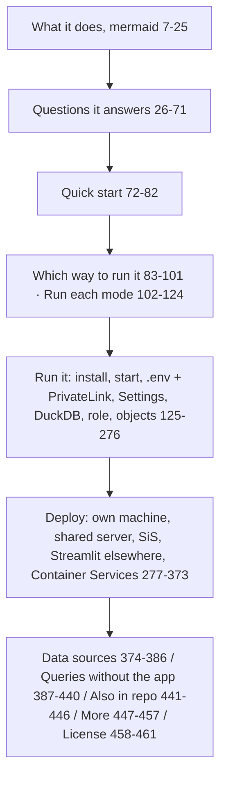

<!-- generated by darshan-singh-meel-knowledge-graph -->
README.md (465 lines): the entry doc — what the app does, quick start, every run mode, settings, the `.env` login (browser SSO, key pair, PrivateLink), objects setup, four deploy targets, data sources, the standalone queries; points to README.html for the full guide.

## Sections (verified headings)
- Title + summary; full guide link to README.html — README.md:1-5.
- What it does (mermaid) — README.md:7; Questions it answers — README.md:26.
- Quick start — README.md:72-82; Which way to run it (by what the role can do: local or Streamlit in Snowflake) — README.md:83-101; Run each mode — README.md:102-124.
- Run it (direct vs objects table) — README.md:125-140; Install — README.md:142-151; Start — README.md:153-163; `.env` — README.md:165-180; PrivateLink — README.md:181-196; Settings — README.md:198-216 (`SNOWFLAKE_HOST`, unset, the PrivateLink host — README.md:208; `QUERY_TAG` default access-explorer and `STREAMLIT_APP` default ST_ACCESS_EXPLORER, same values in `.env`, `sis/.env` and settings.local.sql — README.md:211-212); DuckDB SQL copy — README.md:217; role-based visibility — README.md:248-260; Objects in Snowflake — README.md:261-280.
- Deploy — README.md:281-290; own machine — README.md:291; shared server — README.md:295-314 (PrivateLink bullet README.md:307); SiS — README.md:315-356 (the app is created and opened under its `STREAMLIT_APP` name — README.md:346, README.md:348); Streamlit elsewhere — README.md:357-368; Container Services — README.md:369-377.
- Data sources — README.md:378-390; the Activity tabs and their 60 days of ACCESS_HISTORY + QUERY_HISTORY + SESSIONS — README.md:381-383; Activity tabs on the access and object pages — README.md:32-33; `ACTIVITY` in the DuckDB tables — README.md:221; the app's own queries left out by `QUERY_TAG` / `STREAMLIT_APP` — README.md:387-388.
- Use the queries without the app — README.md:391-444: file table (5 query files, `functions.sql`, `access_examples.ipynb`) — README.md:394-402; How to use them (worksheet or notebook path A / B) — README.md:404; Needs (ACCOUNT_USAGE read, warehouse, `CREATE FUNCTION` for path A only) — README.md:442; Check (`test_queries.py`) — README.md:443. See modules/access-queries.md, flows/standalone-queries.md.
- Also in this repo — README.md:445-450: access_queries (the Snowflake notebook, `functions.sql`, test) — README.md:446; sf.py CLI — README.md:447; tests incl. `access_queries/test_queries.py` — README.md:448; IaC — README.md:449.
- Where to find more — README.md:451-461; License (MIT or Apache-2.0) — README.md:462-465.

## Login (`.env`, step 3)
- `SNOWFLAKE_ACCOUNT` / `USER` / `ROLE` / `WAREHOUSE`; `<org>-<account>` is the start of the Snowflake URL — README.md:170-175.
- Browser SSO by default, key pair via `SNOWFLAKE_PRIVATE_KEY_FILE` (+ `_PWD`); no passwords; `ALLOW_ID_TOKEN` keeps one login ~4 h — README.md:176-178 (SSO and key pair 176, no passwords 177, `ALLOW_ID_TOKEN` 178).
- PrivateLink (AWS PrivateLink, Azure Private Link, GCP Private Service Connect), linked from README.md:179, section README.md:181-196:
  - Keep `SNOWFLAKE_ACCOUNT=<org>-<account>` and set `SNOWFLAKE_HOST=<org>-<account>.privatelink` + Snowflake domain; the connector connects there instead of the public address — README.md:182-186. The host is `regionless-privatelink-account-url` (or `privatelink-account-url`) from `SYSTEM$GET_PRIVATELINK_CONFIG()` — README.md:187-188.
  - Private DNS for the private host and the OCSP host (`privatelink-ocsp-url`); a missing OCSP record hangs or fails the certificate check — README.md:189-191.
  - Key pair as is; browser SSO needs the SAML integration on the PrivateLink URLs (`SAML2_SNOWFLAKE_ACS_URL`, `SAML2_SNOWFLAKE_ISSUER_URL`), else use a key pair — README.md:192-194.
  - Check with `python sf.py "select current_user(), ..."`; `run_sql.py` and both apps share the login — README.md:195. Not needed in Streamlit in Snowflake — README.md:196.
  - Shared server: the same `SNOWFLAKE_HOST` and private DNS there — README.md:307.
  - Code: `sf.connect()` passes `account=` (sf.py:28) and `host=` from `SNOWFLAKE_HOST` (sf.py:29). See processes/privatelink-login.md.

## Relates to
- Processes: setup-local, privatelink-login, run-local, deploy-snowflake, build-web, test, container-services.
- Config: .env.example, sis.env.example, settings.sql, requirements*.txt, environment.yml.
- Code: run.py, run_sql.py, sf.py, server.py, app.py, access.py, cache.py, sql/*.sql, access_queries/.
- Contains a clone URL with a personal handle — README.md:75 (not copied into the graph).
