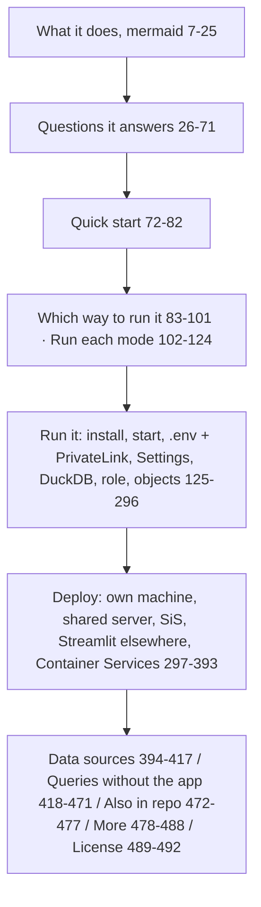

<!-- generated by darshan-singh-meel-knowledge-graph -->
README.md (492 lines): the entry doc — what the app does, quick start, every run mode, settings, the `.env` login (browser SSO, key pair, PrivateLink), objects setup, four deploy targets, data sources, the standalone queries; points to README.html for the full guide.

## Sections (verified headings)
- Title + summary; full guide link to README.html — README.md:1-5.
- What it does (mermaid) — README.md:7; Questions it answers — README.md:27.
- Quick start — README.md:74-84; Which way to run it (by what the role can do: local or Streamlit in Snowflake) — README.md:85-103; Run each mode — README.md:104-128.
- Run it (direct vs objects table) — README.md:129-146; Install — README.md:148-157; Start — README.md:159-174; `.env` — README.md:176-191; PrivateLink — README.md:192-207; Settings — README.md:209-240 (`SNOWFLAKE_HOST`, unset, the PrivateLink host — README.md:225; `QUERY_TAG` default access-explorer and `STREAMLIT_APP` default ST_ACCESS_EXPLORER, same values in `.env`, `sis/.env` and settings.local.sql — README.md:228-229; `CSV`, unset = on, `0` hides every CSV button and refuses the downloads in both versions — README.md:230); DuckDB SQL copy — README.md:241; role-based visibility — README.md:271-283; Objects in Snowflake — README.md:284-303.
- Deploy — README.md:304-313; own machine — README.md:314; shared server — README.md:318-337 (PrivateLink bullet README.md:330); SiS — README.md:338-379 (the app is created and opened under its `STREAMLIT_APP` name — README.md:369, README.md:371); Streamlit elsewhere — README.md:380-391; Container Services — README.md:392-400.
- Data sources — README.md:401-424; the object inventory (objects no grant names: ACCOUNT_USAGE DATABASES, SCHEMATA, TABLES, FUNCTIONS, ... and SHOW STREAMLITS / NOTEBOOKS / ALERTS / WAREHOUSES, names and owners only, each read may fail on its own) — README.md:403-405; read levels per read (inventory per kind ACCOUNT_USAGE, else INFORMATION_SCHEMA per database, else SHOW; compute pools; database list once; schema list for future grants; INFORMATION_SCHEMA only when its DATABASES answered; grants, users, streams and future grants ACCOUNT_USAGE else SHOW), the run's SOURCES / NOTES say which and why — README.md:417-423; the Activity tabs and their 60 days of ACCESS_HISTORY + QUERY_HISTORY + SESSIONS — README.md:406-409; Activity tabs on the access and object pages — README.md:33-34; `ACTIVITY` in the DuckDB tables — README.md:245; the app's own queries left out by `QUERY_TAG` / `STREAMLIT_APP` — README.md:413-414.
- Use the queries without the app — README.md:425-478: file table (5 query files, `functions.sql`, `access_examples.ipynb`) — README.md:428-436; How to use them (worksheet or notebook path A / B) — README.md:438; Needs (ACCOUNT_USAGE read, warehouse, `CREATE FUNCTION` for path A only) — README.md:476; Check (`test_queries.py`) — README.md:477. See modules/access-queries.md, flows/standalone-queries.md.
- Also in this repo — README.md:479-484: access_queries (the Snowflake notebook, `functions.sql`, test) — README.md:480; sf.py CLI — README.md:481; tests incl. `access_queries/test_queries.py` — README.md:482; IaC — README.md:483.
- Where to find more — README.md:485-495; License (MIT or Apache-2.0) — README.md:496-499.

## Speed and progress
- Direct mode reads: one `SHOW` per role 16 at a time (`SHOW_THREADS`), heavy ACCOUNT_USAGE reads `WORKERS` at a time; the page shows what the app is doing line by line in both versions and in the terminal, with a line every 60 s on what is still running; the first load locks the page, the SQL button shows once there is data — README.md:139-144.
- Cache and refresh: 24 h in memory and in `.cache/` (one file per account and source, one per user for My access), the replaced file of another run kept as `<name>.prev.pkl` for What changed; locally ↻ and Rebuild snapshot run in the background and replace the data only once built (a failed read keeps the old one), Streamlit answers when done; rule results kept in `.cache/<key>.rules.pkl` until the data, settings or `access.py` change; a refresh that brings a new run also compares it with the previous snapshot and keeps the result in `.cache/<key>.diff.pkl` — README.md:146.
- Rule checks count role paths in an in-memory DuckDB (5,000 roles and users: about 13 s instead of 161 s), Python when duckdb is missing or a role loop / `MAX_HOPS` makes the counts differ — README.md:233.
- Settings rows `WORKERS` (3), `STATEMENT_TIMEOUT` (300), `ACTIVITY` (1), `HIERARCHY` (1) — README.md:221-224.
- Two stages: `python run.py --export` (stage 1: every Snowflake read a Parquet part in `.cache/reads/<key>/`, a stopped load resumes; `--fresh` reads every part again) and `python run.py --build` (stage 2 from the parts, never Snowflake); parts are read again only on Rebuild snapshot / Read Snowflake again — README.md:167-171.
- DuckDB: the SQL copy follows every Snowflake read (no off switch, `DUCKDB=1` also for fake data), `duckdb` in both requirements files; without it the app runs, slower on big accounts (the rule checks walk in Python) — README.md:118, README.md:227, README.md:249-251.
- SESSIONS is read only from a week before the first day read, so Snowflake does not scan a year of sessions — README.md:408.
- Read order per source: ACCOUNT_USAGE, then INFORMATION_SCHEMA (query history in 7 one-day windows over 167 h; tags and policies per object), then `SHOW`; a full ACCOUNT_USAGE read that times out gets no fallback (Direct mode marks it unread, a snapshot run fails); no warehouse (000606) stops the load with a hint — README.md:140-141, README.md:402.
- Big-account answer sizes after paging and lazy boxes (object page 7.2 MB -> 0.38 MB, role PUBLIC 7.9 -> 0.42 MB, access graph 52 -> 0.29 MB, What changed after a refresh 65 MB / 23 s -> 0.06 MB / 0.1 s, person page with 40 roles 7-10 s first open) — README.md:235-239.
- Readable graphs: crowded people and role lanes fold into one box that opens on click — README.md:21.

## Login (`.env`, step 3)
- `SNOWFLAKE_ACCOUNT` / `USER` / `ROLE` / `WAREHOUSE`; `<org>-<account>` is the start of the Snowflake URL — README.md:181-186.
- Browser SSO by default, key pair via `SNOWFLAKE_PRIVATE_KEY_FILE` (+ `_PWD`); no passwords; `ALLOW_ID_TOKEN` keeps one login ~4 h — README.md:187-189 (SSO and key pair 176, no passwords 177, `ALLOW_ID_TOKEN` 178).
- PrivateLink (AWS PrivateLink, Azure Private Link, GCP Private Service Connect), linked from README.md:190, section README.md:192-207:
  - Keep `SNOWFLAKE_ACCOUNT=<org>-<account>` and set `SNOWFLAKE_HOST=<org>-<account>.privatelink` + Snowflake domain; the connector connects there instead of the public address — README.md:193-197. The host is `regionless-privatelink-account-url` (or `privatelink-account-url`) from `SYSTEM$GET_PRIVATELINK_CONFIG()` — README.md:198-199.
  - Private DNS for the private host and the OCSP host (`privatelink-ocsp-url`); a missing OCSP record hangs or fails the certificate check — README.md:200-202.
  - Key pair as is; browser SSO needs the SAML integration on the PrivateLink URLs (`SAML2_SNOWFLAKE_ACS_URL`, `SAML2_SNOWFLAKE_ISSUER_URL`), else use a key pair — README.md:203-205.
  - Check with `python sf.py "select current_user(), ..."`; `run_sql.py` and both apps share the login — README.md:206. Not needed in Streamlit in Snowflake — README.md:207.
  - Shared server: the same `SNOWFLAKE_HOST` and private DNS there — README.md:330.
  - Code: `sf.connect()` passes `account=` (sf.py:28) and `host=` from `SNOWFLAKE_HOST` (sf.py:29). See processes/privatelink-login.md.

## Relates to
- Processes: setup-local, privatelink-login, run-local, deploy-snowflake, build-web, test, container-services.
- Config: .env.example, sis.env.example, settings.sql, requirements*.txt, environment.yml.
- Code: run.py, run_sql.py, sf.py, server.py, app.py, access.py, cache.py, sql/*.sql, access_queries/.
- Contains a clone URL with a personal handle — README.md:77 (not copied into the graph).
