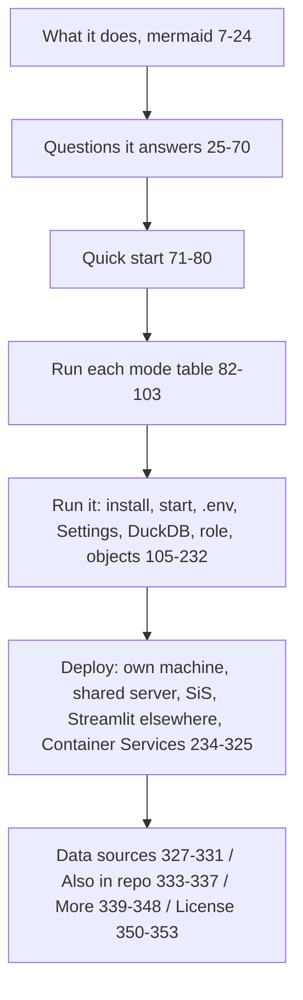

README.md (353 lines): the entry doc — what the app does, quick start, every run mode, settings, objects setup, four deploy targets, data sources; points to README.html for the full guide.

## Sections (verified headings)
- Title + summary; full guide link to README.html — README.md:1-5.
- What it does (mermaid) — README.md:7; Questions it answers — README.md:25.
- Quick start — README.md:71-80; Run each mode — README.md:82-103.
- Run it (direct vs objects table) — README.md:105-120; Install — README.md:122-131; Start — README.md:133-143; `.env` — README.md:145-158; Settings — README.md:160-174; DuckDB SQL copy — README.md:176; role-based visibility — README.md:207-218; Objects in Snowflake — README.md:220-232.
- Deploy — README.md:234-242; own machine — README.md:244; shared server — README.md:248-265; SiS — README.md:267-307; Streamlit elsewhere — README.md:309-319; Container Services — README.md:321-325.
- Data sources — README.md:327-331; Also in this repo (sf.py CLI, tests, IaC) — README.md:333-336; Where to find more — README.md:338-347; License (MIT or Apache-2.0) — README.md:349-352.

## Relates to
- Processes: setup-local, run-local, deploy-snowflake, build-web, test, container-services.
- Config: .env.example, sis.env.example, settings.sql, requirements*.txt, environment.yml.
- Code: run.py, run_sql.py, sf.py, server.py, app.py, access.py, cache.py, sql/*.sql.
- Contains a clone URL with a personal handle — README.md:74 (not copied into the graph).
