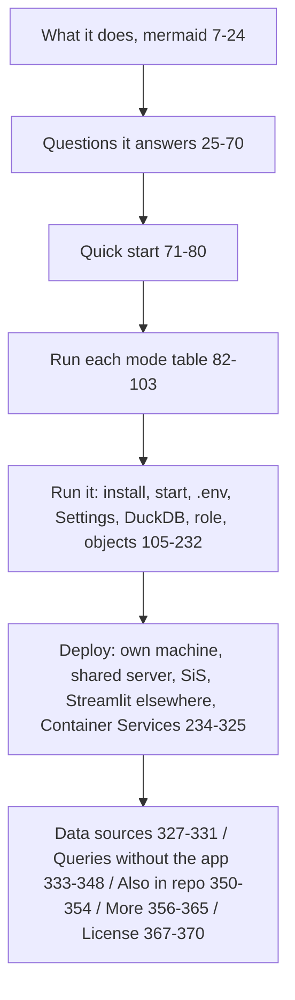

<!-- generated by darshan-singh-meel-knowledge-graph -->
README.md (412 lines): the entry doc — what the app does, quick start, every run mode, settings, objects setup, four deploy targets, data sources, the standalone queries; points to README.html for the full guide.

## Sections (verified headings)
- Title + summary; full guide link to README.html — README.md:1-5.
- What it does (mermaid) — README.md:7; Questions it answers — README.md:25.
- Quick start — README.md:71-80; Run each mode — README.md:82-103.
- Run it (direct vs objects table) — README.md:105-120; Install — README.md:122-131; Start — README.md:133-143; `.env` — README.md:145-158; Settings — README.md:160-174; DuckDB SQL copy — README.md:176; role-based visibility — README.md:207-218; Objects in Snowflake — README.md:220-232.
- Deploy — README.md:234-242; own machine — README.md:244; shared server — README.md:248-265; SiS — README.md:267-307; Streamlit elsewhere — README.md:309-319; Container Services — README.md:321-325.
- Data sources — README.md:327-337; the Activity tabs and their 60 days of ACCESS_HISTORY + QUERY_HISTORY + SESSIONS — README.md:330-336; Activity tabs on the access and object pages — README.md:31-32; `ACTIVITY` in the DuckDB tables — README.md:180.
- Use the queries without the app — README.md:339-391: file table (5 query files, `functions.sql`, `access_examples.ipynb`) — README.md:342-350; Run (worksheet or notebook path A / B) — README.md:352; Needs (ACCOUNT_USAGE read, warehouse, `CREATE FUNCTION` for path A only) — README.md:390; Check (`test_queries.py`) — README.md:391. See modules/access-queries.md, flows/standalone-queries.md.
- Also in this repo — README.md:393-397: access_queries (the Snowflake notebook, `functions.sql`, test) — README.md:394; sf.py CLI — README.md:395; tests incl. `access_queries/test_queries.py` — README.md:396; IaC — README.md:397.
- Where to find more — README.md:399-408; License (MIT or Apache-2.0) — README.md:410-413.

## Relates to
- Processes: setup-local, run-local, deploy-snowflake, build-web, test, container-services.
- Config: .env.example, sis.env.example, settings.sql, requirements*.txt, environment.yml.
- Code: run.py, run_sql.py, sf.py, server.py, app.py, access.py, cache.py, sql/*.sql, access_queries/.
- Contains a clone URL with a personal handle — README.md:74 (not copied into the graph).
