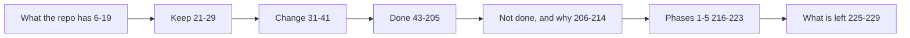

docs/redesign-notes.md (229 lines): working notes for the UI redesign — what the repo had, what stays, what changes, per-screen done list, what was not done and why, and the five phases.

## Content
- Based on a redesign brief `access-explorer-redesign.zip` (17 screens, tokens, specs) — docs/redesign-notes.md:3-4; the zip is not in the repo (unclear where it lives).
- Repo map table (pages, API, data layer, path engine, rules, What if, policies, Streamlit, URL params, tests) — docs/redesign-notes.md:8-19.
- Keep: engines, `?page=` URLs, graph component and node styles, bundled IBM Plex Mono, no new deps — docs/redesign-notes.md:21-29.
- Change: tokens, shell, shared components, derived fields, new page keys — docs/redesign-notes.md:31-41.
- Not done: per-browser rule mute, no Streamlit fallback — docs/redesign-notes.md:206-213.
- Phases 1-5 all done; old pages kept as default tabs — docs/redesign-notes.md:215-222.
- README.html regenerated by `python docs/make_readme.py` — docs/redesign-notes.md:226-227.

## Relates to
- web/src (pages, components), ui.py TOKENS, access.py derived fields, README.html, docs/img/redesign.

## Possibly stale (inferred)
- "use the container runtime or the local version" — docs/redesign-notes.md:209; web/ST.md now says only "use the local version" — web/ST.md:50, and the review found the container runtime path unusable — docs/review-2026-11-09.md:320.
