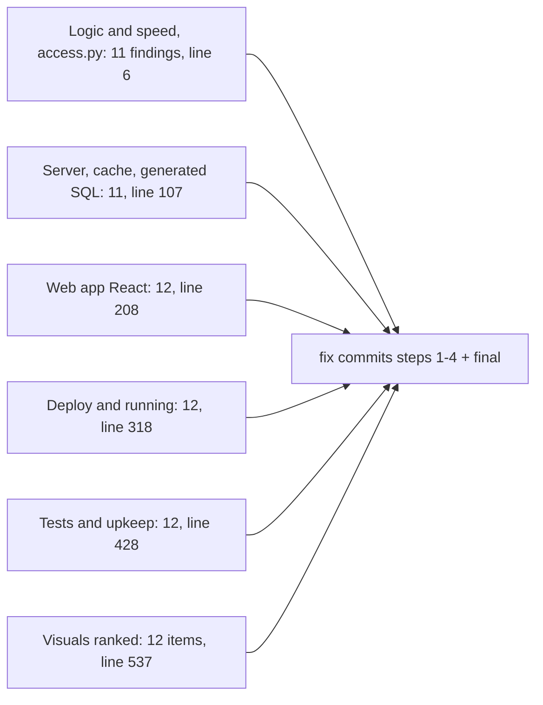

<!-- generated by darshan-singh-meel-knowledge-graph -->
docs/review-2026-11-09.md (551 lines): a read-only whole-app review (5 reviewers + a visuals reviewer, each finding checked by a second agent), grouped by area with Fix and Checker notes; the findings were then fixed in the "Review 2026-11-09, step 1..4 and final" commits.

## Content
- Scope and method — docs/review-2026-11-09.md:1-3.
- Logic and speed (e.g. path walks 33 s+, facts() ~19 min on big()) — docs/review-2026-11-09.md:6-105.
- Server/cache/SQL (e.g. shared-server My access shows service user, missing Host/Origin check) — docs/review-2026-11-09.md:107-206.
- Web app — docs/review-2026-11-09.md:208-316.
- Deploy and running (container runtime dead end, blank page, unpinned Streamlit, missing sis folder, DEV_ROLE privileges, .env-less run) — docs/review-2026-11-09.md:318-426.
- Tests and upkeep (test_perf flaky, bundle freshness) — docs/review-2026-11-09.md:428-526.
- Visuals ranked by value/effort — docs/review-2026-11-09.md:528-542.

## Relates to
- access.py, server.py, cache.py, sf.py, sql/4_streamlit.sql, environment.yml, web/src, tests; processes/container-services.md.
- Fixed status per finding: inferred from git log commit messages (steps 2-4, final); not checked finding by finding. Line numbers quoted inside the review refer to code before the fixes (e.g. docs/review-2026-11-09.md:323), so they are historical.
