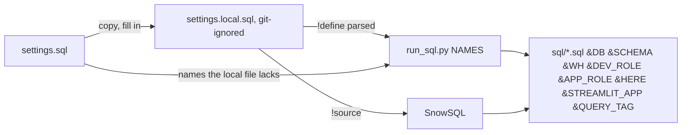

<!-- generated by darshan-singh-meel-knowledge-graph -->
settings.sql (25 lines): SnowSQL-style `!define` template for the Snowflake object names that run_sql.py and SnowSQL substitute as `&NAME`; real values go in the git-ignored settings.local.sql. run_sql.py takes a name the local file lacks from this template; SnowSQL needs every name in the local file (settings.sql:2-3).

## Names
- `DB`, `SCHEMA` (snapshot tables and procedure) — settings.sql:5-7; `WH` — settings.sql:8-9; `DEV_ROLE` (creates and owns, procedure reads grants with its rights) — settings.sql:10-11; `APP_ROLE` (SELECT on snapshot tables only, may equal DEV_ROLE) — settings.sql:12-13; `HERE` (SnowSQL only, repo path for PUT) — settings.sql:14-15.
- `STREAMLIT_APP`, default `ST_ACCESS_EXPLORER`: name of the app inside Snowflake in `CREATE` / `GRANT` / `DROP` / `SHOW STREAMLIT` (sql/4_streamlit.sql:65, sql/4_streamlit.sql:83, sql/3_cleanup.sql:12, sql/4_streamlit_verify.sql:4, sql/3_cleanup_verify.sql:22) and `APP_ST` in SP_ACCESS_SNAPSHOT (sql/1_setup.sql:211) — settings.sql:16-17. Must match `STREAMLIT_APP` in `.env` and `sis/.env`.
- `QUERY_TAG`, default `access-explorer`: the local app's query tag, `QUERY_TAG` in SP_ACCESS_SNAPSHOT (sql/1_setup.sql:210), so the procedure's activity read leaves the local app's queries out — settings.sql:18-19. Must match `QUERY_TAG` in `.env` and `sis/.env`.
- Both: letters, digits, `-` and `_` only; run_sql.py refuses quotes, `$` or backslash in them (run_sql.py:26-28), since they are pasted into the procedure's Python and `$$` block.
- For SP_ACCESS_SNAPSHOT only: `STATEMENT_TIMEOUT` (300 s per statement, 0 = Snowflake's own; the app's own is `STATEMENT_TIMEOUT` in .env) — settings.sql:20-21; `WORKERS` (3 heavy reads at once) — settings.sql:22-23; `ACTIVITY` (0 = no ACCESS_HISTORY reads) — settings.sql:24-25; run_sql.py wants whole numbers (run_sql.py:29-31), since the procedure reads them with `int("&NAME")` (sql/1_setup.sql:212-214).
- Variable substitution on — settings.sql:4.

## Relates to
- run_sql.py:17-42, run_sql.py:65-66; access.py:68-69 (env QUERY_TAG / STREAMLIT_APP of the app); every sql/*.sql (`!source settings.local.sql`, e.g. sql/1_setup.sql:6); .gitignore:4; processes/deploy-snowflake.md.
