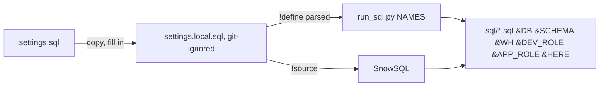

<!-- generated by darshan-singh-meel-knowledge-graph -->
settings.sql (14 lines): SnowSQL-style `!define` template for the Snowflake object names that run_sql.py and SnowSQL substitute as `&NAME`; real values go in the git-ignored settings.local.sql.

## Names
- `DB`, `SCHEMA` (snapshot tables and procedure) — settings.sql:4-6; `WH` — settings.sql:7-8; `DEV_ROLE` (creates and owns, procedure reads grants with its rights) — settings.sql:9-10; `APP_ROLE` (SELECT on snapshot tables only, may equal DEV_ROLE) — settings.sql:11-12; `HERE` (SnowSQL only, repo path for PUT) — settings.sql:13-14.
- Variable substitution on — settings.sql:3.

## Relates to
- run_sql.py:17-35, run_sql.py:58-59; every sql/*.sql (`!source settings.local.sql`, e.g. sql/1_setup.sql:6); .gitignore:4; processes/deploy-snowflake.md.
