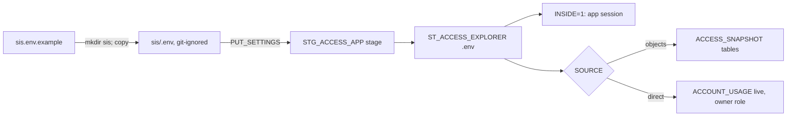

<!-- generated by darshan-singh-meel-knowledge-graph -->
sis.env.example (15 lines, at the repo root; there is no tracked `sis/` folder): template for `sis/.env`, which sql/4_streamlit.sql uploads as the Streamlit-in-Snowflake app's `.env`.

## Content
- Purpose, `mkdir sis` then copy — sis.env.example:1-2.
- `INSIDE=1` (use the app's own session); never `SNOWFLAKE_ACCOUNT` or a key — sis.env.example:3-5.
- Pick one source — sis.env.example:6: `SOURCE=objects` + `ACCESS_SNAPSHOT=<DB>.<SCHEMA>` (recommended for a team) — sis.env.example:7-10; `SOURCE=direct` (commented; owner role needs IMPORTED PRIVILEGES or SECURITY_VIEWER + GOVERNANCE_VIEWER; SHOW may be refused -> Incomplete) — sis.env.example:11-15.

## Relates to
- sql/4_streamlit.sql:58-59 (PUT), run_sql.py:52-55 (missing-file hint), .gitignore:8 (`sis/`), access.py:34-35 (INSIDE), README.md:282-291, web/ST.md:67.
