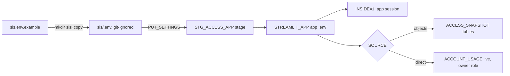

<!-- generated by darshan-singh-meel-knowledge-graph -->
sis.env.example (33 lines, at the repo root; there is no tracked `sis/` folder): template for `sis/.env`, which sql/4_streamlit.sql uploads as the Streamlit-in-Snowflake app's `.env`.

## Content
- Purpose, `mkdir sis` then copy — sis.env.example:1-2.
- `INSIDE=1` (use the app's own session); never `SNOWFLAKE_ACCOUNT` or a key — sis.env.example:3-5.
- Pick one source — sis.env.example:6: `SOURCE=objects` + `ACCESS_SNAPSHOT=<DB>.<SCHEMA>` (recommended for a team) — sis.env.example:7-10; `SOURCE=direct` (commented; owner role needs IMPORTED PRIVILEGES or SECURITY_VIEWER + GOVERNANCE_VIEWER; SHOW may be refused -> Incomplete) — sis.env.example:11-15.
- `STREAMLIT_APP` (commented, default ST_ACCESS_EXPLORER; same as `!define STREAMLIT_APP` in settings.local.sql, so Activity leaves the app's own queries out) — sis.env.example:16-18.
- `QUERY_TAG` (commented, default access-explorer; same as `!define QUERY_TAG` and the local `.env`, so Direct mode here leaves the local app's queries out) — sis.env.example:19-21.

## Relates to
- `CSV=0` (commented): no CSV export inside Snowflake either (server.csv_on, server.py:4283-4284) — sis.env.example:22-23.
- `STATEMENT_TIMEOUT` (default 300 = 5 min; a read that stops names its step, give it longer with 600) — sis.env.example:24-26; `WORKERS` (default 3; 1 if Snowflake refuses statements side by side on the app's session) — sis.env.example:27-29; `ACTIVITY=0` (no ACCESS_HISTORY: Activity tabs, rules 24-28, Granted vs used show skipped) — sis.env.example:30-31; `HIERARCHY=0` (skip the rule checks that walk role paths) — sis.env.example:32-33.
- sql/4_streamlit.sql:64-65 (PUT), run_sql.py:59-62 (missing-file hint), .gitignore:8 (`sis/`), access.py:50-51 (INSIDE), access.py:107-108 (QUERY_TAG / STREAMLIT_APP), README.md:345-354, web/ST.md:67.
