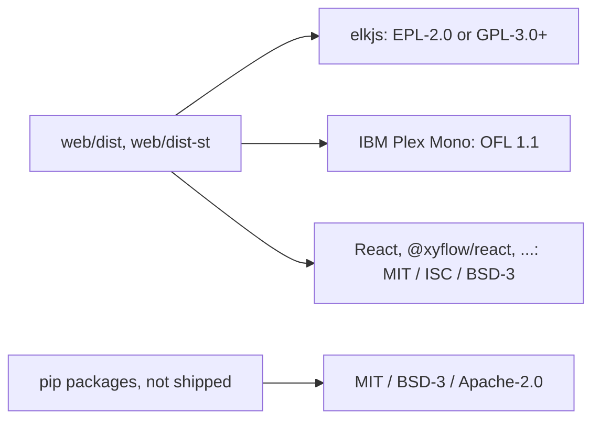

THIRD_PARTY.md (13 lines): licences of third-party code shipped in the committed bundles web/dist and web/dist-st, plus the pip packages.

## Content
- Scope: bundles; project itself MIT OR Apache-2.0 — THIRD_PARTY.md:3-4.
- elkjs — THIRD_PARTY.md:6-7; IBM Plex Mono with licence file `web/src/components/fonts/OFL-IBMPlexMono.txt` — THIRD_PARTY.md:8-9; web deps — THIRD_PARTY.md:10-11; Python packages — THIRD_PARTY.md:12-13.

## Relates to
- web/package.json, web/package-lock.json, LICENSE-MIT, LICENSE-APACHE, README.md:404-407; processes/build-web.md.
